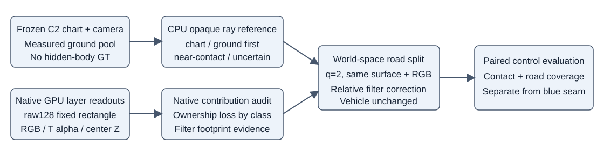

# raw128 红圈：固定表面下的车地接触控制

原生输入为 `diagnostic/layers_v1/128` 的 480×320 图像及浮点读出。红区固定登记为半开区间 **x=[232,284), y=[190,218)**，共1456像素；先登记、后看贡献和几何，不能根据损失移动区域。蓝圈接缝由另一条控制处理，此处不形成合并的“通过”标签。

车辆使用原 C2 及相机对应的真实 LOD；道路使用上一轮1000步 cellfit材质，SHA256 `70a9f7262977099f875ebd18dd359313232d0662025e6213b799bce41ea90968`。二者的颜色、车辆位置和车辆几何均冻结。这里没有模型更新、GPU执行、按像素裁路或真实ground隐藏。

## 固定参考与已知边界

C2原canonical active UV点构成双面、不封闭三角片。Delaunay后剔除UV边长>1.5像素的三角形，避免跨越洞；固定matte阈值.01/.5分别检查。射线先交此表面，再与同场景真实ground pool构建的h(x,y)交点比较，深度差±.05m以内单列接触。该ground是另一CPU几何读出，与R0共享BUILD测量，不是独立验证数据。ground使用半径.8m内最多8个真实return、至少3支持及迭代残差<.03m。没有triangle命中时记为不确定，不能直接判ground前。

这沿用上一轮35射线的内部表面参考，**不是隐藏车体GT、封闭车辆mesh或完整MOG实现**。retained非chart Gaussian不被三角片覆盖。ground高度也是测量支撑下的近似。原RGB里的a37遮挡不能成为被删a37后C2轮胎的真值。Gaussian native expected centre depth亦不是首交深度。

## 可执行的最小世界坐标控制

只对原固定strip中的全部10098个active newroad父格统一执行q=2，必要时再考虑q=4。不按红区选格。父格8cm正方形内，子格平面偏移为

`dx = .08*((i+.5)/q-.5), dy = .08*((j+.5)/q-.5)`。

在scene-local的物理米坐标中，父格位置p、单位法向n决定同切平面子格：`p_child=p+[dx,dy,-(nx*dx+ny*dy)/nz]`。所有当前n_z>0；若其他资产法向接近竖直，必须拒绝该XY构造，而不是除极小数。继承父格normal、固定RGB、source/provenance和原峰值opacity .99。三轴sigma统一除q，即原[.052,.052,.015]/q米；保持薄厚比例，避免只缩切向后法向厚度反而占主导。source支持计数仍是父格测量数，**不能把q²子格声称为q²新测量**。child新增明确parent_id。

局部切平面与全局IDW高度函数不严格相同，因此应输出child相对该CPU h(x,y)读出的残差及法向夹角，验证是否引入高度偏移；不以轮胎显露率反推或调整z。世界/model位置使用原coordinate_anchor/world_to_model链，每次转换仅一次。n=1必须走原父数据路径并验证逐位一致。

q=2共40392行；q=4共161568行。继承峰值opacity并不保证光学等价：子格被原生最小协方差+.3I扩大后可能更加不透明。因此普通q2是必要的机制对照，不能默认q4更好。

## 原生滤波地板与parent-relative补偿

原3DGS按投影协方差进行alpha混合，并使用中心view depth参与tile内排序；它不逐射线计算真实曲面首交。[原论文/项目](https://repo-sam.inria.fr/fungraph/3d-gaussian-splatting/)

Mip-Splatting将屏幕低通扩张改为带幅度补偿的滤波。其官方实现先求未加滤波的二维协方差Σ，计算`f(Σ)=sqrt(detΣ/det(Σ+kI))`，再给对角加k，并将opacity乘f；官方代码另有小量与退化保护。[论文§5.2](https://arxiv.org/html/2311.16493v1#S5.SS2)、[官方forward.cu](https://github.com/autonomousvision/mip-splatting/blob/main/submodules/diff-gaussian-rasterization/cuda_rasterizer/forward.cu)

此轮可用的最小、保持父q1原样的对照为：

`alpha_child = alpha_parent * f(Σ_child)/f(Σ_parent)`，`k=.3 pixel²`。

Σ必须用**当前相机、原生同式投影J、viewmatrix以及当前legacy neg_fov clamp**计算，且是未加.3I的矩阵。parent即未细分父格在相同相机下的原协方差；child用真实新中心/新sigma。只修改newroad opacity；原生kernel已经加.3I，不得再加一次。不要采用与实际rasterizer不同的正FOV相机投影来算补偿。分母退化时应显式报告并拒绝，不静默放大alpha。q1直接返回原数据，避免比值舍入变化。

在局部仿射投影近似成立、Σ_child=Σ_parent/q²、共有q²子格时，该规则保存的是**滤波后未合成Gaussian opacity的二维积分之和**：每格积分正比`alpha*sqrt(det(Σ+.3I))`。它不保存逐像素`1-prod(1-alpha)`、Talpha或可见性。高alpha、重叠、中心排序、1/255 cutoff、early-stop及透视J变化都会打破成像等价；它也不能修复真实ground在车面之前的射线。

这是由Mip公式推导的parent-relative控制，不是完整Mip-Splatting训练/3D频率约束。2DGS则在面元上做透视正确的ray–splat intersection，是后续表面渲染方向的主要依据；不能将当前的三角参考或opacity控制称作已实现2DGS/MOG。[2DGS官方项目](https://surfsplatting.github.io/)、[官方代码](https://github.com/hbb1/2d-gaussian-splatting)

## 根代理统一调度的最小GPU读出

优先raw128、keep/delete、q1/q2普通/q2_relativeMip，native单排序RGB与各组Talpha/RGBT、newroad/asset centre_depth_T_m、newroad-solo alpha/RGB/depth。q1与原cellfit1000完全相同。现有layers_v1已提供基线，不能覆盖。CPU红区报告按chart-first、ground-first、接触、不确定分别看assetW/RGB变化，不奖励ground-first区域人为车优先。

同时报告全图原a6/a37观测区域、protected/observed road误差，newroad-solo覆盖与远端固定旧720目标覆盖；不能以轮胎显露改善换取道路空洞。车辆行、原模型、父RGB/材质SHA保持一致；任何per-camera opacity变化须明示为renderer-filter控制，不能当作世界材质更新。若q2显示滤波地板主导，先审relativeMip，不盲目运行q4。此处不触发GPU，由根代理决定并记账。
