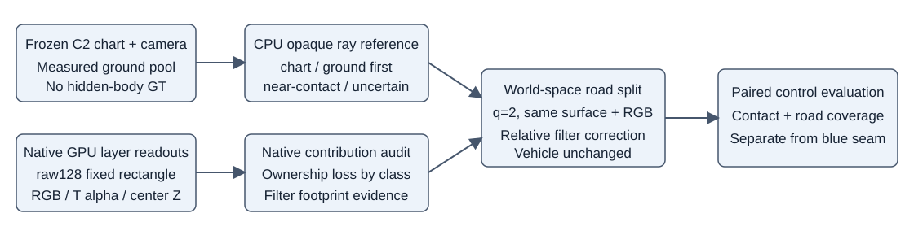

# 红圈独立CPU诊断与n2固定射线复核

红圈已经与蓝圈路面接缝分开登记和复核。raw128原生480×320图像的固定红区为 **x=[232,284), y=[190,218)**（1456像素）。对应原图及最近邻放大见[原生登记图](raw128_native_registered_red.png)、[接触分层图](raw128_contact_ordering_crops.png)。车辆、车辆位置与C2表面冻结；道路材质固定上一轮cellfit1000。

## 车地两类机制同时存在

固定红区中，原V44 assetW>.9且加入原n1道路后损失>.01共有36点。按canonical active-UV不透明三角参考与真实测量池地面射线先后，固定分为 **23 chart-first、12 ground-first、1接触±.05m**。地面来自同场景原始LiDAR支持的另一CPU几何读出，与R0共享BUILD测量，**不是独立验证数据**；23/12/1仅描述当前C2/地面模型关系，隐藏真值未知。两套预设matte阈值.01/.5分组完全一致。损失>.5的19点里则为6/12/1；不能把全部19点当作正确轮胎被裁，也不能归因全部是预测车面穿地。

| 原n1固定36点分组 | 点数 | Canonical射线表面高于测量池地面(median，范围m) | asset-solo dominant真实LOD中心高度(median，范围m) |
|---|---:|---:|---:|
| chart-first | 23 | +.0701，[+.0113,+.0983] | +.1153，[+.0567,+.1403] |
| ground-first | 12 | −.0670，[−.1440,−.0311] | −.0207，[−.1080,+.0123] |
| 接触±.05m | 1 | +.0134 | +.0600 |

23个chart-first点的原生newroad组件expected centre depth相对测量池地面surface-ray交点，提前中位.89585m；这是组件Gaussian中心深度及足迹的量，**不是地面surface被抬起.9m**。对这些点，主road Gaussian投影中心距像素1.17…2.69px，单格无滤波alpha中位.00231，经原生+.3I滤波后为.08306。当前全10098格的投影协方差窄轴中，滤波项占方差中位64.5%。这支持“表面车体在前，但邻近road Gaussian的足迹与中心排序接管”的机制。

12个ground-first点的canonical表面本来就位于近似测量地面之下。该参考没有隐藏车体首交GT，不能宣布原预测错误或真实轮胎正确形状；它只说明不能用固定车辆前景优先级来修全部红圈。

全部36点原始可见内容为a37：23个chart-first点为a6 unknown17/occluded6；12个ground-first点为unknown8/occluded4；接触1点unknown。离原a6 reviewed边缘12…16px，不是原可见a6轮廓边缘。红区原真实可见a6共50像素，其newroad贡献及车辆成像未变。原观察road mask在该矩形为0像素；不能用原a37 RGB评价隐藏轮胎正确性。

道路10098中心到同一真实ground池独立height函数的残差最大4.21e-7m（中心本来即由该测量规则生成，故这仅核对映射/适配，不是独立几何真值验收）。normal全部单位、正local-z；与IDW高度数值法向的夹角中位1.66°、最大20.75°，支持全局正常但存在局部粗糙度，没有坐标链/法向翻转bug证据。原生层RGB闭合误差≤7.75e-7、alpha闭合≤1.08e-6。

CPU Gaussian混合只含C2+newroad，未包含其它原场景行。在23个chart-first点，与原生current assetW差值中位.0208、最大.0895，因此CPU足迹是辅助机制证据；原生GPU贡献和明确边界的表面参考优先。

## 普通2×2细分：有限改善，未解决

固定上述raw128的36点及上一轮raw130的35点，不因新控制重选射线。n2仅全strip道路同面细分，继承相同RGB/alpha。以下为delete状态原n1→n2的assetW均值；原车辆行hash在5key×2state均一致。

| 固定参考分组 | 点数 | n1 assetW | n2 assetW | gain>.01点数 | loss>.01点数 |
|---|---:|---:|---:|---:|---:|
| raw128 chart-first | 23 | .566785 | .624887 | 17 | 0 |
| raw128 ground-first | 12 | 0 | 0 | 0 | 0 |
| raw128 接触 | 1 | .001419 | .000010 | 0 | 0 |
| raw130 chart-first | 24 | .622210 | .654851 | 17 | 7 |
| raw130 ground-first | 11 | 0 | 0 | 0 | 0 |

raw128的6个chart-first严重点仍相对V44损失>.5；raw130仍有7个此类严重点。raw130的7个chart-first点反而下降>.01，最大下降.076185。普通n2是局部支撑改善的证据，不能称轮胎遮挡已修复。ground-first两组都保持0车辆贡献，没有人为抢回地面在前的区域。

新pilot parent与layers_v1的RGB、全图alpha、group alpha、newroad alpha逐位相同。expected-depth归一化在两个读取包装间最大差7.63e-6m，未伪称深度逐位一致。5key×2state的原a6RGB改变量最大9.81e-7；protected RGB改变量介于−8.98e-6至+5.31e-6。这是小pilot描述，未运行全49验收，也不宣称候选采用。

滤波地板占比高、仍有chart-first严重损失，是n2+parent-relative Mip控制的具体依据；不根据隐藏轮胎显露率调整车辆或道路高度。公式、坐标约定、积分近似证明和覆盖限制见[最小控制设计](CONTACT_CONTROL_DESIGN.md)。道路solo覆盖、原观测保护门、蓝圈接缝仍须单列。该控制不能修复ground-first的内部表示冲突，也不能称完整2DGS/MOG。

## relative Mip（AA）关键帧：更稳定的支撑候选

25-forward关键帧pilot由根代理统一执行，本审查只CPU读取既有结果。固定raw128的36点及raw130原35点，没有重选。与普通n2相比：

| 固定chart-first组 | 点数 | 父R0 assetW均值 | 普通n2 | AA | AA−n2均值 | AA−n2 gain>.01 / loss>.01 |
|---|---:|---:|---:|---:|---:|---:|
| raw128 | 23 | .566785 | .624887 | .666535 | +.041649 | 8 / 0 |
| raw130 | 24 | .622210 | .654851 | .734828 | +.079977 | 15 / 0 |

AA相对父R0：raw128有17点gain>.01、0点loss>.01；raw130全部24点gain>.01、0点loss>.01。raw128 ground-first12点、raw130 ground-first11点仍全部assetW=0，新增显露>.01的点数均为0；没有为这些地面在前的射线强行给予车辆优先。raw128接触1点由.001419到.005565。

相对原V44仍有raw128的6个、raw130的7个chart-first点损失>.5，AA未彻底修复这些缺失。此为同场景内部模型关系下的支撑改善证据，可以进入全49附属保护/覆盖检查；没有隐藏轮胎GT，也不等于全场景采用。逐点记录见[AA固定射线审查](n2_mip_pilot_fixed_contact_comparison.json)。

全49结果随后完成。独立CPU重算98个帧/状态的sum/count与收据一致；98个车辆行hash相同，parent98张PNG与普通n2的parent逐字节一致。5key×2状态10对candidate NPZ的所有共同浮点字段pilot→full49逐位一致，固定射线增量重现。raw137的720像素newroad-solo alpha最小.999793589，720/720≥.98。相对原V44的全49附属RGB退化仍为keep road+.000434089/protected+.000168702、delete road+.000963173/protected+.000478089；这些单项不能推出接缝解决或全场景成功。详见[AA全49附属保护审查](n2_mip_full49_protection_review.json)、[AA全49固定射线复核](n2_mip_full49_fixed_contact_comparison.json)。本轮主候选为AA加父cellfit颜色；18系数蓝侧材质未并入。

## 复现与更正

- [raw128诊断v2](raw128_contact_audit_v2.json)：权威分组、surface高度、真实LOD几何、原生组件深度口径、输入SHA。
- [n2固定射线审查](n2_pilot_fixed_contact_comparison.json)：每点与分组变化量、车辆hash及5key指标。
- [AA固定射线审查](n2_mip_pilot_fixed_contact_comparison.json)：同一71射线，不重选；raw128的36点和raw130的35点。
- `raw128_contact_audit.json`保留初版现场：其几何命中/原生W/23/12/1分组有效；初版dominant-C2行用combined权重，在完全遮挡时会argmax零权重退回row0。**dominant高度字段以v2的asset-solo选择为准**。更正仅CPU诊断，不影响GPU模型、车辆、道路或任何first-hit分组。
- `audit_raw128_contact.py`与`compare_fixed_contact_controls.py`均仅CPU、写入本轮red/；未改root/runtime和旧实验源码，无GPU执行，无关机。
