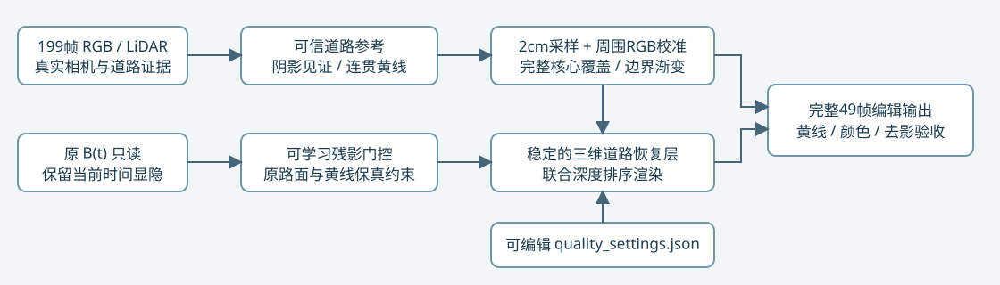

# scene-008 黄线与左车道优化及单车因果检查

[报告、真实单车1k对照及49帧](result_report.html)。R8为质量候选，黄线偏差和左侧原边界残差改善，阴影代理MAE较R4回升；人工结论保持null。原B与全部旧现场只读保留，GPU保持开启。

最终R8重放：在原远端环境，解包后运行 `python source/local_runtime.py --resume formal/checkpoint001000.pt --output restored_review --evaluate`。需要原生v41 B四份权重、V3坐标bundle与原Python/CUDA环境；这些大体积原始依赖不在包内。包内保留最终派生输入、完整优化器/RNG/checkpoint、指标与源代码。

参数重建：新运行目录放置source与quality_settings.json，执行 `python source/prepare_local.py --output-name coarse_inputs`，再执行 `python source/refine_road.py` 和 `python source/start_quality.py`。构建另依赖远端R4实测199帧证据、R5原生表面统计、原始199帧RGB/LiDAR与V3坐标。现有运行输入不会覆盖。

单车重放：`python source/single_actor_controls.py --actor 5 --resume formal/checkpoint001000.pt --output restored --evaluate`；a37同理，输入位于single_a5/single_a37。共同删五车基线保持相同，只改变道路修复目标。

本次R5-R8正式4000步+136验证/重放，追加单车正式2000步+68验证/重放，共6204；结合原R1-R4的4000步，累计10204。完整中间现场保留远端；本地包包含最终回放所需派生数据、检查点、关键验证与各中间最终模型。全199帧均为BUILD，不是独立测试。
