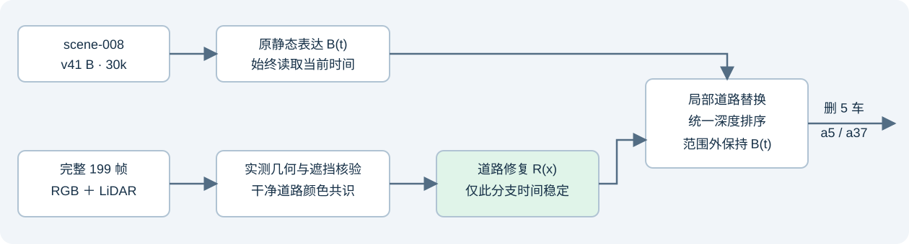

# scene-008 · 199帧道路修复1k

[完整结果与49帧对比](result_report.html)。正式1000更新，按用户要求跳过smoke。代理指标改善但两处大块残影仍在，quality_accepted=false，human_verdict=null。

大体积真实道路证据和49帧资格图位于远端同名campaign与用户本地239MiB完整快照；本目录保留轻量审阅、checkpoint、入口源码与原始指标。回放需要原B30k四件权重及V3坐标bundle。failure_ledger_delta=none。
