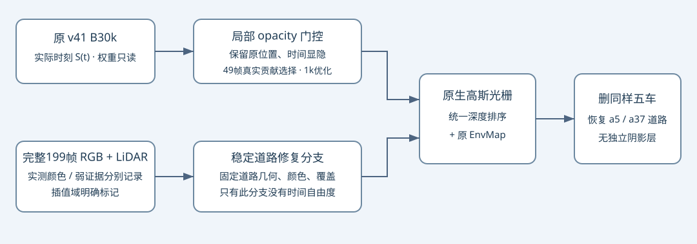

# scene-008 a5/a37 道路去影修正版

[修正版结果、bug证据、49帧对比](result_report.html)。

最终R4为1000更新，旧R1/R2/R3各1000失败更新单列，合计4000。完整199帧道路证据；只稳定恢复道路分支，保留原静态时间状态，不加阴影层。固定原生代理域的阴影MAE：a5 0.08083→0.00870，a37 0.07945→0.01069。中央车形彩色残影仍在，human_verdict=null。完整原始派生输入与失败现场保存在独立约478MiB快照。
