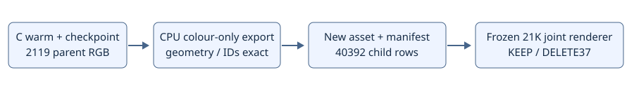

# C49 共享父格道路材质推理资产

本包只更新完整 C 支撑的父格、子行渲染颜色。其余数组的 dtype、shape 和字节逐项相同，原 21K 场景与 a5 语义侧车仍为独立冻结依赖。7979 个零质量父格保持源 C 颜色，40392 子行保持原四子共享映射。

推理使用现有 `RoadFusionV44Integration(semantic_runtime, 本包/scene_manifest.json)`，不读取训练 Adam 或目标图像。原 V44 loader 的既有输入依赖保持；本包不包含原场景大权重。资格和训练元数据位于 provenance。

本包是研究候选，默认未采纳。全部 49 帧属于 BUILD；烟检查点与正式步数分开记录。材质导出不代表轮胎遮挡、道路接缝或删除质量通过。CPU 导出没有额外 GPU 前向；新的资产重放须另行记录。
