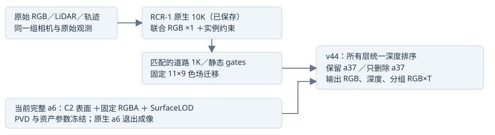

# v44 实际GPU配对结果

主结果模式：full49。帧：89, 90, 91, 92, 93, 94, 95, 96, 97, 98, 99, 100, 101, 102, 103, 104, 105, 106, 107, 108, 109, 110, 111, 112, 113, 114, 115, 116, 117, 118, 119, 120, 121, 122, 123, 124, 125, 126, 127, 128, 129, 130, 131, 132, 133, 134, 135, 136, 137。
本页为完整49帧实际渲染。

打开 index.html；初始raw113真实PNG无需JavaScript可见。拖动、双状态、共用车体裁剪、蓝/银ROI与可选原始实拍列使用本地相对PNG，不fetch，不依赖外部资源。

engine pass 不等于 human 画质接受。当前车体C2/固定RGBA/SurfaceLOD冻结；RCR-1已保存native10K与匹配road1K/gates接入。11×9色场仅frozen-transfer，未重新标定。HELD是内部开发域，没有独立隐藏删车GT。主运行current没有同口径actual group RGB；仅在另存的真实分层重放核对范围内比较净层差。银残片留下一轮，本轮先解决蓝紫斑。

CPU原报告保存在cpu_stage.html，历史图像及证据保留。本包只带PNG、JSON和代码；大floatNPZ及components留在原结果目录。AutoDL按用户要求保持开机。
