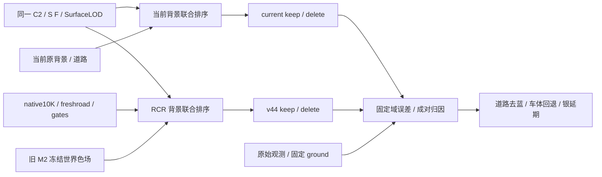

# V44 独立指标与归因复核

审查日期：2026-11-07（Asia/Singapore）。已完成 raw105/113/130/137 四帧 pilot（16 次成像）、完整 raw089–137 的 49 帧两端两状态（196 次成像）以及必要 3 次 current 来源诊断的独立复核。审查者只读远端 CPU 重算，没有启动 GPU、训练、标定或电源操作。

**当前结论：49 帧工程和指标复核通过，数值支持道路去蓝改善与 A6 整体保持；局部回退仍需如实披露。** 49 帧每帧两状态的道路/保护域 RGB 误差、原观测道路绝对蓝误差和超蓝像素数均改善。A6 pooled RGB 接近原表现，最大 RGB 回退仍为 raw137；keep A37 有轻微总体回退，最坏 raw122。用户后续明确“银色残片可以留到下一轮再改善，先解决这个蓝紫斑”，因此银残片不再是本轮通过门；它仍存在，不能用亮度上升宣布修复。原车本身蓝色的 raw105 hood 均值误差改善，但局部蓝尾部像素增加，不能把本结果表述为所有蓝紫异常彻底消失。此次冻结迁移不代表针对 C2/SurfaceLOD 重新标定，也不提供独立泛化结论。变更前的四帧审查保存在 `pilot_initial_review.md` 和 `pilot_initial_verdict.json`，不再作为当前终态。

## 组件与评价流

## 工程与样本分母

独立脚本从保存的 float NPZ 与原始观测重新计算误差 sum/count；146/146 项通过，覆盖实际相机与姿态、两端 S/F 身份、逐帧误差和分母、像素加权汇总、PNG SHA256、alpha 守恒、同次 forward RGB 重建。冻结运行时收据为 `PASS_V44_FROZEN_RUNTIME_ENGINEERING`，训练更新、颜色拟合、标定求解均为 0。

完整 49 帧独立重算 **1,550/1,550 项通过**；pilot→full49 的四帧重叠部分再核相机、S/F、资产行与 PNG SHA256，42/42 项一致，证明正式全段没有悄悄改变方法。full49 同样按 ALL/BUILD40/HELD9_internal_development 分开计算，HELD9 仍不是独立 native 泛化测试。

四帧都在 `HELD9_internal_development` 中。它们仍属同一训练片段的内部开发域；不能写成全 49 帧或独立测试。a6/a37 RGB 来自原观测 visible；深度在 663 个原观测有效 A6 深度像素上比较的是完整联合成像深度；keep 道路使用原 RGB；delete 道路使用 road_edit 与固定 ground 的交集及重观测 proxy。保护域来自原观测 protect，排除两车 visible。没有用预测 alpha 挑选这些正式分母。

| 指标 | keep 像素 | delete 像素 |
|---|---:|---:|
| A6 RGB | 2,760 | 2,760 |
| A6 有效深度 | 663 | 663 |
| 道路 RGB / proxy | 93,464 | 19,956 |
| 保护域 RGB | 520,738 | 520,738 |
| A37 RGB | 36,995 | 不评价已删除目标 |

## 完整 49 帧成对误差

均为固定观测分母的像素加权误差。A6 RGB 共 39,308 像素、深度 8,930 像素；keep road 共 1,075,281、delete proxy road 共 287,368、保护域共 6,312,448、keep A37 共 536,128 像素。

| 状态 | 指标 | current | v44 | 差值 |
|---|---|---:|---:|---:|
| keep | A6 RGB | 0.055103 | 0.054988 | −0.000115 |
| delete | A6 RGB | 0.054947 | 0.054945 | −0.000002 |
| keep | A6 深度 m | 0.173956 | 0.171734 | −0.002222 |
| delete | A6 深度 m | 0.171958 | 0.170030 | −0.001928 |
| keep | 道路 RGB | 0.031688 | 0.016458 | −0.015230 |
| delete | 道路 proxy RGB | 0.018606 | 0.009619 | −0.008987 |
| keep | 保护域 RGB | 0.022450 | 0.015194 | −0.007255 |
| delete | 保护域 RGB | 0.019033 | 0.015359 | −0.003673 |
| keep | A37 RGB | 0.014727 | 0.014916 | +0.000189 |

逐帧最坏回退须与 pooled 同时读：

| 指标 | keep | delete |
|---|---|---|
| A6 RGB | 14/49 帧回退；最坏 137，+0.000683 | 29/49 帧回退；最坏 137，+0.000538 |
| A6 联合深度 | 21/49 帧回退；最坏 101，+0.020699 m | 20/49 帧回退；最坏 101，+0.020297 m |
| A37 RGB | 32/49 帧回退；最坏 122，0.021336→0.023364 | 不评价删除目标 |
| road / protected RGB | 两者均 49/49 帧改善 | 两者均 49/49 帧改善 |

A6 可见贡献的全段像素加权 alphaT：keep 0.995630→0.995500，delete 0.996602→0.996389。keep 的 alphaT<0.9 像素总数 93→77，delete 24→24；alphaT<0.5 均为 4→4。keep 有 6 帧的 <0.9 个数局部增加（109/114/124/126/129/136），delete 没有增加帧。最大 asset alphaT 下降与 static alphaT 增加都在 raw137，后文给出其分组。没有新增低于 0.5 的明显覆盖洞；这不等于逐像素完全无回退。

在 HELD9 内部开发域，A6 RGB keep 0.054919→0.054871、delete 0.054878→0.054861；A6 深度 keep +0.001105 m、delete +0.000711 m，须避免拿 ALL 的深度改善掩盖该子组小回退。

## 四帧 pilot 成对误差（历史阶段）

下表均为像素加权 `sum/count`，RGB 范围按 0–1，深度单位米。每帧两状态的道路与保护域误差均下降；pooled 改善不能覆盖局部瑕疵。

| 状态 | 指标 | current | v44 | 差值 |
|---|---|---:|---:|---:|
| keep | A6 RGB | 0.051790 | 0.051832 | +0.000042 |
| delete | A6 RGB | 0.051743 | 0.051799 | +0.000056 |
| keep | A6 深度 | 0.131915 | 0.140606 | +0.008691 |
| delete | A6 深度 | 0.130632 | 0.135330 | +0.004698 |
| keep | 道路 RGB | 0.030794 | 0.017569 | −0.013225 |
| delete | 道路 proxy RGB | 0.016532 | 0.009478 | −0.007054 |
| keep | 保护域 RGB | 0.023328 | 0.016708 | −0.006620 |
| delete | 保护域 RGB | 0.020692 | 0.016818 | −0.003874 |
| keep | A37 RGB | 0.018413 | 0.017767 | −0.000646 |

A6 逐帧 RGB 差值：keep 的 105/113/130/137 分别为 −0.000042/−0.000008/−0.000211/+0.000683；delete 为 −0.000018/−0.000022/−0.000033/+0.000538。raw137 是唯一 RGB 回退帧。该帧 delete A6 域的 asset alphaT 均值从 0.997964 下降至 0.984496，native_static 从 0.001634 上升至 0.015055；两端 A6 alphaT 低于 0.9 的像素仍为 0。这说明联合排序后的可见贡献改变，不代表冻结资产材质或 intrinsic opacity 被更新。keep 深度的 105/113/130 分别增加约 1.49/0.42/1.65 cm，137 改善约 0.49 cm；delete 的 105/113 增加约 1.32/0.44 cm，130/137 改善约 0.21/0.69 cm。

保护域外的“成对变化”均值约 0.0136–0.0197、单通道最大变化可到 0.859；这是背景替换引起的变化统计，不是误差或隐藏真值准确率。它不能被表述为整个非目标区域逐像素不变。

## 蓝 ROI 空域与补充观测诊断

原 `blue_fixed_ROI` 必须保留：raw113/137 两帧分母均为 0，mean 均为 null，因此 `positive_excess_gt005=0` 不能用于通过结论。raw113 的 1,485 像素固定框中 road_edit∩ground 仅 18 像素，全部被 A37 排除；raw137 在该框内 road_edit 和 ground 都为 0。

独立读取旧 `finalize/evaluate_outputs.py` 后确认：其 `compare_roi` 使用**原始观测 RGB**，先排除 `actor_labels>0` 或 `visible_reviewed.any(0)`，再在两端共同排除 asset alphaT>0.01；并非使用隐藏 road proxy。补充脚本原样保留正式空域，同时新增两个明确命名的诊断：仅原观测 mask 的固定背景域，以及沿用旧共同排除原则的当前 C2 两端交集。后者的分母有预测条件，必须同时报告、不能与历史 M2 的分母或正式空域混用。这只是既存输出的 CPU 评价，不修改监督或标定。

| 帧/状态 | 新共同观测背景像素 | RGB MAE current→v44 | 绝对蓝误差 current→v44 | 蓝误差>0.05 像素 |
|---|---:|---:|---:|---:|
| 113 keep | 788 | 0.142317→0.008728 | 0.023335→0.003575 | 39→0 |
| 113 delete | 782 | 0.040876→0.008674 | 0.084452→0.003921 | 450→0 |
| 137 keep | 1,329 | 0.079216→0.010452 | 0.033899→0.004579 | 232→0 |
| 137 delete | 1,329 | 0.041894→0.010096 | 0.074090→0.004888 | 664→0 |

蓝误差定义为 `(render-target).B − 0.5×((render-target).R+(render-target).G)`。这些有真观测背景支持的结果与成对图片一致，支持局部去蓝改善；它们不证明被删车辆隐藏区域的正确性。

完整 49 帧另以固定原观测 road∩原始观测背景评价蓝误差，两端共用原观测道路 1,075,281 像素；delete 也只在原来可见的道路上对原 RGB 比较，不使用删后隐藏区域的真值假设。补充共同排除两端 C2 alphaT>0.01 的版本也同时报告，分母 keep 1,075,179、delete 1,074,995，不冒充原始固定域。

| 状态 | 固定观测道路绝对蓝误差 | 蓝误差>0.05 像素 | 逐帧结果 |
|---|---:|---:|---|
| keep | 0.016502→0.008185 | 43,954→5,493 | 两项均 49/49 改善 |
| delete | 0.014327→0.008450 | 38,682→6,058 | 两项均 49/49 改善 |

共同排 C2 版本分别为 keep 0.016501→0.008184、delete 0.014324→0.008448，超蓝计数分别为 43,954→5,493 与 38,681→6,058，同样逐帧全部改善。HELD9 固定道路绝对蓝误差 keep 0.016742→0.008291、delete 0.014471→0.008583，超蓝像素 8,413→1,050 与 7,496→1,144。上述支持道路蓝异常改善；残余计数非零，因此不声称所有道路像素完全无色偏。

## 银色残留与 raw105 后验诊断

银 ROI 全框固定，不按预测亮度挑点。delete 的 raw130（4,992 像素）亮度均值 0.399210→0.406779，raw137（1,600 像素）0.430515→0.450330。成对图片中银色片/横带仍可见；没有删后隐藏真值，不能把变亮解释为更准确或已修复。

同次 forward 的 v44 实际 RGB 分组重建误差最大为 7.15e−7。各组在完整银框上的亮度贡献为：

| 帧 | asset | A37 | road | native_static | environment T |
|---|---:|---:|---:|---:|---:|
| 130 delete | 0.035951 | 0 | 0.155908 | 0.171208 | 0.043712 |
| 137 delete | 0 | 0 | 0.116238 | 0.258009 | 0.076083 |

raw137 银框没有 asset/A37 RGB 贡献，不能将其直接归咎于当前替换 A6 资产。主任务另追加 3 次必要 current 原生联合前向，为 current 的 SH 成像颜色加入同排序 RGB 标记；未改参数。与原存结果相比 RGB/alpha 最大误差为精确 0，depth 为 7.63e−6 m；RGB 分组重建误差最大 3.87e−7。审查者读取该收据和源代码，再与原 float 输出、v44 分组及两端 alpha 均值核对，90/90 项算术与一致性检查通过。

因此现在可描述同完整固定框的成像净变化：raw130 亮度净增 0.007569，分解为 static +0.125412、road +0.011244、environment T −0.128478、asset −0.000608；raw137 净增 0.019815，分解为 static +0.234462、road +0.001152、environment T −0.215799。static 增量与 environment T 减量大幅抵消。仍不能把此分解当训练根因，也没有分离环境模型内禀颜色与透射率 T 的变化。

raw105 左侧原车本身为蓝色；两端重建都存在形状错误，不能把“蓝车更蓝”直接称为新增整车色错。按目视后指定的 hood 矩形 `[18,237,91,262]`（1,825 像素，可能混有非车）对原始 RGB 做后验开发诊断，keep/delete 数值相同：RGB MAE 0.061097→0.053446、绝对蓝误差 0.053091→0.048625，但蓝误差>0.05 的尾部像素由 105 增至 172。整体均值改善与局部紫蓝异常可以同时成立。v44 此框 alphaT 约 0.994437 均来自 native_static，asset/A37/road 为 0；其 RGB 均值为 static `[0.162619,0.183175,0.265275]` 加 environment `[0.002553,0.002820,0.003173]`。追加分组显示亮度净增 +0.013966=static +0.034310+environment T −0.020344；蓝色度净增 +0.009107=static +0.018329+environment T −0.009222。这定位同排序成像净变化，不把该后验框升级为正式通过门，也不证明全车数值更差。

## 验收与证据

用户更新范围后：银色残留延期，不作本轮门槛。完整 `full49_r1` 指标支持道路蓝异常改善与 A6 近稳定，不能写成所有目标/所有像素零回退；A37 最坏 raw122、A6 深度最坏 raw101、A6 遮挡最坏 raw137 交主任务视觉复核。raw105 真实蓝车的后验框存在局部超蓝尾部增加，保留该开发问题，不做统一去蓝。不改变方法、资产或冻结色场。AutoDL 按用户要求保持开机，本审查没有电源或服务操作。

证据：`domain_audit.json`、`pilot_independent_audit.json`、`pilot_supplemental_scope_audit.json`、`full49_independent_audit.json`、`phase_consistency_audit.json`、`pilot_layers_receipt.json`、`pilot_layers_independent_audit.json`、`verdict.json`；可复现 CPU 脚本为 `support_diagnostic.py`。主运行现场为 `/root/autodl-tmp/drivingeditor_repro/campaign/scene008_v44_rgb_asset_20261107_r1/results/pilot_r1` 与 `results/full49_r1`；追加来源收据为同 campaign 的 `results/pilot_layers_r1/receipt.json`。图像检查使用已取回的 `retrieved/pilot_delete_board.png` 与 `retrieved/results/pilot_r1/raw105_other_vehicle_detail.png`。正式代码与原始 receipt 未被本审查修改。
