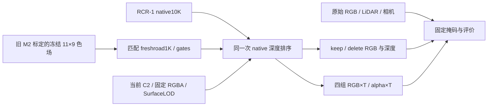

# v44 独立代码审查

审查日期：2026-11-07（Asia/Singapore）。审查方式：只读静态审查与 CPU 检查；没有执行 GPU 渲染、训练、实例启动或关机。未修改运行代码。

结论：已审代码没有剩余的已证实阻塞项。发现的父 checkpoint 身份比较问题已修正。此结论仅允许继续输入验收和后续 GPU pilot；新 v44 画质、遮挡表现、去蓝效果与银亮片均未验收。

## 组件与检查范围

审查文件：`source/v44_runtime.py`、`source/evaluate_v44.py`、`contract/v44_contract.py`、`contract/input_contract.json`、`publish_v44.py`。交叉核对当前 `scene_runtime.py`、原始 `surface_lod_asset.py`、RCR-1 `final_runtime.py` / `calibration_adapter.py` / `calibration_method.py`、原始 `v4_road_render.py` 及历史同排序 RGB 分解脚本。

## 已修复阻塞项

**checkpoint 身份记录的 tuple/list 差异**（`contract/v44_contract.py:151`）。`torch.save` 保存的 `n.before` 值是 `(size, mtime_ns)` tuple，JSON receipt 中对应值为 list。直接字典比较会将正确的道路 checkpoint 拒绝。现已改为比较两侧规范化 JSON 的内容哈希，仍逐值验证原始父模型身份；没有放宽为只看路径或行数。运行时加载检查本来就对 JSON 值作 tuple 转换。

## 通过的接线审查

- **父模型和 gate 行号绑定：**运行时要求独立进程，验证 fresh-road 的父 native10K、metadata、checkpoint step 和方法契约；checkpoint 的 gate IDs 必须与同一 fresh-road contributors 逐元素相同且唯一、有效。没有导入旧 `scene_runtime`、旧 `final_runtime` 或旧 M2 资产。`current` 与 `v44` 在两个顺序子进程运行。
- **当前完整资产保持：**canonical 文件和 C2 posterior 使用固定 SHA256；要求 45,314 行、42,536 个 chart 行和精确为零的高阶 SH。两端都使用同一 SurfaceLOD 与固定 S/F；每帧各自检查 keep/delete 资产行哈希相同，并比对两端 S/F 哈希、原始观测身份以及实际运行相机的内参／FoV／时间／view／projection 与实际物体姿态。原生 a6 物理移除；delete 物理移除 a37，没有改用背景旁路。
- **数组与 feature ABI：**原生 `raster` 返回 `extra = features[2:]`。运行时保留 feature `0:2` 的 depth/one，`2:6` 为四组 alpha×T，`6:18` 为四组 RGB。因此 `extra[:4]` 与 `extra[4:16].reshape(4,3,H,W)` 偏移正确。评价入口要求 RGB `[3,320,480]`、四组 alpha `[4,320,480]`。
- **真实同排序分解：**所有层先合并，再只调用一次 native raster；RGB 标记与用于成像的逐行 `colors_precomp` 相同。pilot 直接保存该次输出里的分组，不额外重渲染。组 RGB 之和、常量背景×T、环境×T 重建完整输出，并检查 alpha 与 RGB 守恒。保留常量背景项，符合原始合成 API。
- **冻结 fine transfer：**源 native、road、gates、metadata、source、degree 和道路 baseline 逐项匹配；保留原 M2 源绑定与新场景绑定。仅计算 `clamp(baseline + basis @ world, 0, 1)`，没有加载原 M2，没有重新求解，也没有将 coarse 残差再叠加一次。换车体后的遮挡和画质明确等待 GPU。
- **评价域：**a6/a37 RGB、LiDAR 和道路候选域取自原始观测，不用预测 alpha 选分母；keep 道路用原 RGB，delete 道路用固定重观测 proxy 与独立 ground support。非目标区域的成对变化域排除原 reviewed 轮廓及候选框；变化与误差分别报告。汇总使用误差 sum/count 的像素加权值。HELD9 标为内部开发域，没有独立泛化声明。
- **交付表述：**HTML 明示新组合未 GPU 渲染；历史旧 M2 配对和当前车体／旧背景分别标注，历史去蓝数字没有冒充 v44 效果。GPU 不可用时入口直接失败，不排队、不操作电源。

## CPU 检查证据与边界

本审查完成：全部新 Python 文件 AST 解析；运行时模块导入没有加载 torch 或场景模块；新 `world_basis` 与原 RCR-1 11×9 实现在 1,002 个边界／随机点上逐元素相等；每行非负且最多四个非零权重、权重和为一；域外点夹到边界；非有限坐标被拒绝；评价掩码尺寸拒绝、squeeze、固定分母求和与空域 `mean=None` 行为通过。

另已独立读取取回的 `contract/cpu_preflight_receipt.json`：`PASS_V44_CPU_INPUT_CONTRACT`，552/552 项检查通过、132 个小文件 SHA256 验证通过、failures 为空。receipt 明确记录 CUDA 操作 0、renderer import 0、native checkpoint payload 载入 0、训练更新 0、`gpu_render_verified=false`。全部 49 帧观测 shape／有效深度与 FIXED 第 3 层 ground proxy 尺寸均通过；已修正的 checkpoint 身份检查通过。本审查没有再次载入远端 checkpoint；复核该实际 CPU 收据与上述独立算术检查，不能替代真实 GPU pilot。

后续 GPU pilot 仍须实际覆盖 raw105/113/130/137 双状态、完整输入与冻结收据、守恒误差、完整 a37 删除和图像检查，通过后才运行 full49。没有新组合图像时，不形成画质通过结论。

银亮片是独立待验项。当前 runner 保存 v44 端的同排序 RGB 分组；它能描述 v44 固定 ROI 的组成，但若后续要声称“当前组合→v44”的净亮化来自某一层，还需给当前端同样加入 RGB 标记并成对比较。历史 315 亮点属于旧版本事后诊断域，不能作新版本分母。当前报告只转述历史归因并使用完整固定 ROI，没有作上述新因果声明，因此这不是当前交付的阻塞项。

## 已审文件快照

| 文件 | SHA256 |
|---|---|
| source/v44_runtime.py | `245336e5bedeb2e994d690c14df88e53c8c1303242b626b636bc7ad9de718ad9` |
| source/evaluate_v44.py | `c765fea12eacb7588df8394e5f745cc60c5ef28d1caa3721e7f3177f8ab5a24e` |
| contract/v44_contract.py | `b1c44e92b98b49577f17aebc3386898caa601f33deb497fc6c0070c3324be0c2` |
| contract/input_contract.json | `719b0660cbb952e4a8ed4595dc5e56a7f358d1a633c1eb42eaadef186f530a17` |
| contract/cpu_preflight_receipt.json | `64c5de2bed0c4c948307113bd0ee911342390ad5927e054bcb9f95e750bd1e9c` |
| publish_v44.py | `53f909ad652c7ace00e19e30ef9c777f83d84e52412509d1fadbf01143959eba` |

快照之后如发生接线变更，应重新检查对应部分。CPU 输入通过、渲染工程通过和人工画质接受是三个不同结果；本次仅完成独立代码审查。
