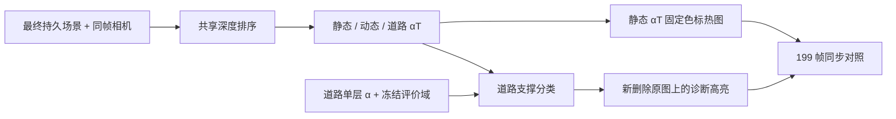

# 道路支撑与静态可见贡献可视化

本次只从已保存的最终持久场景导出诊断，无训练、优化、材质或删除规则变更。

## 数据流

页面同时保留不带高亮的原始结果。

## 判定含义

冻结域为 `views.target & views.inside & ~retained_reveal_guard & ~retained_box_guard & ~K`，其中 `K` 是非删除目标的实例像素。它不是整张图、二维框或优化 fit 域。域外不判缺失。

- 红色：域内道路单层 α < 0.05，表示当前道路层几乎无支撑；不能仅据此证明几何本身不存在。
- 黄色：0.05 ≤ 道路单层 α ≤ 0.9，表示覆盖不足。
- 青色：道路单层 α > 0.9，但完整场景道路 αT < 0.5；表示支撑充分而可见贡献低。正常前景遮挡也可能造成此现象，不能直接当作错误归属。
- 其余域内：支撑充分且道路贡献不低；域外不着色。白色细轮廓只界定冻结域。

静态热图显示全部原生静态行（包括 unknown 归属）的 `Σ α_i T_i`。`T_i` 来自静态、动态与道路共同排序。使用最终 loader 的 `extra[20]` 分支诊断；不使用单独静态渲染、静态 RGB 灰度或旧 R1 数据替代。

固定色标为 0、0.25、0.5、0.75、1，全部 199 帧共用；0 表示当前无静态贡献，不等于缺失。PNG 只将显示值量化至 256 级，数值和计数仍来自远端 float32。

## 验收

导出过程逐帧检查重放 RGB 与既有最终结果、道路 αT，以及静态 + 动态 + 道路 αT 对总 α 的守恒（误差均 < 1e-5）。冻结域、缺口和充分支撑计数必须逐帧等于既有独立评价，空域的比例保持 null。

全 199 帧共有 975,795 像素帧冻结域，其中 86,430（8.8574%）属于支撑缺口。第 179 帧为 892 / 9,242（9.6516%）；另有 418 个覆盖不足像素、285 个支撑充分但道路贡献低的像素。第 0–13 帧没有道路恢复域。

远端目录：`/root/autodl-tmp/drivingeditor_repro/campaign/scene065_closedloop_20261116_r1/handoff_coverage_r2/contribution_diagnostics_20261116/`。

`float/`、原始诊断 PNG、模型和场景仍留远端；本地只取回 398 张小型预览与 manifest（预览约 16 MB）。道路高亮使用质量 90 的 WebP 视觉预览，静态热图使用固定 256 级色标 PNG；科学计数及均值不从预览像素反算。脚本为 `export_diagnostics.py`、`compact_diagnostics.py`、`add_diagnostics_ui.py`、`qa_diagnostics_ui.py`。

发布后真实 Chrome 验收通过 46 项检查，覆盖八视图同步、滑块与播放、完整画面／车辆区域／像素区域、像素点击、诊断显隐与高亮、手机布局，以及报告七个关键帧的六种视图；无 JavaScript、控制台或资源加载错误。重复构建验证没有页面变更。

本轮诊断让缺口与贡献可辨认，不改变此前“删除质量未通过”的结论。GPU 保持开机。
