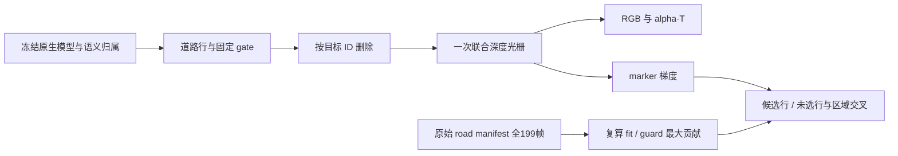

# Scene008 → Scene065 删除策略独立复核

本复核读取本地诊断脚本、远端公开包及两个历史实验源文件；自行执行的远端检查均为 CPU 只读。未训练、未修改共享代码、未启动 GPU 作业。另交付独占的新诊断脚本 `trace_selection.py`，由主代理审阅并完成真实 GPU 执行；以下已核对其实际结果。

代码策略已有可确认的迁移差异，不能把 Scene065 描述为完整复用 Scene008 的保持规则。

| 项目 | Scene008 a37 | Scene065 白车 |
|---|---|---|
| 目标像素的 native keep | `keep[(actor_labels==5)&~other_vehicle_guard]=0`，覆盖完整目标 mask | 仅在 `road|reveal` 域清零；目标不在受支持道路域的部分仍保持 |
| 左侧保持域 | `valid & domain_a5 & ~domain_a37 & (actor_labels==0)`，明确背景 | `~inside & ~other`，会包含目标车体 |
| 静态 gate 候选 | fit/guard 筛选 | 同类筛选再加 `fixed_static_owner<=0` |
| 删除后的保护参考 | 冻结原生删车结果 | `semantic_delete`，其未消除残留仍存在 |

Scene065 的 gate 候选为 45,449 / 1,558,011 静态行，约 2.917%。这些行在原始 semantic NPZ 中 owner 均为 0；工厂的 `source_fallback` 将静态 0 映射为 -1，因此实际是身份未知行，不能认定为车辆行。112,779 条语义目标静态行按目标 ID 删除；其余静态贡献不因此自动成为目标残留。

CPU 重新读取实际 mask 和 road views 得到：

| 帧 | 目标像素 | 目标内 fit | 目标内 keep | 目标内 left/outside |
|---|---:|---:|---:|---:|
| 60 | 1,508 | 85 | 1,423 | 1,379 |
| 119 | 11,624 | 4,472 | 7,152 | 5,296 |
| 150 | 12,532 | 4,949 | 7,583 | 5,624 |
| 198 | 12,265 | 4,905 | 7,360 | 5,373 |

这些帧中目标与 `other`、`marking` 均不重叠。119 帧的 61.5% 目标像素受到 keep 保护，45.6% 同时落入 left 保护。这里确认的是保持监督覆盖错误，不能据此直接断言它解释全部车形残影，也不能认为将 keep 清零即可生成没有观测支持的道路。

`diagnose_joint.py` 的 ABI 与颜色路径审阅通过：

- 原生特征 0/1 为 depth/alpha，活跃行的 alpha 特征为 1；将 RGB 乘该特征后交给光栅，是同一次排序的 RGB·alpha·T，未重复乘透明度。
- 5 组 RGB 写入特征 8:23，正确对应 `extra[6:21]`。组互斥且覆盖行；目标行最后被 mask 删除，目标 RGB 应为零。
- `_rows` 顺序为 native static、native dynamic、附加表面；`features[:,5]>0` 对应原六组中的 road。对当前 manifest 成立。
- 当前工厂背景为黑色，因此组 RGB 加环境项可与最终 RGB 加和；非黑背景的一般化用法须另计背景残余项。
- `nonfocus_static/dynamic` 表示物理分支，包含未知 owner，不能改名为“全部残留车辆”。原六组中的 `other_static` 也不是全部非目标静态。
- `road_only` 实际仍添加环境项，应标为“仅道路+环境”；黑车形可能来自道路覆盖、透明度与环境，不是纯道路颜色证据。
- 原四模式缺少 ungated+road_off；补齐四格后才能估计 gate×road 交互。仅比较最终图与单开关，不能将差值视为独立层颜色。

最有辨别力的控制依次是：完整四格开关；最终同排序的候选/未选静态行 alpha·T；在冻结 gate 上分离 photo、目标 keep、目标 left 的局部梯度。目标保持项应保留原分母，以隔离目标域监督；重新归一化的修正总损失可另报，不能与纯删项混同。

实际查看 `119_layers.png`、`198_layers.png` 与 `119_controls.png`：非目标静态的同排序 RGB·alpha·T 中仍能直接看到中央车形及彩条，说明问题并非只由动态分支贡献；动态层同时保留邻车及底部碎影，不能统一当作待删目标。道路最终贡献仅有局部小块，而“仅道路+环境”呈现彩色异常与黑车形；这张控制图没有证明道路已经恢复。四格开关均能保留明显车形，不能将 alpha 降低或开关造成的亮度差异当作删除完成。

本代理读取了实际 GPU 梯度 receipt，并核对 `gradient_probe.py`：目标 keep+left 与道路 photo 的梯度余弦在 119/150/198 帧分别为 -0.7821/-0.6287/-0.8325。目标 keep 项的梯度 L1 中，促使增加 opacity 的份额为 85.2%/81.2%/80.0%；目标 left 为 78.2%/83.2%/63.7%。目标项保留原分母，因此确有拉回残留底图、反对道路 photo 下降的局部监督。60 帧的余弦为 +0.0095，并非每帧一致。该证据是固定最终状态的局部机制检查，不是完整训练因果效应或修复质量结果。

新交付 `trace_selection.py` 已由主代理运行完成：全199帧候选 IDs 与旧 contributors 逐项一致，119/198 最终 RGB 与保存结果的最大差均为0，零训练更新、零 optimizer step。fit/guard 的浮点 score 不是逐位一致，已选行最大绝对差分别为 9.16e-4 / 4.58e-5；未改变阈值筛选结果。脚本分别取 fit/guard 的全帧最大值，两个最大值可能来自不同帧；保存全量 score/guard、交叠原因 bit、互斥原因及最终逐行贡献。

以下百分比的分母是各区域中的静态 alpha·T，区域都与输入目标 mask 相交；区域可重叠，禁止相加冒充空间划分。

| 区域 | 119 已选 / 未选 | 198 已选 / 未选 |
|---|---:|---:|
| 全目标 | 60.33% / 39.67% | 61.38% / 38.62% |
| fit | 99.967% / 0.033% | 99.947% / 0.053% |
| keep | 36.23% / 63.77% | 36.96% / 63.04% |
| outside | 23.74% / 76.26% | 23.93% / 76.07% |

互斥口径依次归因低 fit、guard、positive owner：全目标静态贡献中，低 fit 未选行为 38.03%/36.92%，通过 fit 后因 guard 未选为 1.64%/1.70%，仅因 positive owner 未选为0。全库仅8行单独被 positive-owner 筛选排除，本两帧可见贡献为0；不能把这个额外筛选列为主要成因。交叠口径完整保留了同时失败条件，不能将交叠计数相加。以上贡献仍是物理分支归因，不是每条行属于车体的认证。

由此可区分两种问题：fit 内主体静态贡献已经进入候选，且已选行在 keep/outside 亦有可见贡献，保持域冲突有实际作用路径；fit 外仍存在明显选择覆盖缺口，单修损失不会使这些未选行变为可优化行。二者可以同时存在。

道路参考不足是第三个独立限制：119 帧目标内仅529像素有 real-domain 支持，3,943依赖推断，另5,296在道路图范围外、1,856在范围内但无支持；198分别为789、4,116、5,373、1,987。road receipt 的 heldout_frames 为空，参考来自 BUILD，不是独立干净道路真值。清除目标保持约束不会补出未知道路；原生残留下降、代理 MAE 下降或道路 alpha 上升均不能单独证明恢复正确。

后续最小验证应先只改已确认的目标保持域冲突，保持原方法与预算，配对查看目标残形、邻车/车道线保持与跨帧稳定；候选覆盖和道路支持问题分别记录。不得通过删除全部 unknown 制造“干净”图，也不得把本次只读诊断写为修复成功。

来源：旧 `source/prepare_road37.py:121–125`、`source/repair37.py` 与 `source/native_binding.py`；共享 `v44_road.py:72`、`v44_gate_fit.py:50–63,90–95`、`v44_scene.py`、`v44_factory.py`；Scene065 `gate1000_command.json`、`gate1000/contributors.npz`、`ownership/semantic_ownership.npz` 及 `world_road/views`。
