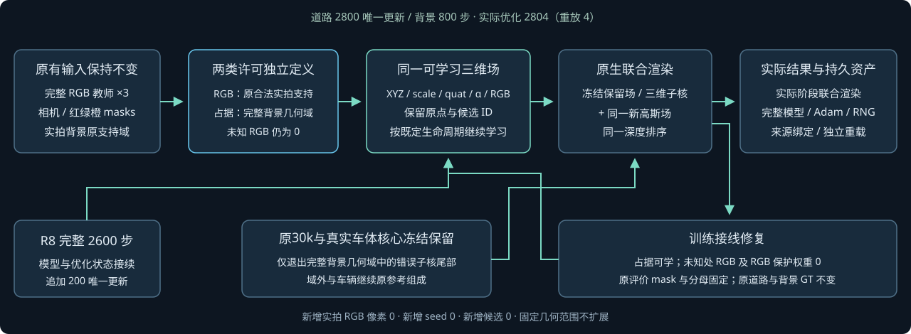

# Scene065：三维道路重建与背景几何补全

更新日期：2026-11-25。R9 已完成道路累计 **2800 次唯一更新**、背景累计 **800 次更新**，最终新场 **69,695 个高斯**。训练链实际优化 2804 次，其中恢复验证重放 4 次。最终图像仍有车底残影和边界彩色破碎，`visual_pass=false`；原人工审阅记录保持原样。

## 输入与三维场组成

完整、未编辑的原始 30k 场提供共同基底。原 native source10 对应待移除 A9，source21 对应保留 A20；源行身份与转移语义标签分别使用。原保留场、A20 与其他真实车体核心冻结，继续沿用原 30k 组成。

道路新场使用三张独立完整 RGB 教师（110／137／165）、训练相机与已确认的连通红域掩码。射线与已核验道路平面的交点仅提供软几何初值。新高斯实际学习 XYZ、尺度、旋转、不透明度和 RGB 五组参数，同时执行增点、克隆、分裂、剪枝。

红域退出集合由八视角完整红域中的实际高斯贡献统一确定。跨界父核一次退出，必要保留部分表达为冻结三维子高斯。保留场、冻结子核与可学习新场在同一次原生深度排序中联合渲染；旧高斯参数不参与优化。

## 必要可见背景

固定背景几何域为：**原橙区 ∩ 原30k基线与R7冻结上下文逐像素最大通道 RGB 差大于 0.04**，并排除 A9、其影子保护区、动态实体与绿色保留内容。

合法背景 RGB 来自同位置实拍，沿用原规范线性 RGB、原照片支持和权重 1。八帧共 **380,639 个合法实拍像素**。背景初始 9,149 点、候选 36,524 点来自 110／137／165 三帧的合法像素；背景 ID 使用 `1e12` 前缀，原生像素索引与 Brown 照片来源坐标分别保存。

另外 **8,665 个像素**被旧照片 `support=False / protected_proxy=True` 排除。八帧数量为 106=1,021、107=1,219、108=1,304、109=1,288、110=822、120=1,124、137=978、165=909。R8 所用照片道路语义掩码中的 `roadFalse`、标线、映射无效、非有限 RGB 和越界 RGB 数量均为 0；旧代理拒绝仍保留。

R9 新增实拍监督像素、初始点和候选均为 **0**。原教师、相机、RGB 目标、候选池、已有 ID 与背景几何范围保持不变。逐帧来源和许可计数见 [data_permissions.json](data_permissions.json)。

## R9：分离占据与 RGB 许可

R8 曾将 RGB 支持域同时作为占据域，使这 8,665 个未知像素被误约束为 `alpha outside=0`，保护损失又使用旧上下文 RGB。R9 修复这两项接线。

| 项目 | 实际规则 |
|---|---|
| 几何占据域 | 原连通红域 ∪ 完整固定背景几何域 |
| 已知背景 RGB | 原合法实拍 GT 与权重保持不变 |
| 未知背景 RGB | 所有 RGB 项继续权重 0 |
| 未知处 RGB 保护 | 逐像素权重 0，移除旧上下文噪声监督 |
| 评价域 | 完整绿区／橙区掩码与分母保持固定 |
| 冻结上下文 | 仅退出投影进入完整背景几何域、且不属于真实车辆三维核心的错误子核尾部 |
| 域外与车辆 | 保留原参考组成 |

训练固定监控中，未知背景 RGB 权重和保护 RGB 权重和均为 0；2800 步未知域的四组等权平均局部 alpha 为 0.839815，alpha 目标 MSE 为 0.0625073。该域的几何占据可学习。

## 接续与实际计算账本

| 阶段 | 唯一更新 | 额外优化重放 | 用途 |
|---|---:|---:|---|
| R7 | 2000 | 1 | 连通红域三维场与冻结上下文 |
| R8 | 600 | 1 | 合法可见背景出生并接续学习 |
| R9 | 200 | 2 | 占据／RGB 保护接线修复 |
| 合计 | **2800** | **4** | **2804 次实际优化** |

背景出生于道路第 2000 步，最终背景生命周期为 800 次唯一更新。R9 沿用 R8 完整模型、Adam、采样器与随机状态，五组参数继续实际学习；未重置 optimizer。目录碰撞重试产生 0 次优化更新。R7 的 2000 步、R8 的 2600 步完整现场分别保留为控制。

R9 的恢复前状态逐位一致。下一步重放的 loss、视角、拓扑、RNG 与 ID 一致，但 **2 个 log-scale 数值未通过原 4eps 阈值**。最大实际 sigma 差为 **0.879 微米**；采用 **sigma 差不超过 1 微米且 log-scale 差不超过 1e-5** 的参数感知等价证书，其余状态继续使用 4eps。R9 下一步不是全状态 bit-exact 重放。正式训练从保存的原始唯一轨迹 2616 状态继续。

独立历史控制单列：R4 的 RGB-only 尝试为 1772 次唯一／1773 次物理更新；R5 为 2000 次唯一／2001 次含重放更新，另有接线工程 1 次，合计 2002 次；R6 中断于 894 次唯一／895 次物理更新。这些旧现场与账本继续保留，不并入当前 R7→R8→R9 的 2800 步预算。

## 指标与持久资产

训练帧固定为 106–110、120、137、165，按 `[106–110] / [120] / [137] / [165]` 四组等权，每次两个视角。留出 134、179、181–185、198 只用于渲染观察。

严格四类 RGB、原三类道路 RGB、实拍背景 RGB 与不含先验的混合目标分别记录。R7／R8 原生固定域不同；R9 的 RGB 来源及分母与 R8 一致，共同域 RGB 比较独立重算。加权训练保护损失与完整评价掩码上的未加权 RGB 差分开记录。

同一 R8 支持域重算的固定八训练帧指标如下，均非留出 score：

| 共同域 RGB MSE | R8 actual2600 控制 | R9 actual2800 |
|---|---:|---:|
| 道路原三类加权 RGB | 0.000187871 | 0.000167576 |
| 合法实拍背景 RGB | 0.0000712039 | 0.0000330630 |
| 四类加权 RGB | 0.000259075 | 0.000200639 |

R9 自身固定域的最终混合目标（不含先验）为 0.00174470，与上表严格 RGB MSE 分列。

实际执行目录：`/root/autodl-tmp/drivingeditor_repro/campaign/road_teacher_background_coverage_fix_20261125_r9`。

`results/metrics.json` 记录固定监控、共同域比较、五组真实梯度／变化、完整域诊断与计算账本，紧凑摘录见 [results_summary.json](results_summary.json)。`training_v1/train` 保存完整 checkpoint、无 Adam 推理模型、新场 NPZ 与阶段实际渲染；冻结 recipe 和全部来源绑定共同构成可重载资产。主资产为 **R9 actual2800 + saved reload**。独立重载输出 20 个编辑帧及 20 个原始基线帧，与 16 个真实训练快照比较的全部数组 `byte_equal=true`、`max_abs=0`；推理不创建或加载 Adam。

外围静态保留候选 `outside_preservation_v1` 用时 18.26 秒、0 次 optimizer 更新。只有 259 个静态核合格，且全部在 20 个视角中均未被 preprocess 判为可见；没有图像改善证据，**未晋升为主资产**。未生成新的主组成，也未追加训练；现有 speckles、残影或边界破碎仍按实际图像记录。

原两份 HTML 展示原生 106–110／181–185 两组连续五帧，保持相同 raw、相同缩放，分别选择 R7／R8 控制与 R9 阶段；历史内容和人工状态原样保留。

资产与取回状态：最终训练资产及原生静态／动态／environment三份30K权重在远端完整保留；本地原生三权重的传输与完整性核验仍为 pending，尚不声明全部离线资产完整。见[资源状态](resource_status.json)。

哈希绑定恢复使用取回包中的原始代码和配置。Git文本归档的换行符规范为LF，原始campaign文件保留。

免责声明：交付范围是授权红域与原橙区内实际丢失的可见道路背景。R9 未增加照片或教师证据，未知位置只进行几何补全，不称真实结构恢复或全场重建。训练误差、参数感知重放等价及数值资产一致不代表视觉验收通过；最终质量以实际图像及保留的人审记录为准。
