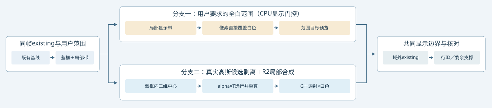

# 蓝框限定白底诊断：范围预览与实际高斯剥离

当前验收是以 existing 为基线，在用户蓝色边界以内纳入车底黑影和彩色噪声，禁止新增框外 unknown。为了避免把白色显示当作归属正确，交付两种明确分开的结果。

## 方法与输出

| 部分 | 实现 | 证据与限制 |
|---|---|---|
| 用户边界 | 近似描摹 raw113 蓝色多边形；raw98/114 按实拍车身框仿射传递 | 2D 投影范围，不是已验证的3D车体包围盒 |
| 纯白范围预览 | 蓝框内局部带 G/环境显示贡献全部关闭，白色占位；域外保留 existing | 这是空间门控参考，不能证明自动 unknown 或语义归属正确 |
| 真实GPU候选删除 | 从原 existing 集合出发，新增候选要求当前高斯中心投影在蓝框内，并对车身、用户车底查询、已暴露越界颜色查询有真实 alpha*T 贡献 | 阈值1e-7；删除后重算；保留所有门槛与身份命名空间；查询并非独立GT，不作为训练标签 |
| 白底合成 | G_after+(1-alpha_after)×白色；仅局部带采用这一分支 | 不对仍有Gaussian贡献的像素直接涂白；环境参数没改，但该诊断局部绕过环境 |
| 框外保护 | 同一时刻、同一相机的 existing 分支 | 跨边界支撑在域外继续保留；逐像素差0来自明确的空间合成策略，非自动归属精度证据 |

候选删除与永久身份写回分开。新增行ID作为本次诊断候选保存；没有将全局owner改写，也没有将环境texel编造成高斯行。

## 实际结果

| raw | 新增框内候选行 | 新增框外中心 | 查询内仍贡献的框外中心行 | 真实结果框外差分 |
|---|---:|---:|---:|---:|
|98|14874|0|421|0|
|113|8485|0|326|0|
|114|7936|0|345|0|

真实结果车底查询的显示亮度低于0.2的像素数为0，但仍非纯白；AI目视报告仍见浅暗边与彩色细纹。这个阈值统计不能代表阴影物理消失或去影成功。查询内最终平均alpha仍约0.305/0.315/0.310，说明跨界高斯仍在贡献。不能为追求全白而越界把这些高斯整行重新标成unknown。

局部范围预览能做到严格纯白；真实剥离尚未达到同样效果。页面将两者并列，用户验收的应当先是边界与目标形态，再判断实际方法是否达标。

## 可复现与开销

- `build_bounded_white.py`：明确边界、浮点范围预览、差分检查与本地接线。
- `render_bounded.py`：冻结模型GPU候选渲染，5.506秒，峰值reserved 1583349760字节；训练0。
- `localize_native.py`：复用实际 G/alpha，在CPU限制白底显示域，避免框上部天空变白，无额外GPU更新。
- `install_bounded_native_ui.py`：三帧并列报告与数据验收。
- `numeric_validation.json`：真实渲染分量闭合、新增候选中心全部在框内、域外像素完全一致。
- `ai_visual_review.json`：AI辅助目视，human_verdict=null；不是人工GT。

远端现场：`/root/autodl-tmp/drivingeditor_repro/campaign/v43_ownership_20261028/unknown_detection_v3/bounded_native_r1`。
本地报告：`outputs/V43_Ownership_20261027/gpu_v43/bounded_white_v1/index.html`。
第三场景仍停止，无补景、无颜色参数修改、无训练。failure_ledger_refs=[V82-F01]；failure_ledger_delta=none。

当前范围内没有验证高召回/高精度的可迁移检测器。下一步若继续，需要明确如何拆分跨界混合支撑，不能将屏幕范围门控等同三维语义身份。
