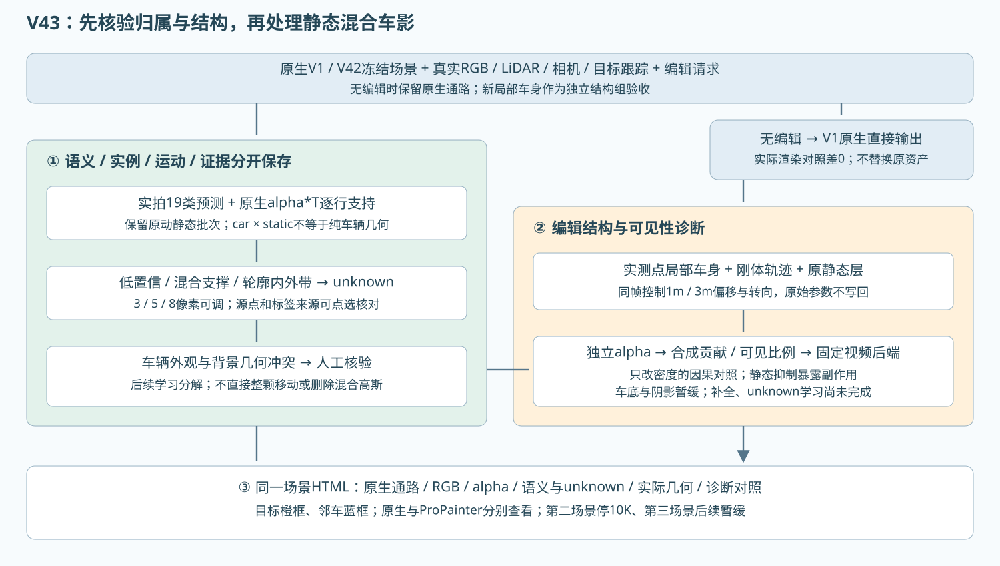

# V43 GPU 实验与诊断：身份及结构优先

本轮用户授权三件事：动态车辆结构修复；诊断车辆表达是否错误留在 static；更细静态语义。每个case首轮10K、最多20K。额度只记录，停止由用户通知。旧自动任务和旧30K队列不恢复。

## 观察证据

- 三个开发场景各49原始实拍帧。缓存 SegFormer-B0 Cityscapes19类，概率门限0.65，低置信为unknown。不是GT，不把原始box转mask。
- 原始30K的完整static/dynamic行，alpha*T实际可见贡献；辅助特征反向累计与前向alpha闭合。CUDA通道容量24（包括深度和alpha），代码显式守卫。
- 单帧和跨时刻语义证据分别保留；非目标不统称背景。目标掩码贡献不直接等于目标身份：后方道路也可能通过透明度参与成像。
- 补充同像素实际车身LiDAR回波的alpha*T加权深度均值、二阶矩与高斯中心深度差。只覆盖有实测回波的像素，深度相符仍不等于三维身份已证实。混合支撑保留unknown，不能为了减少unknown而硬分。

## 第一训练组：实测 Actor 局部资产重建

复用原V42冻结static/environment，保留原dynamic30K作为对照；新目标从原先已核验的目标车身实测LiDAR索引重建。49帧各点变换到同一Actor局部坐标，6cm体素去重，保留源frame、LiDAR行号。没有按box筛点。

每帧使用真实ActorTrack刚体姿态求值，局部xyz、尺度、旋转、颜色、opacity共同学习。目标跨帧结构统一，不用自由逐点SHM轨迹去拟合整个车辆。RGB/车身掩码/稀疏实测深度联合监督；不是补全、不是分割模型训练。

这是明确登记的结构探针，不是声称完整继承GN11损失与容量的主方法：原static及其原有寿命/速度/SH参数全部冻结，目标从约百万行自由时变高斯变为数千行刚体实测种子、DC颜色，无SGCM/NPS或增密。新训练RGB采用PIL LANCZOS到480×320并RGB8量化；原native是浮点RGB经cv2.INTER_LINEAR。共同观测比较同时列出两种预处理，不能把新探针重建分数直接与旧报告原生分数混用。主方法若要求严格继承，应另立合同进行最小改动，而不能静默把此探针替代完整原生方法。

R15型约束：距原测量锚点最大0.25m；半框+0.1m与初始框外种子绝对值两者最大值定义允许包络；sigma上限为初始1.5倍，最小1cm；无新增高斯。约束清除被裁坐标Adam外推量，保留其他分量。box只限制新外扩，原测量框外点不删除。

Adam参数组：xyz 2e-4，log_scale2e-3，DC2e-3，opacity5e-3，quaternion5e-4，eps1e-8。损失：全图RGB L1×1，车身独立RGB L1×5，独立alpha MAE×0.1，稀疏LiDAR深度L1×0.05，锚点平方位移×0.01。每次更新真实前后向，检查loss与全部梯度finite。固定容量、固定10K预算。

每case fresh≥300s和完整恢复≥300s smoke，smoke额外更新单列；恢复检查模型、Adam、采样队列、Python/NumPy/Torch/CUDA RNG。smoke保存节点也做完整49帧实际评价及15°转向入口。正式从原实测初始化fresh10K，1K/5K/10K完整状态与49帧评价。保存失败保现场，不重启健康worker。

该组没有修改static，也没有联合补全，因此静态残影可能仍在。全49帧均用于证据与训练，评价是重建诊断，不能称独立留出泛化。原静态30K也已看过这些帧。新侧面没有独立RGB GT，不报编辑PSNR。

## 必须保留的对照和后续门槛

1. 原V42自由动态30K vs 新Actor局部初始化零更新 vs 新Actor局部10K；变化包含重新初始化和表示，应分别列出，不把全部收益归于box约束。
2. 相同实测局部初始化、同采样/损失/10K的无约束组，隔离约束本身。几何、RGB、真实贡献分别验收。
3. 归属候选复核：真实车身深度支持、遮挡、其他车辆、混合支撑。未经确认，不整批把车辆语义static迁到目标。
4. 后续静态车辆分解对照保留assignment-only、structure-only、二者组合；再用同容量、同预算比较先分解后补景、联合优化和断开耦合的联合组。当前不预定联合必胜。
5. 时序控制固定时刻不同幅度、不同时间固定幅度，原始顺序/逆序/跳帧；生成图不当新独立实测。固定ProPainter对照单独记账，当前结构组不调用。

所有数据、权重、日志留campaign，不入Git。下载只取必要图、逐行诊断数据与执行凭据。NVML采样与CUDA allocator峰分开；磁盘起跑检查保留25GiB储备，不擅自删除既有资产。每个case一个HTML，新实验与旧实验共用入口、帧轴和点选诊断。
