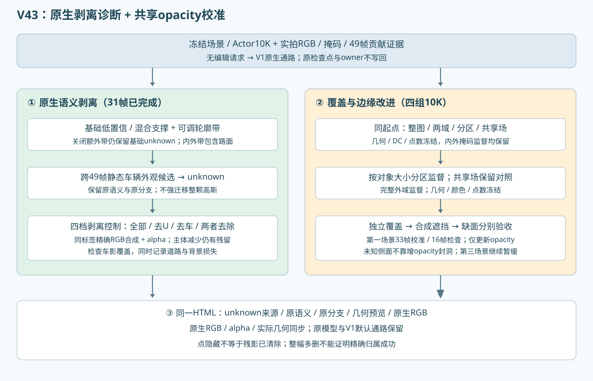

# V43 第一场景：原生剥离与通用opacity改进

本轮仅第一场景；第二未新增训练，第三继续暂缓。无编辑主通路继续保留原V1输出，模型和历史结果不覆盖。

## 原生剥离：候选集合尚未达到干净分离

已完成31帧×2种带宽×5种控制，共310张实际原生RGB；未抑制控制与旧Actor10K输出最大PNG字节差0。共享HTML新增6个剥离组：去unknown、去车辆14–19、两者去除，分别0/5px；原删除动态资产基线保留。车辆组包含其他车辆，属于全局语义剥离控制，不是仅删除目标。

raw98/101/109/113/114排查图中，两者去除后车身主体明显减少，底部/原位仍有暗色残留；同时背景出现大范围空缺与异常曝光/颜色，不能宣称完成干净车辆分离。原生合成中的环境图和此前被遮挡的表达可能在剥离后暴露，进一步的类别贡献诊断另列。没有把这些图当成完成的背景补全。

几何显示现在使用每个剥离组保存的固定0/5px与20%规则，和左侧原生RGB对应。右侧手动预览只会进一步隐藏，不会改写固定实验。RGB、alpha、原语义与原动静态分支仍分别保留。

## opacity：同起点、冻结结构与颜色的三组控制

所有组从相同Actor10K重新开始，各增加10K优化；不是从各自smoke继续正式训练。固定6241个高斯及其xyz、尺度、旋转、DC、static和环境。完整内外掩码监督均保留。33帧用于校准、16帧检查；基础重建与种子已见过49帧，因此只称校准留出，不称独立重建泛化。

- legacy：只优化原opacity，使用原整图alpha MAE×0.1。
- balanced：只优化原opacity，使用掩码内MAE×0.05＋掩码外MAE×0.05；这是显式重新分配权重，不声称与旧0.1同强度。
- field：冻结原opacity，用Actor局部共享MLP预测有界q；o'=1-(1-o)^q。q在0.25–4内，由仅训练帧的可见车身/语义支持可靠度门控，无支持时q=1。输入没有case、帧号、编辑角度；加入logq≈0与局部平滑正则各0.001。表示容量与正则改变单列，不能把field与balanced当单因素比较。

三组RGB训练目标、稀疏深度约束、采样序列与起点一致；检查覆盖、外泄漏、合成遮挡、转向与横移，不依赖RGB分数。原固定opacity增强仍作为旧控制保留。校准模型不回写原checkpoint或语义owner。

## 工程与执行

三组分别完成真实100更新smoke及恢复到110的下一阶段验证，覆盖前后向、finite loss/梯度、保存、49视角评价、原生编辑入口及完整Actor/MLP/Adam/采样与所有RNG恢复。每组额外110更新单列。正式方法和10K预算保持不变。本轮为分钟级短实验，不是小时级长跑。

一个父控制器持有全局GPU锁，按实测显存准入，最多两个已登记子进程并发。其他工作不能误入同一GPU租约。CUDA allocator与NVML采样分开记录；首轮实际并发NVML约3.6GB、利用率约93%。最初控制器因gpu_slot导入路径在训练前失败，日志保留，修复后重启控制器，没有丢失训练更新。

尚未学习unknown身份分类、拆分静态混合高斯或联合补全背景，也没有证明联合优化优于简单流水线。failure_ledger_refs=[V82-F01]，failure_ledger_delta=none。

## 正式10K校准留出结果

|组|车身内部alpha均值|掩码外alpha均值|车身合成可见比例|
|---|---:|---:|---:|
|legacy|0.90928|0.00220|0.93857|
|balanced|0.93479|0.00228|0.93863|
|field|0.90668|0.00218|0.93848|
|boundary|0.92975|0.00171|0.93849|

这是原始观测掩码上的覆盖/泄漏/遮挡统计，不是编辑RGB真值或正确身份率；转向侧面仍需逐帧看图。

## 剥离后残留的类别贡献

raw113、5px、去车辆＋unknown后，原目标车身掩码内剩余Gaussian贡献约92.7%仍携带原road标签，另有terrain/sky；剩余合成alpha均值约0.357。加权中心深度约48.2m，原目标实测LiDAR中位约20.6m。这个统计覆盖原车身掩码，不能冒充对每个暗残影像素的精确分类，也不能把中心深度当表面交点。

因此，仅删vehicle/unknown标签不足以完成干净分离。保留的背景类也在目标区域参与成像，支持静态混合支撑／车辆外观污染的解释。仍需区分几何归属与外观污染，不把这些road行直接整批迁入车辆。阴影没有重标到车身，车底问题继续暂缓。

## 同一姿态、固定诊断域的覆盖与边缘代价

|组|31帧转向独立alpha均值|原视角车身外5px alpha均值|
|---|---:|---:|
|base|0.82188|0.35663|
|fixed2|0.91238|0.41850|
|legacy|0.82737|0.36014|
|balanced|0.85335|0.37325|
|field|0.82389|0.35702|

转向域固定为同姿态原Actor10K独立alpha>.1的像素，不是编辑GT。固定增强覆盖最高但外圈代价更大；两域平衡取得部分覆盖改善，边缘也增加；共享场当前几乎保持原状，没有额外收益证据。generic渲染接口与已保存正式RGB逐字节一致，V1无编辑路径浮点差0。

## 第四组：按对象投影大小划分完整外域

观察到balanced边缘外泄漏后，追加一个配对boundary控制：内域权重.05；外域分为邻近带与其余外域，各.025，整个掩码外域均覆盖。邻近半径由clip(round(.1*sqrt(body像素数)),2,12)决定，不使用case/帧号/角度触发。也是同Actor10K起点、冻结几何/DC、额外10K，另100＋10恢复smoke；这是复用同一开发留出做的探索性跟进，不是新的独立测试。

|组|31帧转向同域alpha|原视角外5px alpha|
|---|---:|---:|
|base|0.82188|0.35663|
|balanced|0.85335|0.37325|
|boundary|0.81803|0.28154|

第四组在16帧校准留出上，内部alpha约0.930，外域alpha约0.00171；对比legacy的0.909 / 0.00220，同时改善了源观测域内的覆盖和外泄漏。编辑视角固定域包含边缘，整体alpha下降不自动等于核心车身变淡，需再分核心和边缘核对。

## 转向核心和边缘分别核对

固定同姿态原Actor10K alpha>.8为核心，.1<alpha≤.8为边缘；取自已保存8bit地图，量化界限1/255，不是编辑GT。

|组|31帧核心alpha|边缘alpha|
|---|---:|---:|
|base|0.93008|0.58414|
|legacy|0.93527|0.59024|
|balanced|0.95775|0.62421|
|field|0.93182|0.58670|
|boundary|0.93959|0.54889|
|fixed2|0.98619|0.74890|

当前优先保留简单的分区监督改动做下一轮核验，共享MLP没有显示额外收益，不设为默认。静态车影、遮挡和未见侧面仍未解决；不声称跨场景泛化已证实。
