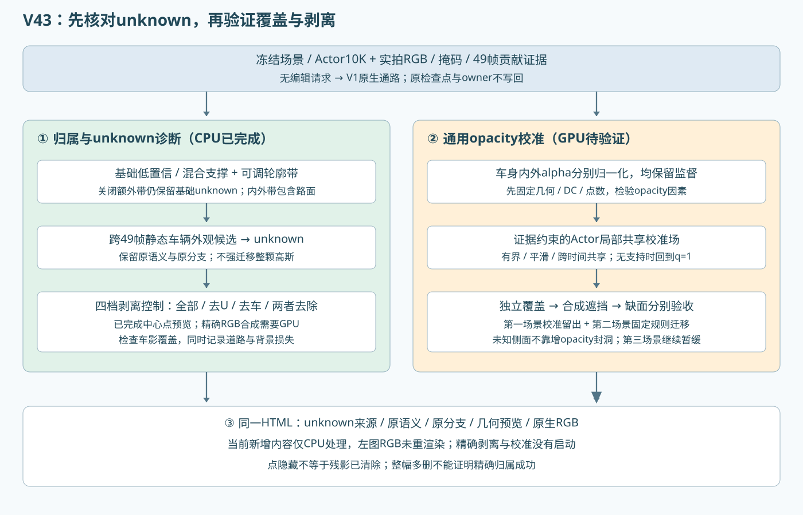

# V43：opacity 校准与 unknown 剥离的 CPU 排查

本轮没有启动 GPU 推理、渲染或训练，没有恢复任何队列。第三场景继续暂缓。原生 checkpoint、RGB 和渲染 owner 不变。下述算法是待验证方案；几何中心隐藏已经实现，真实 RGB 剥离尚未执行。

## 1. opacity 增强有效，但固定 ×2 尚不能直接变成通用修复

用户同帧观察表明增强 opacity 后车身更实，这与已有独立 alpha 对照一致。保留该对照，不否认改善。旧名称“密度×2”实际执行的是峰值 opacity 变换 `o'=1-(1-o)^2`，没有增加高斯数量；原生 rasterizer 中像素 alpha 是 `min(.99,o*G(u))`。因此这也不等同于严格的沿射线光学厚度整体翻倍，不能直接解释为物理正确的密度校正。

代码已经核对：Actor 采用实测种子、局部刚体、DC-only、无增密，且限制了尺度；编辑保持这些参数不变，但投影覆盖和静态遮挡会改变。旧诊断 raw113 的内缩车身域静态遮挡损失由约5.6%升到17.3%。增加目标 opacity 不能让前方错误静态层的透射率恢复，也不能补出缺失侧面。它只是其中一个有用的对照。

另发现当前 `train_actor.py` 的 opacity 项为 `.1*mean_full_image(abs(A-M))`。读取原始 DEVA mask 与已保存独立 alpha（8bit量化）得到：raw91–114所查6帧的车身仅占整图1.245%–1.447%，内部均值项的有效系数约.00125–.00145，外部约.0986–.0988。它保留了内外监督，但按面积稀释了小车内部权重。此处是可疑机制，尚未证明是变淡的主因。

## 2. 建议的通用代码改动顺序

先改训练监督的归一化，再决定是否添加额外模块：`L_alpha=lambda_in*mean_M(|A-1|)+lambda_out*mean_notM(|A|)`。掩码内外两域都保留，显式记录归一化、系数与掩码来源，不把 outside 项删掉，也不只在编辑时提高 opacity。先固定几何、DC、点数，只优化 opacity 做配对控制，检查车身内部覆盖、轮廓外泄漏及多帧稳定性。若有效，再纳入正式训练合同。不能把平衡后的系数与旧0.1直接当成同强度。

若仍需校准，增加 Actor 局部坐标中的共享、平滑、有界校准场 `q_i=exp(c_i*b*tanh(h_theta(z_i)))`，`o_i'=1-(1-o_i)^q_i`。`z_i`包含局部位置、尺度、邻域支撑和观测次数；`c_i`是证据可靠度。无支持时c=0，q回到1。这个校准场随物体运动，跨时间共享；输入不包含case编号、帧号、编辑角度触发条件，不逐帧追求“颜色更深”。参数用实拍/掩码监督，并加q≈1与邻域平滑约束，先保留结构和颜色，避免靠颜色/尺度一起补偿透明度。标为unknown的归属不据此改成车辆。

分三类验收：独立车身alpha不足才是密度/支撑问题；独立车身够实而合成贡献低，先查静态遮挡；缺少实测支持的新侧面继续标未知，不靠增密封洞。V1无编辑主通路继续直出，训练校准的结构探针另行验收。转向后内在可见颜色也会因可见高斯集合不同而变化，opacity不是唯一解释。

泛化验证先在第一场景部分观测帧校准、其余帧检查，再固定规则/参数迁移到第二场景的不同车体与尺度；这些是已见场景中的校准留出和跨开发场景诊断，不冒称独立重建泛化。第三场景不使用。比较原版、固定增强、两域归一化、归一化＋校准，记录覆盖/泄漏/遮挡和时序稳定，不用编辑RGB分数代替人工诊断。

一手依据：[Mip-Splatting 官方实现](https://github.com/autonomousvision/mip-splatting)与[gsplat rasterization](https://docs.gsplat.studio/main/apis/rasterization.html)展示了投影协方差、滤波和opacity需一致处理；其抗锯齿补偿是协方差行列式比，不是通用增亮系数。本项目CUDA实际采用cov2D对角加0.3和o*G混合，未接上述补偿，不能直接把Mip公式当本例修复。[2DGS](https://surfsplatting.github.io/)强调跨视角表面几何的重要性；本轮不更换表示，作为缺面/几何与密度应分开诊断的依据。

## 3. 关闭仍有灰圈，以及5px为何使路面变灰

灰色是语义map的 `class_id=0 unknown`，并不是“确定非目标”的0。旧CPU 1/0/U身份候选是独立层，网页已重新注明。

关闭只关闭额外轮廓带。二维预测置信低于.65、逐行语义纯度不足.65、当前帧没有足够可见贡献，仍为基础unknown。边缘恰是容易发生这些情况的位置。原先UI只写“关闭”，容易让人误以为强行消除全部unknown，现改成“关闭额外轮廓带”。

轮廓来源为所有预测车辆14–19类与目标DEVA车身掩码的并集，欧氏距离取内外两侧，在480×320实拍像素上计算。5px不是世界坐标5单位。高斯只要至少20%的本帧可见alpha*T贡献落入带内就暂缓分类，不要求中心或原语义属于车。外圈包含路面，大尺度/混合支撑又可能把影响扩到较远的中心。

full-row CPU复核49帧：raw113的Actor10K无编辑证据中，原基础unknown38,826行，5px另外增加12,803行；其中原road→unknown4,521行（static4,100，dynamic421）。二维带7,355像素，其中road2,085像素。这是该规则的实际影响，不是显示采样统计，也不说明所有这些行都应属于车。已增加unknown来源着色与分原因计数，保留带宽对照。

另外确实修复一个显示更新问题：改变带宽时，原始二维语义图以前没有立即重画，现在随参数更新；诊断记录载入也恢复带宽、阈值和剥离选项。

## 4. 静态车影先隔离到 unknown，不做整行身份迁移

使用已完成49帧原始/Actor10K可见贡献，在同一static行空间汇总候选。任一观测满足mass>.01、目标掩码贡献比例>.05且车辆语义贡献比例>.3，就将该静态行作为“车辆外观可能混合在static”的unknown候选。共23,204个不同static行，其中19,174行在至少3个不同帧有候选支持。两套可见性去重，支持帧不能重复计数。

这些阈值沿用前期诊断的宽松候选口径，意在暂缓强分类；它们不是纯车辆身份条件，也不具备安全删除保证。可能同时覆盖道路、阴影和背景混合支撑。原标签与支持帧保留，网页可关闭此隔离层对照，不改变owner、几何或RGB。它不能宣称已包含所有残影。

## 5. “不渲染unknown和车辆”实验的界线

已接入同入口四档三维预览：全部、隐藏unknown、隐藏车辆类14–19、两者都隐藏。实际Canvas在0/5px下验证，过滤后的投影列表不再含对应类别；目标橙框和其他蓝框保留。此处只是三维中心过滤，左侧保存的原生RGB不动，不能把车形消失当作原生残影剥离成功。

GPU版本已准备，未启动：`render_semantic_ablation.py`读取同一49帧证据和静态unknown清单，在冻结模型中将相应行opacity设零，并用原生CUDA重做alpha合成。分别输出只去unknown、只去vehicle、合并去除及未去除控制，0/5px带对照。此为全局语义剥离上界，车辆14–19包括其他车；不冒充只删除目标车。当前观测未标出的行按unknown处理，会增加空洞。所有新露出的行必须重新合成，不能从旧RGB减去alpha*T贡献近似结果。

如果合并剥离后车影消失，说明候选集合足以覆盖其表达；同时检查路面/背景损失。只有大面积多删才能消失不能视为精确归属已经成功。若仍残留，再定位保留下来的非车类别贡献。这是下一项需要GPU的工作，目前没有结果。

本轮CPU凭据：unknown_cpu_audit.json、alpha_normalization_cpu_audit.json、unknown_preview_validation.json。原生剥离结果保持null；0训练更新、0 GPU计算。failure_ledger_refs=[V82-F01]，failure_ledger_delta=none。
