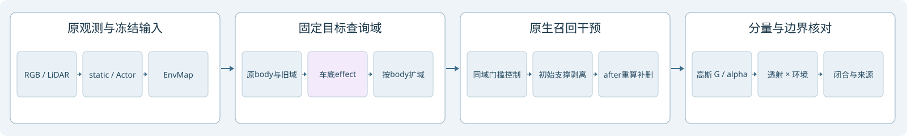

# 召回上界：逐层剥离与剩余贡献来源

任务 WS-V43-TARGET-DETECTION-20261028；run recall-ceiling-r1。用户最新验收为召回优先：背景误选只记录，不否决扩大候选；不补景、不修改颜色或环境项掩盖残留。本轮冻结原static/env30K及Actor10K，新增训练0。三帧raw98/113/114，不宣称独立语义召回率或跨场景泛化。

## 算法与工程变化

1. 候选门槛与证据分开：精确重放原13列body、轮廓、阴影规则，保存每条失败原因及单独放宽的实际新增集合。LiDAR、随动、跨帧不足不再作为本轮扩候选的否决。当前旧分类器本身已把背景冲突保留mixed，并无背景直接veto；此前偏离主要是优先级与验收。
2. 独立扩大待查域：按原始目标body框的宽高比例扩展两侧、车底和上方，并并入原阴影effect/轮廓域。不是按raw编号手画特例；但这是包含真实道路与邻车的诊断上界，不是已验证的可迁移检测器。
3. 重算剥离后的alpha×T：保留918850条原static行号，置零所选opacity，不压缩索引。每个干预状态全量重新光栅并用辅助通道伴随求贡献，不能沿用before权重或只搜索旧稀疏ID。
4. 逐层补查：对固定待查域中新显露的贡献继续剥离，区分initial质量恰为0与小于1e-4的阈值穿越。递归仅用于诊断，不生成训练GT、不修改语义标签。
5. 阴影仍为独立紫色effect。将渲染分成Gaussian项、常量背景项、(1-alpha)×environment；保存未裁剪float32。对环境cubemap做独立双线性texel伴随，追到face/texel原参数。
6. 对真实剥离图的暗像素重新归因：显示亮度<0.2作诊断查询，同时列0.1/0.3敏感度。暗像素不等于车辆/阴影真值，查询结果不回填标签；环境项保持不变。

## 真实对照

| raw | 原候选静态行 | 同域全开门槛 | 扩域一次 | 扩域后新增贡献行 | 再剥一轮总行 |
|---|---:|---:|---:|---:|---:|
|98|9961|16746|64622|229|64851|
|113|6848|9525|40620|40|40660|
|114|6442|8990|36583|24|36607|

各阶段另删除同一6241行Actor。这里统计的是固定broad待查域的机械贡献，包含道路/背景；不得把行数当目标车辆GT或P/R。

原候选删除后，车身域alpha均值0.404626/0.405482/0.375446；同域门槛全开后0.006631/0.000402/0.000329；扩域并按after权重再剥一轮后，body/effect/broad域alpha均为数值0。

三类漏检均有台账：existing剩余broad行54707/33785/30149，旧domain未覆盖47810/31079/27553，已入域但被规则挡6785/2677/2548；各分类可重叠。existing新显露46/13/8行中initial恰为0仅8/0/0，其余是阈值穿越。扩域一次后229/40/24行中，初始恰零68/1/1，其余161/39/23是阈值穿越。

原规则精确重放零差异。按剩余broad alpha质量，单独放宽photo_shadow_fraction新增279/122/130行居前；这是包含背景的机械贡献质量，非独立召回、不能与其他gate相加。失败条件的多标签统计与真正单项反事实增量分开保存。

## 为什么仍看到暗块

本轮不能宣称RGB车影已全部消失。固定域高斯贡献清零后，原生图仍有环境斑块；对应环境cube参数输出有负值及大于1的值，PNG裁剪会形成黑/白/彩色区域。当前EnvLight实现为无输出非负约束的可学习cubemap线性采样；我们没有截断、改色或替换它。

例：raw113最终body内亮度<0.2的20像素、effect内189像素，Gaussian alpha与RGB积分均为0；原生RGB积分与environment积分完全相同。broad内3029暗像素同样来自环境。不能继续把它们全部算作“未删静态高斯”，也不能凭黑色认定都是真实车底阴影。

环境texel积分闭合相对误差8.3e-7/4.4e-6/2.6e-6；高斯SH积分和alpha×T闭合通过。廉价模型AI目视审查与分量定位一致，但human_verdict=null。背景破坏只旁注，未用来否决本轮召回上界。

## 交付与下一步

同入口新增“召回上界”链接，3帧×5阶段真实native/Gaussian/environment/alpha可切换；提供逐行原因和环境texel证据。旧双目标报告标为历史阶段，原数字不改。主报告本地outputs/V43_Ownership_20261027/gpu_v43/recall_ceiling_v1/index.html。

下一步先把环境方向/texel污染作为独立来源暂缓归属，联合原始多帧表面与遮挡证据判断其是否关联目标；绝不冒充Gaussian语义。Gaussian候选生成保留宽域，深度/时序/运动冲突成为特征和原因。先建立真正车体、阴影、环境伪影的独立评审掩码，再报告召回；剩余来源确认完后才逐条加回背景保护，量化每条损失。当前不训练分类器、不恢复第三场景。

GPU原生短程smoke8.23秒，正式三帧20.57秒；额外精确gate/env和暗像素归因另记各status/summary，均为分钟内冻结推理。无小时级训练。所有模型和原始输出留存campaign，代码/轻量证据入Git。failure_ledger_refs=[V82-F01]，failure_ledger_delta=none。
