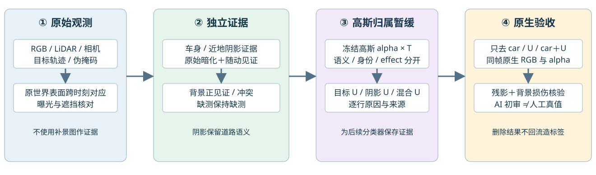

# 车辆残影检测与归属暂缓：独立阴影证据和原生剥离验证

task `WS-V43-TARGET-DETECTION-20261028`；第一场景，run `frozen-evidence-r1`。本轮执行完成，质量未通过；新增训练0步。第三场景保持停止。历史Top3修复分支保留，但不继续用修复图、删除结果或视频教师生成本轮检测标签。

## 已执行算法

1. 在原始RGB、LiDAR和相机位姿上做路面拟合、同世界表面跨时刻对应和曝光对齐；车辆离开后的可见表面提供原始观测参照。掩码/19类语义均为预测，不作真值。
2. 车底/投射阴影为独立effect，不把道路语义改为car。先要求原始暗化、颜色衰减和目标随动的严格种子，再沿有光度支持的路面有限传播；缺随动证据保留unknown，不强行判负。近地实际LiDAR回波与原始暗化另作接地effect候选。
3. 冻结原static/env30K和Actor10K，用原生alpha×T追踪完整Gaussian行贡献。保持语义、实例、原分支、证据与effect分开。重复body投影只是候选提议，并未证明正确车辆归属。
4. 独立背景见证比较实际可见LiDAR表面、跨时刻原始颜色和SH颜色。缺证不反推car/U；混合冲突保留原因。执行baseline、只去car、只去U、去car+U四控制，渲染结果仅作验收，不回流标签。

## 实际结果与方向调整

- 49帧严格阴影候选1861像素；受约束传播3881像素。另存6397个光度支持unknown，其中4377未连种子；数量不是精确率/召回率。
- raw98/113/114接地effect候选67/52/59像素；body伪掩码内5/1/7像素。每点实际最前LiDAR回波距道路平面≤5cm，并重新核对原始光度。仍可能包含轮胎接点，右侧车底仍缺证。
- 4种检测设置×3帧×4控制＝48份原生RGB。宽泛body＋shadow集合整行剥离造成亮洞及道路损伤；只纳入shadow effect时附近道路较稳定，但车底暗残留仍在。不能把宽集合失败单独归因新增contact，因为无contact的body＋photo也已失败。停止扩跑同一失败方案。
- 22305个候选/背景相关原static行的49时刻world(float64)、SH颜色和有效opacity已导出。严格背景保护候选只有1/0/0，命中原U为0/0/0；删除集合不变，跳过重复GPU。颜色不符mixed为39/46/41，不能自动判car。
- 固定query世界点，49源→联合87源（49＋完整199片段外每4帧）稳定原始表面见证508→551、503→556、539→590；新增命中U仅10/0/0。该对照不使用源SH/运动外推，不能替代严格保护。15962个原始颜色观测回放通过。
- 严格保护和覆盖对照均未获得独立完整“无阴影”真值，certified background=0。当前仍不能保证“车影完全消失且背景不损坏”。

## 验证与交付

原检查点未写回，训练0、无inpainting/ProPainter/扩散调用。alpha×T伴随归因闭合检查通过，实际小规模GPU任务均为分钟内冻结推理，没有小时级训练。影像采用完整原生高斯，而网页采样仅影响中心显示。基础检查点已见过这49帧；本轮3个query不是独立未见场景，48份RGB包含重复基线与控制，不计48个独立样本。

原始来源回放、CPU输入契约、216项原生区域副作用统计，以及真实数据Canvas接线完成。gpt-6-luna做AI视觉初审，human_verdict=null。12份最终设置原生结果接入共享第一场景；49帧轴中3帧complete、46帧pending；49帧阴影原始证据在报告可拖动查看。保留79个历史组、原默认组、所有蓝色原始车辆框和橙色目标框；不将pending替换邻帧。browserQA=false，不冒称浏览器手工验收。

本地报告：`outputs/V43_Ownership_20261027/gpu_v43/target_detection_v3/index.html`。共享入口保持`outputs/GS_Scene_Diagnostics_20261027/index.html`。远端完整现场：`/root/autodl-tmp/drivingeditor_repro/campaign/v43_ownership_20261028/unknown_detection_v3`；模型、逐行npz和原生PNG保留在campaign，不入Git。通用远端模板为`persistent_world_20261027/code/diagnostic_templates/v43_semantic_gpu_v2`，有delivery才加载。

## 下一步实验

1. 将Gaussian中心/半径对应换成协方差支撑及实际可见表面关联，单独验证背景保护覆盖；保持缺证状态。
2. 增加车底右侧/接地边缘的独立来源与阴影标注，分车身残影、阴影、真实道路三个评估区域；不把暗色邻近当阴影。
3. 对同一颗Gaussian同时承担目标和道路的情况保存混合支撑，验证贡献可分离性；单纯给整行改标签无法保证安全删除。后续可学习分类器应接收这些证据与冲突，不能接删除结果作真值。
4. 首场景三控制通过后扩到49帧，再冻结全部规则验证第二场景。当前未宣称跨场景泛化或高召回/高精确率。

相关一手工作：[Trace3D, ICCV 2025](https://arxiv.org/abs/2508.03227)使用跨视角实例权重并处理歧义高斯；本轮借鉴保存证据，未复现其训练。[OSDR-GS, IJCAI 2025](https://ijcai.org/proceedings/2025/111)显式建模光照与阴影；本轮据此区分阴影effect和路面语义，未引入其逆渲染训练。

failure_ledger_refs=[V82-F01]；failure_ledger_delta=none。增加同场景表示/数据支持诊断，不据此新造普遍科学失败结论。
