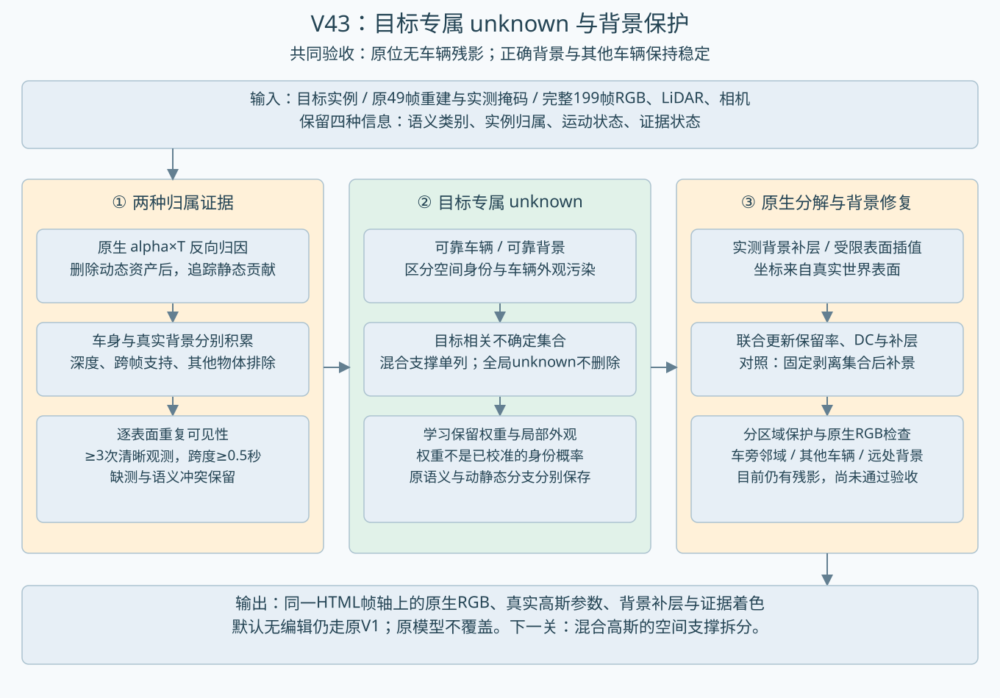

> 最新收尾：[Top 3与延期实验简报](BRIEF.md)。下文为前三组阶段记录；后来两组、最新总账和运动审计以简报为准。原static几何参数冻结不代表世界静止：原分支自带SHM运动；“背景支持”仅指背景深度支持，尚未核验静止。

# V43：目标专属unknown算法与原生剥离实验

目标是删车后RGB中无车辆残留，同时保护正确背景。**本轮尚未通过这个联合验收**。第一场景已完成三个新10K对照，第二、第三没有追加实验。默认无编辑V1输出、原模型和旧结果继续保留。新增结果是实际原生高斯渲染，没有视频生成或贴图覆盖。

## 算法改动

1. 目标相关unknown单独建集合。删除目标动态资产后，使用原生alpha×T的精确辅助通道反向归因，找参与目标车身成像的静态行。全局低置信、缺测unknown不再作为删除集合。语义、实例、运动、证据四字段分别保存。
2. 车辆与背景证据分别积累。车身实测深度、车身掩码、尺度用于车辆假设；避开所有预测车辆/行人与标注物体、真实深度一致、跨帧重复的世界表面用于背景假设。二维语义和高斯中心深度都不是物理身份GT。
3. 混合支撑不强行归车。参与目标成像，同时得到清晰背景支持的行单列；保留几何归属与车辆外观污染的区别。原static分支不自动等于正确背景。
4. 联合调整目标相关静态行的保留率和DC，以及实证背景补层的DC/opacity；其余原高斯、所有原几何、原环境冻结。保留率只是优化控制量，还不是已校准的身份概率。对照组先固定整行剥离集合，再拟合同一背景证据。
5. 背景保护按目标邻域、其他车辆、整片外域分别归一化。49帧pilot的整图均值会掩盖局部损伤，正式199帧证据实验使用分区保护。监督参考是原删除动态资产后的RGB；也可能保留其已有错误，因此不能当干净背景GT。

## 输入证据与边界

完整第一片段实际读取199帧，保留原始CRC、相机、时刻和LiDAR关系；并非把原生重建偷偷改成199帧。原重建与查询仍为49帧，33帧优化、16帧校准检查；基础重建见过这些49帧，199帧背景记忆也使用整段，因此没有独立泛化测试。

追加帧的SegFormer-B0输入为480×320，原49帧沿用旧预测不变，其预处理来源1920×1280；这是显式记录的证据预处理差异。语义模型冻结，没有训练分割器。标注框只用于排除可能前景，不能证明剩下的高斯一定是背景。

发现全片段固定分段会随片段长度改变资格，正式背景表面规则改为：至少3个清晰帧、每个世界表面的观测跨度至少0.5秒。旧全局分段结果保留作审计，没有通过放大unknown强求减少残影。

三角形插值仅在重复实测点包围的近水平表面内使用，最长边1米、法线竖直分量大于0.95，不外推。插值色彩和位置不是新增实测；其查询遮挡检查只覆盖这些表面，不能冒称完整场景GT。这组增加几何密度，不代表未见背景已经有观测。

## 原生剥离结果

目标相关静态候选 27,642 行，捕获原车身域静态贡献约 99.50%；背景重复支持 7,491 行，其中与目标混合 1,235 行。严格纯车辆候选 0 行。零不是‘静态里没有车’，而是当前条件没有证明整行纯车辆。

整颗删除目标相关unknown仍产生明显背景破坏；加背景深度保护也不能解决混合支撑。联合优化减轻部分车身外观，同时比固定整行删除保住更多背景；原位暗色/结构残留仍可见，其他区域仍有变化，没有采纳为最终算法。需要进一步处理混合高斯的空间支撑，不能把同一行的所有像素贡献一起搬走。

|组|新增步数|补层高斯|16帧检查：保护区改变像素数/帧|raw113保护区改变像素|
|---|---:|---:|---:|---:|
|split199|10000|692|35555|41863|
|joint199|10000|692|10276|16907|
|joint_dense199|10000|6080|10049|16144|

改变像素指三通道平均绝对变化超过1/255；保护域为原车身外扩8px之外。它衡量改动影响，不是背景正确率；这里也不能替代车身残影的逐帧目视检查。

## 额外因果诊断：共享支撑与环境回填

目标相关候选整体可见贡献只有 12.85% 落在车身域内，其余在域外；这不是‘其余一定属于可靠背景’，但说明整行删除会同时作用于大量其他像素。当前优化只调整整行保留率和DC，尚未拆开混合高斯的空间支撑。

原环境图查询中出现约−12到+11的颜色值。raw113整颗剥离上界图有 8629 个超亮饱和像素，其中 6966 个由环境回填项的绝对贡献主导，约 80.7%。环境项按 (1-alpha)×env 实际分离；去掉或限制环境回填的图保存作因果对照，未采纳为修复。不能把全部白色/彩色破洞直接当成道路几何缺失，也不能直接clamp后宣称背景正确。

## 交付与验收

共享工作台新增6组，原生RGB与真实静态保留率、DC变化和背景补层几何对应。V2证据着色：橙=目标相关未分清，紫=目标/背景混合，蓝=重复背景支持，灰=此目标之外，青=新增背景补层（语义仍unknown）。这些是目标相对的证据状态，不替代19类语义编码；旧语义与旧owner没有被学习权重覆盖。橙框标为原位参考，其他原始车辆蓝框保留。

正式3×10K；49帧pilot为2×1K；各轮save/eval/完整状态恢复与下一阶段入口smoke额外650更新单列，合计32650更新。199帧正式组与插值组实际原生RGB恢复差0；早期pilot检查模型/优化器状态与RNG恢复，未保存RGB恢复对照，不冒称检查项相同。分钟级实验，未启动小时级长跑。并行最多两个已登记子进程持有全局GPU租约。权重和原数据保留远端，取回图像、参数与SHA清单，未下载checkpoint。

未证明联合优化在普遍场景优于强流水线；本轮固定剥离基线较弱，不能代替最强分解方法比较。failure_ledger_refs=[V82-F01]，failure_ledger_delta=none。
