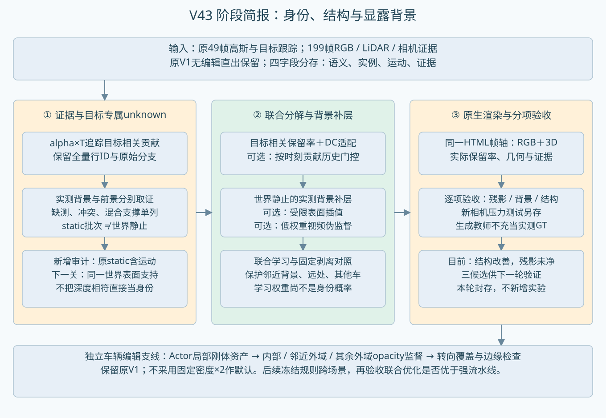

# V43 阶段简报｜2026-10-28

本轮按要求收尾，不再新增实验。**车辆局部结构和转向已改善；目标专属unknown仍未同时做到“RGB无车影、正确背景不破坏”。** 以下Top 3是继续研究的候选排序，全部尚未验收通过。保留原V1无编辑主通路、旧模型、坏例和对照。

## Top 3：按残影与背景保护的综合观察排序

|顺位|候选|实验ID|改了什么|当前判断|
|---|---|---|---|---|
|1|按时刻软归属＋联合优化＋视频先验|conditional_joint|按时刻贡献历史控制目标相关保留率/DC；联合学习背景补层，低权重ProPainter伪监督|保护区改动最少；仍有原位暗残影。时间门控与教师同时改变，收益未拆开归因。|
|2|受限插值背景＋联合优化|joint_dense199|目标专属unknown保留率/DC与背景联合优化；背景由重复实测表面内插值加密|无视频先验；相对第3项收益有限，增加补层数量，仍有灰雾与暗残留。|
|3|直接实测背景＋联合优化|joint199|只用重复实测点建补层，优化目标相关行的保留率/DC与补层|最简单、无视频先验，适合保留作后续可迁移性基准；仍有残影和域外变化。|

排序参考raw98/113/114同帧目视及背景影响，**不能理解为残影已去净或第1项所有维度最好**。原位暗残影三项均在；第1项减少域外改动，第2与第3的差异较小。按时刻固定硬剥离与逐帧75%控制仍暴露亮色环境伪影，保留作失败对照。

|候选／对照|16帧保护区改变像素/帧|raw113保护区改变像素|新增背景高斯|
|---|---|---|---|
|conditional_joint|3143|5612|6080|
|joint_dense199|10049|16144|6080|
|joint199|10276|16907|692|
|conditional_split|3762|7214|6080|
|split199|35555|41863|692|

改变像素：原车身外扩8px之外，三通道平均绝对变化>1/255；仅是改动范围，**不是背景正确率**。33帧优化、16帧校准检查；基础重建和199帧记忆已见这些数据，视频教师也见其31帧，不能称独立泛化留出。raw113属于训练帧。

## 算法、证据与调参分列

|改动|性质|实际实现／参数|可迁移性与限制|
|---|---|---|---|
|目标专属alpha×T归因|算法|从原生可见贡献找目标相关行，未把全局unknown全删；2D语义、实例、运动、证据分别存|依赖掩码和原生渲染器辅助通道；换case可复用，物理身份正确性未证明|
|软保留率＋DC＋补层联合优化|算法|联合调整候选行opacity保留率/DC与新背景层，其他原参数冻结；保留率不是身份概率|逐场景优化，尚不是可直接迁移的unknown分类器|
|按时刻贡献历史门控|算法|原49帧目标贡献比例，邻近±1帧中位平滑；时间变化的保留率和DC幅度|不输入case ID，但依赖源视角；新相机沿用同一时刻门控，未证明视角无关|
|分区域背景保护|算法＋损失权重|邻近外域、其他车辆、其余外域分别归一化；总保护权重2|代码不绑定本case；保护参考仍含原模型错误，不能代表干净背景GT|
|199帧实测背景记忆|证据构建＋规则参数|排除预测前景与标注物体；10cm体素、≥3帧且跨度≥0.5秒；直接补层692颗|199帧是背景证据，原生查询仍49帧；当前5raw-frame跨度依赖10Hz，泛化前须改实际时间戳|
|受限道路表面插值|几何构建＋规则参数|最长边1m、法线竖直分量>.95、只在实测包围三角形内；补层6080颗|非外推；插值位置/颜色不是新增实测，不能保证未见背景正确|
|ProPainter低权重教师|外部先验＋权重参数|沿用旧固定结果，31帧可用；权重.25，仅原修补mask且排除真实背景监督像素|最终交付仍为原生高斯渲染；训练依赖生成伪监督，不能当真实身份或背景GT|
|逐帧硬剥离纯度阈值|诊断规则／调参|当前帧目标贡献比例≥.75或.95时整行抑制；固定剥离组使用.75|减少域外伤害但亮色环境泄漏、残影仍明显，未采纳|
|Actor局部刚体与有界结构|车辆表示改动|实测目标点初始化，局部结构约束，随统一刚体轨迹编辑|3D形状与转向明显改善；表示、容量及损失同时变化，不能只归因身份规则|
|车身内／近外／远外opacity监督|算法＋损失权重|内.05、近外.025、其余外.025；带宽clip(round(.1√车身像素数),2,12)|同起点冻结几何与颜色；核心alpha .9301→.9396，边缘.5841→.5489；跨场景待验|
|固定密度×2、共享MLP、环境clamp|诊断对照|密度×2核心更深但边缘也更厚；MLP无额外收益；clamp仅定位环境泄漏|均未设默认，也未作为已验证的归属修复|

## 本轮最关键的新诊断

原代码的static批次允许逐高斯SHM运动和时间opacity门控，并不等于世界静止背景。27,642个目标相关候选中，25,413个在时间门控有效的采样时刻位置跨度>10cm；此前7,491个“背景深度支持”行中，6,569个也超过10cm。这里的有效仅指时间门控>.05，不等于相机中实际可见。页面中world_static描述已更正；旧试验标签不追溯篡改，蓝色改称“背景深度支持（未核验静止）”。

候选全视图贡献约12.85%落在目标车身域；其余不能自动当正确背景，但整行删除会牵连大量域外成像。原环境存在带符号和超范围颜色，删除opacity后通过(1-alpha)×env暴露；raw113整行剥离上界图中约80.7%的超亮饱和像素由环境项主导。因此白洞不能全部归因于道路几何缺失。

这些发现要求下一轮把“分支名”“世界运动”“几何归属”“车辆外观污染”分开。当前保留率只是优化旋钮，不是学成的实例归属概率，也没有把unknown分类问题解决。

## 暂存实验与验证清单（本轮不执行）

|优先级|待做项|验收目的|
|---|---|---|
|P0|重做运动一致的背景证据|分开原static批次与真实静止；跟踪同一世界表面，不能把同一行的多帧深度支持当静止证明。|
|P0|混合高斯支撑拆分|区分车辆几何、背景几何、车辆外观污染；验证拆分能去残影且不切掉背景。|
|P0|拆开时间门控与视频教师|固定数据、步数与初始化，完成有／无门控×有／无教师对照，不能把当前组合收益归给某一组件。|
|P1|环境回填的有效性|在匹配覆盖率下比较原环境与受限回填；同时验收颜色、曝光、几何，不能用clamp掩盖缺陷。|
|P1|更强的先分解后补景基线|使用相同背景证据、教师和计算预算；现有硬剥离较弱，尚不能证明联合优化普遍更优。|
|P1|冻结规则跨场景验证|先第二场景；停止逐case调参，核验残影、其他车辆与道路保护。第三场景继续暂缓。|
|P1|新相机／时间／编辑幅度解耦|补匹配原模型对照与可见真值；当前±0.5m仅压力图。固定幅度跨时间、同时间多幅度分别比较。|
|P2|可学习unknown归属|先人工验收可靠正负样本和混合支撑，再造数据训练；另设校准和独立场景测试。|
|P2|车底与阴影|车体身份与路面光照效应分开；按此前约定暂缓。|

## 执行、复现与收尾

本轮unknown实验为5个独立10K分支，共50,000正式更新；pilot额外3,000，smoke与恢复额外980，合计53,980。不是一个模型顺序训练50K。早期三组与最后两组分别保留，同起点的正式分支不从smoke续跑。最后两组均完成100更新smoke、保存/评价、完整状态恢复再10更新及下一入口，原生RGB恢复差0。此账不包含前一批车辆结构与opacity试验。

正式权重保留AutoDL，15个正式checkpoint已计算SHA；两批交付包均验证归档及逐文件SHA，没有下载模型。第一场景HTML已接入新增按时刻联合/固定剥离与75%/95%诊断，左右RGB与3D使用同一时刻的实际参数。19类语义编码保留：0 unknown；1 road，2 sidewalk，3 building，4 wall，5 fence，6 pole，7 traffic light，8 traffic sign，9 vegetation，10 terrain，11 sky，12 person，13 rider，14 car，15 truck，16 bus，17 train，18 motorcycle，19 bicycle。V2证据颜色独立：橙=目标相关未分清，紫=混合，蓝=背景深度支持未核验静止，灰=此目标之外，青=新增背景补层（语义unknown）。

新相机±0.5m图只作压力测试；无GT及匹配原模型对照，残影和周围车辆重边仍可见，不支持新视角泛化结论。页面经真实Canvas运行与本地路径/图像校验；浏览器file协议访问受工具限制，未声称完成浏览器交互验收。

已暂停新实验入口，第二未追加、第三继续暂缓，旧队列和心跳未恢复。Git提交、取回验证和最终资源状态另见收尾回执。failure_ledger_refs=[V82-F01]；failure_ledger_delta=none。
