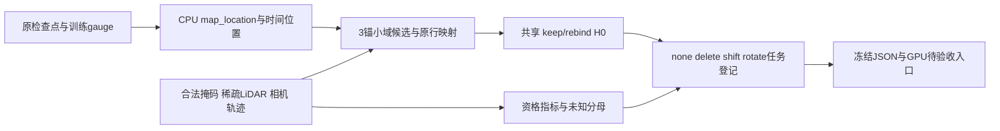

# V43 R4 CPU入口

本包只做真实检查点CPU读取、合法候选冻结、任务登记与共享动作域结构枚举。没有原生渲染、奖励查询、模型训练或编辑成功结论。



候选半径固定0.25m，为本次局部域工程定义，不是校准过的资格阈值。最多3个首次命中来源组，每组二元动作；组外和原生动态行保持原绑定。`defer`只在查询层。

仿真保留原合同的`simulator_sensor_oracle`角色；原M0和hybrid8属于同一个已有开发世界。真实首场来自reviewed DEVA关联、注释辅助目标轨迹与实际LiDAR行，不能称无注释部署方案。历史GT类别账本只验证原始行映射，不进入候选筛选或资格。

资格阈值均为null。`f_geom`需要完整静态+动态原生贡献，`f_bg`需要历史世界射线对应；本轮均unknown。`f_view`仅是12扇区合法视向代理，`f_motion`仅检查CPU相机/轨迹字段。原生Scene恢复、两种none与编辑渲染仍为E0 GPU gate pending。

```bash
env CUDA_VISIBLE_DEVICES= OMP_NUM_THREADS=1 MKL_NUM_THREADS=1 OPENBLAS_NUM_THREADS=1 NUMEXPR_NUM_THREADS=1 \
 /root/autodl-tmp/envs/motionproj/bin/python scripts/worldsim_v82/v43_ownership_20261028/v43_decision_r4/prepare_cpu.py --output NEW_RUN_DIRECTORY
```

输出目录必须不存在，重复运行使用新run ID；不会覆盖旧现场。相同环境下运行`test_cpu_contract.py --run NEW_RUN_DIRECTORY -v`验收合同和真实冻结结果。所有未渲染loss、D/C数值和人工结论保留null。
