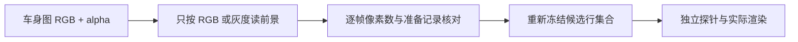

# V82-F07：RGBA 透明度被误判为车身前景
<!-- metadata: {"title":"RGBA透明度被误判为车身前景","defined_ids":["V82-F07"],"referenced_ids":[],"versions":["V82"],"topics":["engineering","mask-semantics","input-validity","evidence-boundary"]} -->

类型：工程 / 输入语义。R4 新增的 CPU 候选构造和探针读取车身图时，把 RGBA 任一非零通道当成前景；不透明 alpha 因而将背景也纳入车身，改变候选集合和后续查询域。这是输入接线错误，不能据此判定 D/C 方法失败或安全动作不存在。

错误输入影响两组模拟场景原 CPU 候选域及其后续各 96 张、共 **192 张**模拟 route/edit 输出；旧结果保留但不用于科学结论。修正后两组模拟场景分别为 **4,445** 和 **30,024** 候选行。真实场景使用二维布尔车身输入，候选 **2,703** 行，前后未变；不得将模拟故障扩展为真实输入失效。原生恢复与合成器一致性检查与该错误候选域分开记录。

最强控制是原始训练输入链路的独立复核：**32 帧、96 张训练掩码 PNG、32 次继承加载器实际 CPU 调用**均与准备记录一致；原模拟训练检查点不因本次新增读取错误而失效。此项不声称所有后续编辑效果通过，也不将机械核验当人工视觉验收。

适用教训：按实际图像模式定义前景语义；RGBA/LA 的透明度不可自动并入目标掩码；在真实输入上核对逐帧像素数与修正前后集合，再讨论候选域和下游输出。旧失效记录与修正结果均保留。

- [输入有效性及替代关系](../input_validity_and_supersession.json)
- [独立掩码纠错](../independent_review/input_mask_independent_correction.json) · [错误边界](../independent_review/input_mask_erratum.json) · [原训练链影响核验](../independent_review/original_sim_training_mask_impact_audit.json)
- [工程失败记录](../engineering_failures.json)

`failure_ledger_refs: []`；`failure_ledger_delta: V82-F07`；`human_verdict: null`。
