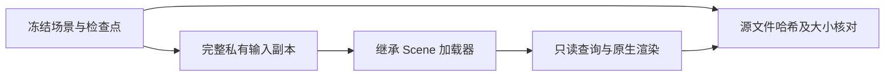

# V82-F08：只读查询调用继承加载器时写回源坐标矩阵
<!-- metadata: {"title":"只读查询调用继承加载器时写回源坐标矩阵","defined_ids":["V82-F08"],"referenced_ids":[],"versions":["V82"],"topics":["engineering","input-immutability","scene-loader","recovery","evidence-boundary"]} -->

类型：工程 / 输入完整性。R4 只读探针调用继承的 Scene 加载器时，加载器将坐标规范化矩阵写回源目录，导致冻结源矩阵哈希改变。该次尝试在原生渲染前被检查拦截；不能说源文件从未被触碰，也不能将此故障当作 D/C 方法失败。

恢复时先按原生写入格式重建矩阵，并在写回前核对原有 SHA；随后恢复原始修改时间。重放改用完整私有副本承接加载器的写入，不让加载器写入冻结源。恢复后对 **250 项冻结输入**逐项复核，内容 SHA 与大小全部一致，修改时间差异列表为空；这是恢复后的验收结果，不抹去先前写回。失败和恢复记录保留，失败尝试未发布耗时，因此不补造时间或算力成本。检查点未修改。

适用教训：标称只读的调用也应审计被调用加载器的文件副作用；对会写入的输入先建立完整私有副本，并对源输入记录和核对哈希、大小及需要保留的时间信息。单靠查询方不显式调用写操作不足以证明输入不可变。

- [工程失败及恢复记录](../engineering_failures.json)
- [恢复后冻结输入逐项核验](../frozen_input_immutability_audit.json)
- [输入有效性与替代关系](../input_validity_and_supersession.json)

`failure_ledger_refs: []`；`failure_ledger_delta: V82-F08`；`human_verdict: null`。
