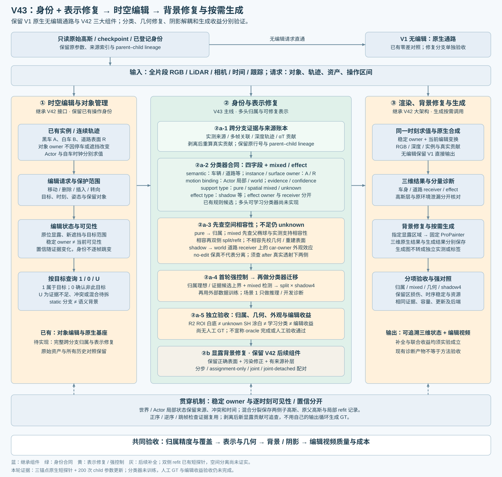

# V43 身份与表示修复实验合同

Revision 3，2026-10-30。本次更新保留原生 V1 无编辑通路和 V42 的时空编辑、背景修复、按需生成三大组件。V43 主线是身份与表示修复：可靠分类负责回答“是什么、属于谁、随谁运动、证据如何”，混合支撑、错误几何和阴影效应另有对应修复。已有 V42、R15 与历史诊断均保留；本轮新增证据为三锚点原生短探针及200次child radiometric参数更新，分类器未训练，空间分离与编辑收益未获证明。本文档生成操作本身不执行训练。

## 1. 继承的大架构与方法边界

|层级|保留的能力|本次设计补充|实现标志|
|---|---|---|---|
|V1 原生基座|无编辑请求直出原生重建；原 checkpoint 不覆盖|继续作为所有修复与编辑的固定对照|已有；既有31帧零差对照见 [BADCASES](LOCAL_WORKSPACE_REFERENCES.md)|
|V42 时空编辑|对象与自车时钟、轨迹、移动/删除/插入/转向、保护范围|查询稳定 owner，分别求值可见性和置信|框架已有；完整跨分支归属待实现|
|V43 身份与表示修复|多帧实测、原生可见贡献、已有操作身份与诊断候选|四字段 + mixed/effect 输出，按类型分流到归属、split/refit、几何校正、外观解耦|统一多头分类与修复链待实现|
|V42 背景修复与按需生成|正确表面保留、显露区修复、固定 ProPainter 接口|先检验三维归属/表示，再比较分步与联合；生成图单独保存|已有框架与旧对照；V43收益待验证|

无编辑、原生编辑、三维修复和视频生成分开留存。同一时刻和请求下比较，不能把生成后更像的画面当作三维归属正确的证明。现有三场景原生 GN11 入口逐场只接一个动态资产；它不是完整多实例实现。

## 2. 五个卡点与对应组件

|卡点|要回答的问题|修复与控制|证据边界 / 实现标志|
|---|---|---|---|
|一颗高斯混合多个空间表面|投影双域支持是否与父椭球的三维空间支持相容？|先检查父椭球与实测支持；相容且有空间证据时才保留双侧split/refit，不相容转几何校正或重新表面建模|已有短split/refit探针；投影混合不等于空间可分，禁止只拿质心中分面硬切|
|归属准确但几何错误|高斯确属车，却在深度、尺度、轨迹或 canonical 位置上错误？|在确认 owner 后做 Actor canonical / 实测深度 / 跨帧轨迹校正；记录位移、尺度、覆盖与保留区损伤|归属提升不等于结构正确；已有 Actor 局部结构探针不等于此统一修复已完成|
|车底阴影与旧外观耦合|暗色来自车身、道路上的车辆效应，还是原环境泄漏？|道路几何是 world road receiver；shadow 是 car-owner effect，外观与几何解耦；原环境泄漏单独诊断|不把道路整体归车并搬走；shadow4 与去旧/生新影待实现|
|候选漏召回|目标允许范围内，剥离后是否有新显露的真实贡献？|固定允许域、相机和请求；每次剥离后用真实透射重新求贡献，追查 gate/范围/阈值遗漏并记账|可做证据候选上界；不得把自己的 after 输出循环生成 GT；现有归因诊断不等于语义真召回|
|跨帧归属不稳定|同一物理对象是否因为遮挡或缺测而换 owner？|稳定 owner 保存在世界/Actor局部状态；当前可见性、遮挡、有效期与置信独立更新|不可见不自动改非目标，低置信也不自动改 owner；完整状态链待实现|

空间混合与外观效应可以同时存在。先分清接收表面和空间支持，再处理其上的 shadow；不能把所有暗色或所有 unknown 一律当作 spatial mixed。

## 3. 分类器与可修复表示合同

每个高斯保存 semantic、instance/surface owner、motion binding、evidence/confidence 四类独立信息，加 support type 和 effect type。字段各自允许 unknown；一个字段未知不抹去其他已核验信息。设计侧车文件见 [ownership_record_contract.json](ownership_record_contract.json)，尚未声明所有 checkpoint 已迁移。

|输出|内容|例子 / 不变量|
|---|---|---|
|semantic|车辆、道路、建筑、植被等类别及未知|确定是车但不知是哪辆时，类别保留|
|instance / surface owner|物体实例或世界表面身份|Actor A、Actor B、Road R；static渲染批次不等于语义背景|
|motion binding|Actor canonical / world frame、姿态与有效期|停放车辆仍有对象身份；道路 receiver 绑定 world|
|evidence / confidence|实测来源、重复支持、缺测、冲突、相关组、校准与拒判|规则分数不是校准概率；生成图不是新增独立实测|
|support type|pure / spatial mixed / unknown|pure才可直接给归属；混合支撑需拆表示|
|effect type|none / shadow / unknown等，另记 effect owner 与 receiver|shadow：effect owner=A，receiver=Road R，几何不随 A 移动|

处理路由：pure → 可靠归属；投影双域候选 → 先查父椭球与实测支持相容性，不能直接命名为已确认spatial mixed。具有空间证据且相容时才保留两侧子高斯 + 局部 refit；不相容则进入 canonical/深度/轨迹校正或重新表面建模。shadow走外观效应解耦，证据不足/冲突或编辑后未能分离时继续unknown。q(i,k)∈{1,0,U} 仅是针对目标 k 派生的查询：0 表示确认非此目标，可属于另一辆车；它不是背景类别。

稳定 owner 与逐时刻状态分存。当前帧不可见或缺测时保留先前已核验 owner，并降低当前观测置信、记录不可见原因；新冲突进入证据账本，不按单帧预测来回覆盖。正序、逆序、跳帧及同一时刻不同编辑幅度分别控制，生成结果不能递推成自己的实测依据。

原始高斯、checkpoint、legacy_render_assignment、实测索引和已有 lineage 保留。新 split 用独立 child ID，保存原父行号、两侧支持、切分/初始化参数、refit 配置及前后贡献。局部 refit 只更新登记范围与参数；不以覆盖原模型换取“修复”。矩匹配可作初始化，但不宣称逐像素 alpha、排序或 RGB 严格守恒；必须实际重渲染检查两侧和保留域。

## 4. 四类产物必须分清

|产物 / 操作|能说明什么|不能说明什么|
|---|---|---|
|现有 R2 ROI 白底诊断|在指定相机、时刻、允许域中查看限定输出与原生分量，检查域外保持和来源|R2不是语义GT；白色像素不是已知道路/背景标签，也不代表归属完成|
|unknown SH 涂白|既有unknown-white已完成6组204个group/frame原生CUDA重渲染，观察同一unknown集合的颜色影响；本轮设计修订未重跑|改颜色不建立owner，不清几何/遮挡，也不证明候选纯净；与ROI显示白底分开|
|可学习分类器|从具备合法来源的数据学习四字段、mixed/effect与拒判，再固定参数迁移推理|不能把R2、规则候选或after暗像素直接当真值；本轮设计没有训练该分类器|
|实际编辑收益|在相同观测、表示容量与预算下，核对删车/平移/转向的残留、背景损伤、结构和时序|候选数量、框内率、alpha归零或白底效果不能替代编辑质量验收|

现有 [召回上界与after贡献](LOCAL_WORKSPACE_REFERENCES.md) 和 [限定ROI白底诊断](LOCAL_WORKSPACE_REFERENCES.md) 保留为诊断证据。R2凭据的白底公式为ROI内 G_after + (1-alpha_after) × white；原环境checkpoint未改，labels_for_training=false，human_verdict=null。它不是unknown高斯SH改白的凭据。剥离后真实贡献追查可揭示新显露高斯；暗像素/环境负值仅是查询和来源线索，不直接成为车辆或阴影真值。固定域内高斯贡献归零不等于语义召回100%，环境项也不能全部称为旧车辆影。

**既有unknown-white单列：** 2026-10-30的[白材质原生对照](LOCAL_WORKSPACE_REFERENCES.md)已完成场景1六组204个group/frame：Actor10K重建49帧，no-edit、删车、横移1m、左转15°、横移3m各31帧。该任务只改同帧unknown行的SH颜色，保留几何、opacity、时序、原环境和原始模型；训练更新0，labels_for_training=false，人工verdict仍为null。它已完成的原生渲染/行ID与数值核对不等于人工语义质量验收，也不证明可学习分类或编辑归属成功。本次设计修订及新的三锚点可编辑归属探针未重跑这204帧，不能把既有完成项写成待执行，也不能将其计算计入本轮。

## 5. 数据角色与场景 1

场景 1（14705303724557273004_3105_000_3125_000）用于分类器推理和开发诊断，**不训练该分类器**。先在外部数据训练，冻结模型后迁移到场景1；在此检查归属、mixed、effect和表示修复。任何需用场景1调参或人工反馈的改动均记作开发使用。已有原生重建、Actor/opacity结构探针已使用该场景观测，因此不能把场景1称作整个方法的未见测试。

训练标签应来自外部真实标注、独立核验的实测种子及保留来源的构造扰动。可对已核验种子施加遮挡、深度/坐标漂移、邻车混入、缺帧和长椭球扰动，保留构造身份和权重。规则预测、自己生成的图、自己剥离后的残影均不能无条件转成 GT。尚无人工GT时，先报告证据覆盖、冲突、unknown和条件性干预结果；不报不存在的人工语义精确率/召回率。

训练/验证按物理场景与供体隔离；同一车辆、相邻帧、同一构造副本不跨集合泄漏。U不当负例，混合支撑不强行压成单一owner；缺少实测的新侧面继续未知。外部数据上的分类结果、场景1的推理诊断和后续编辑收益分别报告。

## 6. 首次实验顺序与强控制

### E0：冻结原生与可追溯入口

先保存 V1 无编辑、V42 编辑、原高斯/检查点/轨迹/环境与候选版本。固定相机、时刻、目标允许范围、目标/保留对象、更新预算与评价域；保留 before/after 原生重渲染和高斯/环境分量。已有CPU规则和后续GPU证据属于不同版本，不合并成同一批标签。

### E1：归属理想 / 证据候选上界 + 混合检测

先问“若归属信息足够好，当前表示是否能支持编辑”。有独立人工或构造真值的子集才可作为归属理想控制；没有该真值的现阶段只做**证据候选上界**。人工GT尚未形成，不宣称 oracle 已完成。

在目标允许范围内列出 pure、spatial mixed、effect与unknown；保存判别证据及未覆盖区域。仅归属控制与原表示对照，检查准确归属后仍有的错几何和混合支撑。候选漏召回允许按剥离后的真实alpha×T重查：范围/gate/阈值变更逐项登记，after查询不反写GT。没有已知分母时，不把干预覆盖叫作语义召回率。

### E2：先查空间相容性，再做局部双侧 split / refit × shadow4

E2首先核对当前父高斯椭球与两侧实测支持的三维相容性：记录世界坐标/协方差、父中心到观测质心的Euclidean与Mahalanobis距离、切面标准化距离a及跨时刻支持。观测质心是贡献加权的深度像素反投影点云质心，不是真实表面或GT；两质心同时落入≤3σ椭球只是描述性counter，不是已证实的通用接受阈值，不为制造可拆行而调门限。**投影混合不等于空间可分，禁止只拿质心中分面硬切。**

不相容候选进入几何校正或重新表面建模，保留原父高斯及unknown；相容且有空间证据的候选才比较原表示、仅归属、保留双侧split、双侧split+局部refit，必要的整行处理仅作损伤对照。固定同一实测证据、共同优化参数和预算，子高斯数量及额外计算显式记账。另以相同owner做canonical/深度/轨迹校正对照，隔离几何修复贡献。

no-edit refit保真通过只能说明该重建查询下的拟合保持。随后必须在actor移除、R2删行等编辑状态下重新计算真实排序与透射，检查两侧贡献是否按假设分离、道路/背景是否保留；不能沿用intact权重。恢复验收、数值收敛或原画面变像均不能替代这个检查，未通过分离则保持unknown，不授予最终编辑归属。

**本轮短探针证据：** [三锚点原生探针、空间相容性与child refit](LOCAL_WORKSPACE_REFERENCES.md)记录raw98/113/114分别有452/777/810个投影双域候选，双观测质心同时≤3σ的描述性计数均为0；raw98 top8初始化全部触发tiny_tail_mass。该结果提示当前质心/切面与父椭球的空间相容性不足，不能推出场景不存在真实空间混合，也不能直接生成行级归属或删除标签。

raw113的7个父高斯/14个child已完成200次radiometric参数更新，checkpoint200零新步恢复验收通过。按当前假设分边的原生可见贡献匹配份额在actor存在时为67.43%→71.34%，actor移除后为39.76%→38.51%；这不是语义准确率或编辑质量指标，后一个状态未见分离改善。因此本轮只支持短程执行/保真路径的验证，不宣称已解决空间分离、分类或编辑收益；分类器训练更新为0。

shadow4 固定为下列四种开关，检验车身几何与道路上的effect能否独立控制：

|车身|车辆阴影effect|用途|
|---|---|---|
|开|开|原始重建对照|
|关|开|只关车身，保留影|
|开|关|只关阴影，保留车与无影路面|
|关|关|两者都关，目标删除|

道路receiver的world几何在四档中保留，shadow effect归车辆owner。若无真实无影路面观测，则其干净外观是待验证估计，不能冒充GT。原环境泄漏继续独立分解，不由shadow开关掩盖。平移/转向另加“去旧影 + 按新姿态生新影”控制，并分别记录去旧、生成新影和接收面保护；shadow4本身不等于已完成重光照。

### E3：外部数据分类器训练与迁移

E1/E2先检验表示与可达收益，再建立可学习分类器。外部数据训练多头输出与拒判，先核验外部独立验证上的准确率—覆盖、校准、mixed/effect及混淆；然后冻结参数到场景1只推理。记录跨域退化与unknown，不能用场景1训练后再称迁移。分类器消融与split/几何/effect消融分开，避免把表示修复收益全归给分类。

### E4：回接 V42 背景修复与按需生成

归属、混合和几何达到约定门槛后，再在同初始化、合法观测、参数容量、总更新/采样次数和视频后端下比较 staged、assignment-only、joint、joint-detached；补充分解阶段单独收敛的强流水线。原生三维结果先验收，再比较固定生成后端。联合优势未成立时接受负结果。

## 7. 验收与执行约束

归属报告字段级准确率—覆盖、拒判、冲突与alpha×T加权错误；人工GT缺失的区域单独列unknown，不填写人工verdict。混合报告检测覆盖、两侧保留与拆分前后误伤；几何报告实测深度/轨迹一致性、尺度和结构；effect报告shadow4独立性、道路receiver保持、原环境泄漏和新姿态影。编辑报告残留、保留对象/背景损伤、正逆序/跳帧稳定与成本。没有新侧面GT时不报虚构编辑PSNR。

一小时及以上正式实验前须在真实环境完成约10分钟smoke，并覆盖前后向、finite loss、显存、数据加载、checkpoint保存、评价、完整状态恢复和下一阶段入口。CPU测试不替代真实smoke；额外smoke与必要重放开销单列，正式采样、学习率与步数预算保持登记合同。当前文档更新不启动上述实验、远端服务或旧队列。

## 8. 一手依据、迁移点与限制

以下是组件依据与本项目的设计推论，不是这些论文已经验证了V43。

|一手来源|可迁移点|必须保留的限制|
|---|---|---|
|[SceneSplat](https://arxiv.org/abs/2503.18052)|Masked Gaussian Modeling与3DGS表示学习，可作为外部分类特征/预训练参照|主要是室内场景理解；不是动态实例编辑，也不直接解决mixed高斯的RGB修复|
|[COB-GS](https://arxiv.org/abs/2503.19443)|边界自适应split后恢复RGB，支持“分类不足时修表示”的路线|静态3DGS分割；需新增动态归属、双侧保留与编辑验证|
|[EVSplitting](https://orca.cardiff.ac.uk/174775/1/3680528.3687592.pdf)|三维切面两侧的矩匹配可参考为子高斯初始化|不是逐像素RGB或alpha严格守恒；仍须局部refit与原生合成检查|
|[LumiMotion](https://arxiv.org/html/2604.10994v1)|动态2DGS中静态表面的时变颜色与逆渲染分影，支持几何/外观分离思路|表示、监督和任务不同；不能直接套用为道路旧影已清除|
|[DecoupleGS](https://arxiv.org/html/2608.01761v1)|canonical车辆与道路receiver上的接触影，可参考effect owner / receiver组织|接触影生成不等于清除旧影或原环境泄漏；需本项目单独验证|
|[OP2GS](https://arxiv.org/abs/2605.20044)|实例mask opacity与RGB opacity分开，提示身份占据和视觉存在需区分|mask分支变干净不表示RGB纯化，不替代mixed split或旧影清理|

## 9. 已有证据与待实现标志

|组件 / 主张|标志|依据 / 剩余缺口|
|---|---|---|
|V1无编辑通路与V42编辑、背景修复和生成框架|已有并保留|原模型、旧接口与历史对照保留；不得声称所有组件已达质量验收|
|CPU 49帧保守候选、GPU语义/贡献和Actor/opacity结构探针|已有独立产物|[原始CPU候选](LOCAL_WORKSPACE_REFERENCES.md)、[GPU实验](LOCAL_WORKSPACE_REFERENCES.md)；规则/分割预测不是GT|
|R2 ROI白底、召回上界和高斯/环境来源诊断|已有诊断|[限定域](LOCAL_WORKSPACE_REFERENCES.md)、[after归因](LOCAL_WORKSPACE_REFERENCES.md)；不能推出语义GT或完整编辑收益|
|同帧unknown SH白材质原生重渲染|既有6组204个group/frame已完成；本轮未重跑|[独立报告](LOCAL_WORKSPACE_REFERENCES.md)；0训练，不构成语义GT或最终归属验收|
|四字段+mixed/effect的统一可学习分类器|待实现|本次未训练；场景1仅推理/开发诊断|
|完整checkpoint字段迁移与parent–child账本|设计合同 / 待迁移|原始模型与已有lineage保留，不把SGCM局部lineage当全历史真值|
|三锚点原生短探针与局部child radiometric refit|已有：三锚点、raw113 7父/14child的200次更新及零新步恢复验收|[本轮证据](LOCAL_WORKSPACE_REFERENCES.md)；投影混合≠空间可分，未训练分类器|
|空间相容的双侧分解、canonical/深度轨迹校正、重新表面建模、shadow4|统一修复与强对照待完成|no-edit保真不等于编辑后分离，after真实透射下未通过则unknown|
|人工语义/实例/effect GT与人工验收|未完成，verdict保留null|不得填写oracle完成、人工通过或GT精确率|
|V43端到端编辑收益与联合优势|待验证|分开分类、表示、三维修复和视频生成贡献|

早期49帧CPU审计的0个候选1结果与阈值原样保留：opacity≥.005、时间权重>.05、最大主轴sigma≤.2m、中心与同像素最近实际回波≤.15m、2sigma投影半径离车身内边界≥2px或目标外边界≥8px、同类≥3帧且跨≥2时间段、无反向证据。它是训练后30K高斯的历史保守候选，不是已完成的V43实测种子初始化，也不是新分类器的标签合同。不能为了制造候选1事后降门限。

原生初始化/损失/静态残影的代码级分析与600,000行种子回放保留在 [STATIC_LEAKAGE_AND_OWNERSHIP.md](LOCAL_WORKSPACE_REFERENCES.md)。设计生成操作不执行训练；本轮已发生的200次child参数更新单列在上述短探针证据中，未训练分类器。旧结果、旧模型和未通过项均保留。
