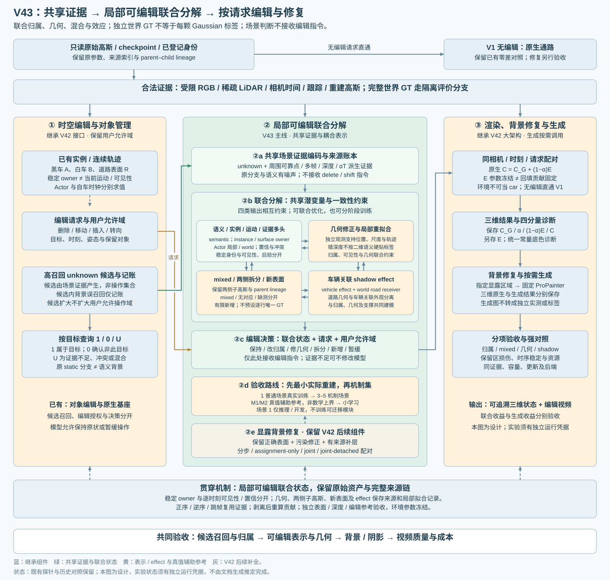
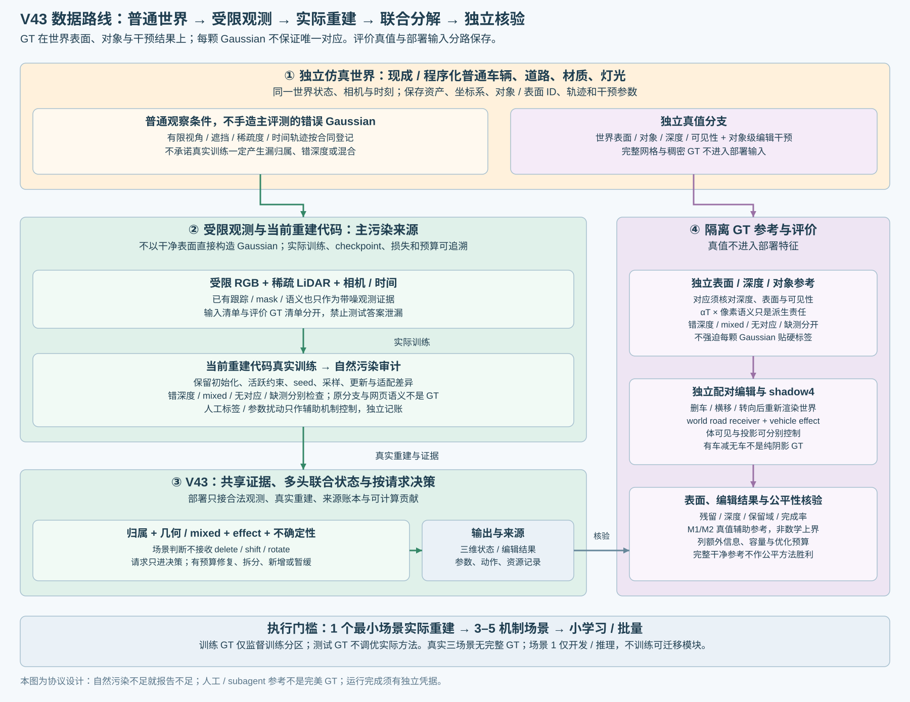

# V43：面向对象编辑的局部可编辑联合分解

Revision 5，2026-10-30。研究目标：在高召回候选中联合推断语义身份、几何支撑与关联效应，把判断转化为可靠的删除、横移和转向。共享证据、多头输出、分阶段训练保持不变。本次明确独立世界真值、真实重建污染与部署输入的边界；文档生成器未启动训练或场景渲染，以下新实验只有取得独立运行记录后才能标记完成。

## 1. 本次纠偏与继承边界

|容易混淆的概念|Revision 5 合同|
|---|---|
|有合成对象标签，所以每颗重建 Gaussian 有唯一 GT|GT 定义在独立仿真世界的表面、对象和编辑干预结果；Gaussian 是待诊断的重建表示，不预设一一对应|
|原 static／dynamic 分支或网页语义色就是正确类别|这些都是带噪证据；与观测、几何和实例关系共同核验|
|alpha×T 加权像素语义就是 Gaussian GT|它只是特定相机、时刻、像素域和对应条件下的派生责任；错深度与无对应不能因投影重叠变成真标签|
|主要通过改标签、手造错误 Gaussian 来验证方法|普通仿真世界经受限观测进入当前重建代码真实训练，先检查自然出现的污染；人工标签／参数扰动只作辅助控制|
|M1、M2 是理想或数学上界|改称真值辅助归属参考与真值辅助表示修复参考，列出额外信息、容量和优化预算；不给出数学支配保证|
|有车图减无车图就是纯阴影|差分可能混有遮挡、反射与间接光变化；阴影须有明确投影干预、world receiver 和 vehicle effect owner|

V1 无编辑原生直出、原 checkpoint、V42 时空编辑／显露背景修复／按需生成的大框架及内部组件全部保留。一个共享模型联合解释归属、几何、混合支撑、效应和不确定性；诊断拆项用于监督与消融，不要求几个独立项目依次完全解决。不能预定联合优于流水线，也不能承诺普通重建一定出现指定污染。

## 2. 一个模型，场景判断与编辑决策分离

部署合法输入为 unknown 候选、周围可靠点、原 Gaussian 参数、原动静态批次、受限 RGB／稀疏 LiDAR、相机与时间、已有跟踪／掩码／语义证据，以及当前状态下可计算的真实渲染贡献。原分支、网页语义和伪标签均须保留来源与噪声状态。语义已确定但表示不可靠的点也允许进入候选；相邻可靠点提供上下文，不意味着可任意修改它们。

共享编码器汇聚 Gaussian、观测像素、帧和表面的关系，输出统一局部状态。第一版可用小型时空图网络或局部注意力，骨干由机制实验决定。

|联合输出|回答的问题|对编辑的作用|
|---|---|---|
|语义、实例／表面 owner、运动绑定、证据可信度四字段|是什么、属于谁、随谁运动、凭什么|停放车辆保留身份；static 批次不等于背景；不可见不自动改 owner|
|混合责任、几何可靠性及修正提议|真实 mixed、错深度、无对应还是缺测|允许改归属、修位置／尺度／协方差／轨迹、保留两侧拆分、有限新增或继续 unknown|
|车辆关联效应|车体、道路材质、车底阴影、环境污染由谁承担|道路 receiver 绑定 world；车辆 shadow effect 绑定车辆，路面几何不随车搬走|
|不确定性与补证据需求|缺测、冲突、域外先验还是不可辨识|可以保持原样和暂缓，不强迫硬标签|

场景判断为 `S = Fθ(observations, Gaussians, evidence)`；delete／shift／rotate 指令不进入身份输出。决策 `D = π(S, request)` 才决定保持、改归属、修几何、拆分、新增、执行或暂缓。同一观察更换请求时身份状态应一致，动作可以不同。若固定诊断编辑用于查询贡献，须记录查询协议与来源，不能依“希望删掉什么”改身份。

几何、语义和运动可共同拟合独立观测。独立生成的训练分区配对编辑损失可以经渲染反传到共享模型，但配对参考不是部署输入；验证／测试 GT 不能用于实际方法的选参、候选修补或逐场景身份输入。离散拆分／新增采用有上限的操作提议和 parent–child 记录，连续几何／外观可联合优化，不声称所有拓扑操作已端到端可导。容量、动作复杂度和改动范围均须记账。

## 3. GT 定义在独立世界，不定义在每颗 Gaussian

独立仿真世界保存对象／表面 ID、语义、几何、材质、坐标系、相机、时间、轨迹、光照、可见性和明确的干预参数。可核验 GT 包括世界表面、相机域的 RGB／深度／可见表面，以及对象删除、横移、转向等独立重渲染结果。待测 Gaussian 的来源索引、原分支或渲染权重都不能反向改写这些真值。

重建后可能不存在与某颗 Gaussian 对应的单一真实表面。只在独立表面、深度和可见性支持对应时建立带适用域的参考；不能直接把同一投影像素的前景类别贴给位于错误深度的 Gaussian。

|情况|记录与监督边界|
|---|---|
|深度和表面对应一致的单一支持|可提供该有效域内的表面／对象参考；仍记录覆盖、误差和来源|
|错深度／错误几何|记录几何残差与对应冲突；禁止按二维重叠强行贴 car／road|
|mixed／多个真实支持|保存多组件支持及未分配质量；投影跨类本身不足以证明三维 mixed|
|无对应的重建伪结构|记录 `no_correspondence`、伪结构证据与有效观测域，不伪造世界对象|
|缺测／被遮挡／未观测表面|记录 `missing_observation` 或不可观测；它不等于无对应，也不等于已知背景|

上述状态可按字段并存，例如身份有独立证据而几何仍错误；不能以修复失败抹去已独立核验的身份。真实三场景没有完整世界／编辑 GT；人工及 subagent 核验只提供带范围、证据和分歧记录的参考，不能称完美 GT。人工 verdict 仅由用户或指定评审填写，当前保持空。

## 4. unknown、后验、派生责任与可见性

unknown 是待判断状态，不是删除／移动集合。候选集合 U、操作集合 A 和可见贡献 W 分开保存。在既有用户允许域内优先召回车身、拖尾、车底和关联效应；正常道路进入候选后可判回 road 并保持，背景误召回记录成本，不提前否决扩候选。环境来源没有对应 Gaussian 时单列，不能虚构 unknown 行。

- **归属后验 p：** 对潜在身份假设的认知不确定性。未校准前称 score；在独立校准场景检验 NLL、Brier、可靠性及风险—覆盖。
- **派生责任 r：** 在明确相机／时刻／像素／可见状态和有效对应域内，将 alpha×T 与独立像素表面语义组合所得的审计／监督参考，含未分配质量。它不是世界 GT，不是身份概率，也不是三维空间质量比例。深度冲突、无对应和缺测分别保留，不以归一化隐藏无效质量。
- **可见性 v：** 当前能否观察及观察可靠性；与稳定身份和认知不确定性分开。高熵不必然 mixed，mixed 也可高置信。

保存含车、删车等不同可见状态的 W 与责任，禁止把各状态权重相加当作身份概率；被遮挡责任不因当前不可见而删除。投影双域、质心距离、原网页语义和 alpha×T 只提供证据。派生参考须记录独立表面／深度来源、对应规则、阈值、覆盖及未分配原因，无法对应就保留未知。

输出合同见 [ownership_record_contract.json](ownership_record_contract.json)。这是设计侧车合同，尚未完成 checkpoint 迁移或联合模型实现。

## 5. 主造数路线：普通世界 → 受限观测 → 实际重建

主路线采用现成或程序化普通车辆、道路、材质和灯光，不先手工设计“带错误的 Gaussian”：

1. 保存独立世界资产、对象／表面、相机／运动轨迹和灯光；预登记观察约束和干预。
2. 沿受限轨迹生成训练可见 RGB、稀疏 LiDAR、相机与时间；遮挡、视角和稀疏度明确记录。完整网格、稠密深度和测试编辑参考留在隔离的 GT 分支。
3. 用当前重建代码完成真实训练，保留初始化、活跃损失、预算、随机种子、checkpoint 与日志。仿真适配必须列出接口差异；不得用干净完整表面直接搭成主评测 Gaussian。
4. 在真实训练所得表示上观察是否出现漏归属、错深度、混合、阴影／外观耦合或时序身份问题；如未出现指定污染，报告零／不足证据，不预填失败结论。
5. V43 仅接合法观测和重建证据；由独立表面、深度及配对编辑参考核验归属参考、几何、残留和保留域损伤。

先做 **1 个最小普通场景的实际重建**，核对渲染器、传感器、重建接口及自然污染，再决定是否扩到 **3–5 个机制场景**，之后才小规模学习或批量造数。机制模板可含单车＋道路＋投影、两车遮挡、宽视角／新显露表面、光照／深色路面。扩展围绕已观察问题和合理变化，不反复改场景直到凑出预设错误。

人工标签遮挡、错归属、错深度或可追溯组件混合仅用于辅助单因素和组合控制，单独命名、计数和报告。它们可以验证接口／特定机制，不能替代主路线的自然污染证据，也不能单靠标签遮挡证明几何／效应修复。普通重建行不强行给唯一 GT。

## 6. 独立编辑参考与阴影干预

删除、横移、转向及不同幅度的参考均从相同独立世界状态实施对象级干预后重新渲染。不得将待测 Gaussian 的删点、剥离、修复输出或生成图作为目标答案；相机、时刻、灯光与非目标对象的配对条件须固定。训练／开发／校准／测试的配对参考按场景隔离。

阴影关系明确为 **world 道路 receiver + vehicle effect owner**。shadow4 是车身可见性开／关 × 车辆投影开／关：道路几何及 receiver 材质保留，独立参考渲染器须证明车体可见与投影可分别控制，并记录其它光路项是否也变化。横移／转向同时核验去旧影与生新影。

**有车减无车不能直接称纯阴影 GT。** 该差分可能含车体遮挡、反射、间接照明等变化，只能先称对象移除的总影响；阴影隔离需要固定 receiver、匹配可见域和明确的投影干预。暗像素和黑色道路纹理不是真阴影标签。无影路面缺观测时保持不确定性，不将估计称 GT。效应语义颜色与 car／road 分开，环境来源也单独显示。

## 7. 实验矩阵：真值辅助参考不构成数学上界

以下为设计，状态只有与具体运行凭据链接后才能更新；清单见 [mechanism_experiment_plan.json](mechanism_experiment_plan.json)。数据验收门槛不是把联合模型拆成必须依次解决的独立问题。

|实验|改变项／冻结项|要回答的问题|
|---|---|---|
|M0 最小真实重建与 GT 接口检查|1 个普通场景、受限 RGB／稀疏 LiDAR、当前代码真实训练；独立生成表面／深度／编辑参考|接口是否成立，实际污染是什么？如未出现就如实报告，不能冒充已有机制证据|
|M1 真值辅助归属参考|固定实际重建表示和渲染器；只在可对应域使用额外独立表面／深度／实例信息，mixed／无对应／缺测单列|额外归属信息能改善多少？固定表示的可编辑缺口是什么？|
|M2 真值辅助表示修复参考|在明确 M1 信息条件下，用独立几何／材质辅助修几何、双侧拆分、效应及组合；固定声明容量和更新预算|额外表示修复能改善哪些剩余问题？改动来源、计算和未解部分分别是什么？|
|M3 候选范围|固定目标全集、实际编辑请求、模型及后端，逐层加入可确认的正常背景|候选精度下降对成本和最终编辑有何影响？候选仍不等于操作|
|M4 小规模联合学习|机制集可行后，在合法训练分区学习，独立分区冻结测试|模型能否从部署合法证据学到有效判断与修复？不先规模化训练|

M1、M2 均为 **真值辅助诊断参考，不是数学上界**；有限优化可能失败，不保证优于实际方法。逐项列出读取的额外真值、可观测域、可用视角、表示容量、新增点数、优化更新、时间与显存。M2 的匹配容量／预算参考和独立完整表面重渲染必须分开报告：后者是信息更完整的编辑目标参考，不能作为公平方法胜利。测试 GT 只进隔离诊断与评价；不用于实际方法选参或现场调优。正确身份也不能凭空确定未观测车侧面的合法输入证据。

M0 的独立参考／接口工作可以与场景1环境核对并行。最小场景实际重建与污染审计通过后扩到 3–5 场景；M1/M2 可在共享接口核验后并行，M3 可复用固定目标全集，M4 需要有效机制和数据隔离。若 M0 没有目标污染，保留原结果并明确下一步依据，不能自动宣称失败机制已覆盖。

四个强消融保持：**B0 特征＋普通阈值；B1 仅概率／决策；B2 仅表示修复；B3 两者联合。** 同重建、合法观测、候选和后端，列容量／计算差别；B2 保持 B0 选择规则，B1 冻结表示。B3 内比较顺序冻结、联合梯度、跨头 stop-gradient，区分耦合与参数／更新增加。匹配候选召回及实际编辑覆盖，暂缓目标仍在残留分母中。

## 8. 联合目标、训练日程与数据隔离

目标包含独立多帧 RGB／深度／掩码／运动、合法对应域的身份／派生责任、独立训练编辑对的残留／结构／保留域、时序一致性以及最小改动／有限容量正则。正式运行前固定有效像素、对应规则、归一化、权重和梯度流。仅原图 RGB 好不能证明可编辑分解。

继续继承完整动态 mask alpha 内外域监督（渲染 alpha 不预乘 mask）、活跃静态与深度约束；缺失监督记缺失，不用预测强补真值。车体 mask、效应 mask 分开。短暖启动可先稳定共享编码和判断头，修正残差初始为零；随后联合启用连续修复／效应和有预算拓扑；最后在独立校准集固定 score 与决策阈值。该日程不要求分类先被完全解决。

开发／训练／校准／测试按物理场景、车辆供体、道路／灯光布局、轨迹及人工扰动祖先隔离，帧级随机拆分不足。3–5 场景首先是机制集，只报告可学习性信号，不冒充泛化基准。仿真完整 GT 和测试配对参考由评价分支读取；实际方法训练仅在训练分区按已声明监督访问，不将 GT 文件混入部署特征。

**场景1仅用于开发诊断和迁移推理，不训练新的共享编码器、判断头、修复策略或效应模块。** 若允许逐场景连续状态优化，单列 test-time adaptation；Actor10K、child refit 和人工反馈已使用该场景，因此它不是整个方法的未见测试。三个真实场景均无完整 GT；人工／subagent 参考须保留证据覆盖和不确定性。场景1用于核对仿真覆盖的残影类型，不用它拟合新的可迁移模块。

## 9. 环境分支：冻结参数与四路配对保持

当前 Actor 完整场景路径采用 `C = C_G + (1-alpha) E`，按整幅图方向查询环境，无天空掩码门控。EnvLight 学习 cubemap 数值，forward 未限制显示颜色区间。Actor10K冻结原静态与环境：原环境异常并非该轮新学得，但 alpha 变化仍可改变异常回填，不能排除车身训练对最终黑带的影响。来源：[train_actor.py](LOCAL_SOURCE_REFERENCES.md#actor)、[envlight.py](LOCAL_SOURCE_REFERENCES.md#environment)。

已有浮点证据支持部分黑带来自环境回填；“几何覆盖不足使环境承担车影拟合”仍是未作因果区分的假设，不能从负值反推训练原因。

|固定环境条件|基线 Gaussian，同一请求|待测分解后 Gaussian，同一请求|
|---|---|---|
|原环境 E 冻结|原生最终 RGB|完整系统收益／残留|
|统一常量底色 B，仅诊断|C_G＋(1-alpha)B|分解后覆盖、残影、背景误改|

四格固定相机、时刻、请求和显示转换；主诊断 B=线性白色，预登记后不随结果改色。每格保存浮点 **C_G、alpha、回填项、最终 C**，另存 E／B 和显示截断，报告负值／超1比例与 ROI。环境参数冻结不代表 `(1-alpha)E` 不变，分别报告 alpha 与回填变化。

两级验收保持：常量底色检查 Gaussian 分解，原环境检查最终 RGB。白洞不是补好道路，环境残留也不自动说明分类失败。若环境是主要瓶颈，再做固定 Gaussian、仅改环境处理的单因素对照；当前不同时重训全部分支。

## 10. 编辑验收与真实数据证据边界

|维度|应报告的量／控制|
|---|---|
|候选与身份|仿真中依据独立世界定义的可观测目标覆盖及分母；派生责任与完整世界 GT 分开；真实三场景只报证据／贡献覆盖，不报完整语义真召回|
|几何与对应|独立表面／深度残差、对应有效域；错深度、mixed、无对应、缺测分别计数，禁止统一硬标签|
|删除|独立删车参考中的车体／效应残留、旧位置误差；未处理 unknown 不移出分母|
|横移／转向|新位置车体完整度、旧位重影、独立深度／表面与去旧生新影；同一时刻比较不同幅度|
|保留域|实际修改后的非目标 RGB／深度损伤、道路几何与 receiver 稳定；候选误召回成本另报|
|时序与泛化|身份跨帧／视角一致性，正序逆序跳帧；独立物理场景测试；机制集与真实开发集身份明确|
|概率与决策|有效 pure 域校准、mixed 派生责任误差、拒判率、任务完成率与风险—覆盖；不同指令身份一致|
|公平比较|匹配候选与实际编辑覆盖的结果／曲线，另列容量、额外 GT、更新、时间、显存；真值辅助和完整参考独立列栏|

## 11. 历史结果与直接相关工作保留

[M0实际重建与独立编辑核验](../sim_mechanism_20261030/index.html)已完成：16帧受限观测、当前原生代码10K重建、12路关键帧编辑与1个留出视角。删除动态分支后仍有车形残留，白底下仍在；这验证了受控失败样本的可用性，不代表新的V43联合模块已训练或产生收益。训练、smoke、恢复与评价开销详见该独立运行报告。

[M1/M2归属与分步表示修复](../sim_m1m2_20261030/index.html)已在该最小场景完成第一轮，而不是等待扩场景后才检验机制。3个锚点的原生alphaT高召回选中约99.9%的原静态车像素贡献，但不等于正确车辆身份，也未覆盖全部阴影；整颗编辑会伤及背景。M2固定同候选，分别改变位置、尺度和必要候选拆分；直接沿用旧外观没有稳健收益。追加中帧两臂各200步DC/opacity局部拟合后，部分删车误差下降，但none/横移仍退化，不能称修复成功或几何拆分已被证明必要。留出视角复用固定候选/修复结果；未进行16帧责任和时序验收。更新数量、不同容量、raw/clamped指标与独立图像见报告。下一步先审残留贡献和真实表面对应，再决定扩展；不以这些有限参考代替可学习联合模块。

既有 [R2 限定白底](../r2_recovery_20261029/index.html)、[unknown 白材质六组204帧](../unknown_white_20261030/index.html)、[三锚点与短 refit](../editable_ownership_20261030/index.html) 不修改。R2显示／剥离、unknown SH涂白、学习判断与最终编辑收益分别验收；原分支和网页语义为带噪证据，旧49帧／三锚点不冒充新的机制集或完美真值。

三锚点452/777/810个投影双域候选的两侧观测质心同时≤3σ计数均为0；raw113七父十四子200步外观拟合后，删Actor状态的假设分边份额39.76%→38.51%。该短探针未显示编辑分离改善，没有完整编辑质量验收。它不能否定联合学习，也不能建立“先彻底修好几何再学习”的必经顺序；质心不是 GT 表面，3σ不是通用拒绝门槛。

|继承的相关工作记录|在 V43 的角色与边界|
|---|---|
|[4D LangSplat](https://arxiv.org/html/2503.10437v1)|语义／时间选择强基线；查询准确不自动证明混合分离与阴影编辑|
|[TRASE](https://arxiv.org/html/2411.19290v2)、[作者实现](https://github.com/yunjinli/TRASE)|动态实例分组／编辑强基线；原方法与当前重建代码适配版本分别列出|
|[HUGS](https://arxiv.org/abs/2403.12722)、[EmerNeRF](https://emernerf.github.io/)|联合几何、外观、语义或运动的建模依据，不能代替本任务的实验结果|
|[Jev 官方文档](https://docs.typesafe.ai/introduction)|仅启发判断与执行分离，不是 Gaussian 方法，不默认接入服务|

TRASE 的[局限与未来工作](https://arxiv.org/html/2411.19290v2#S12)已讨论概率对应和重建／分割联合训练。V43 的贡献须由相近覆盖和明确预算下更少残影、误改和结构不稳定来建立，“联合／概率化”本身不足。上述新适配基线尚无本次运行凭据。

## 12. M1/M2表述修正与来源／证据控制

首轮M1/M2没有回答两个理想问题：M1只比较了表面邻近和车像素贡献选点，未提供准确身份；M2是条件重心、固定尺度截断、继承父外观、单帧短拟合的具体尝试，未提供充分表示修复。此前“真值辅助归属参考”应解释为使用额外世界信息的有限探针，不能给读者接近理想归属的印象。归属分类和联合修复的有效性仍待更合适的实验回答。

[来源与观测证据控制报告](../source_evidence_20261030/index.html)将两条诊断分别验收：冻结旧重建，按实际透射追到删后行ID、16原观测视图贡献、稀疏测量与损失路径；同一个世界增加观测覆盖，固定原验收相机、坐标尺度、方法和10K预算重新重建。新输入RGB/LiDAR及初始化都会变化，识别的是观测证据bundle的效果，不是纯RGB视角因果。新世界GT仍只进入隔离评价，未训练新的可迁移分类器。

已确认旧输入存在道路证据缺口；已有逐行审计支持大量原视角几乎不可见的保留静态表示在删除后暴露。具体分母、有限颜色/移除干预、全行统计和观测覆盖见运行报告，不能用top128子样本外推所有残影。最终checkpoint回放不等于完整训练历史，测量近邻也不代表实际梯度；alphaT像素类别始终不作为唯一高斯身份。

V43的证据字段补入原观测可见贡献、编辑后重算贡献、实际稀疏测量支持和显露表面可靠性。**语义身份属于道路，不等于这颗高斯的位置、尺度和外观可靠。** 同理，编辑后产生彩色残影的点不能仅凭效果被改成car。身份判断保持与用户指令独立；执行层按新可见性补查未验证支撑。可学习模块仍联合判断身份、几何、混合及外观/效应，不回到多模型互相等待。

M2之后的有效修复必须落到真实保留部分：将最终整颗删除的点先移位或缩小，对delete输出没有作用。应明确哪些背景支撑保留、其表面位置与协方差如何拟合、颜色是否仍受父车外观污染，并用跨帧未编辑保持与独立编辑效果共同评价。新的控制结果出来前不继续机械叠修补，也不声称理想上界或泛化。

同世界观测控制现已执行：新增13个视角、保留3个原相机，同原生方法及共享坐标从零10K。目标道路样本至少一帧几何可见率达100%，但原生删除仍有红色车形残影；新模型上的同规则M1相较旧M1明显降低三锚残影误差，仍未清干净。观测增加同时改变RGB、LiDAR、初始化和终态容量，不能解释为纯视角因果或准确归属效果。全行回查仍发现大量删后贡献来自原输入弱可见的支撑。结果及限制见来源报告。

因此下一轮不再以删前贡献覆盖作为M1的完成依据。固定全部Gaussian参数，用预先锁定的构建/验收分区检验跨时刻、相机和编辑共享的受限路由，只称可行性参考；之后固定路由比较受限表示自由度。未见道路的补全责任单列。有限预算搜索失败不证明归属不可行，有限子集穷举结论也不推广到全场景。

## 13. 交付、执行与资源约束

本生成器只更新设计、两张组件图、侧车合同和待执行矩阵；未运行真实重建、V43训练或场景渲染，human_verdict=null。旧成果与 Revision4 备份保留。实验进展须写入各自运行记录后引用，不从设计状态推定执行成功。

小时级实验先完成真实环境约10分钟smoke，覆盖前／反向、finite loss、显存、加载、checkpoint保存、评价、完整恢复及下一阶段入口；正式方法、采样、学习率和步数预算保持，smoke与必要重放分开记账。

**本对话禁止自动 AutoDL 关机。** 用户2026-10-30最新规则覆盖旧自动收尾约定：完成或空闲均保留实例，只有用户明确要求才关机。subagent仅允许gpt-6.1-sol或gpt-6.1-terra。该文档生成器不调度GPU任务，不从历史报告自动恢复队列。
