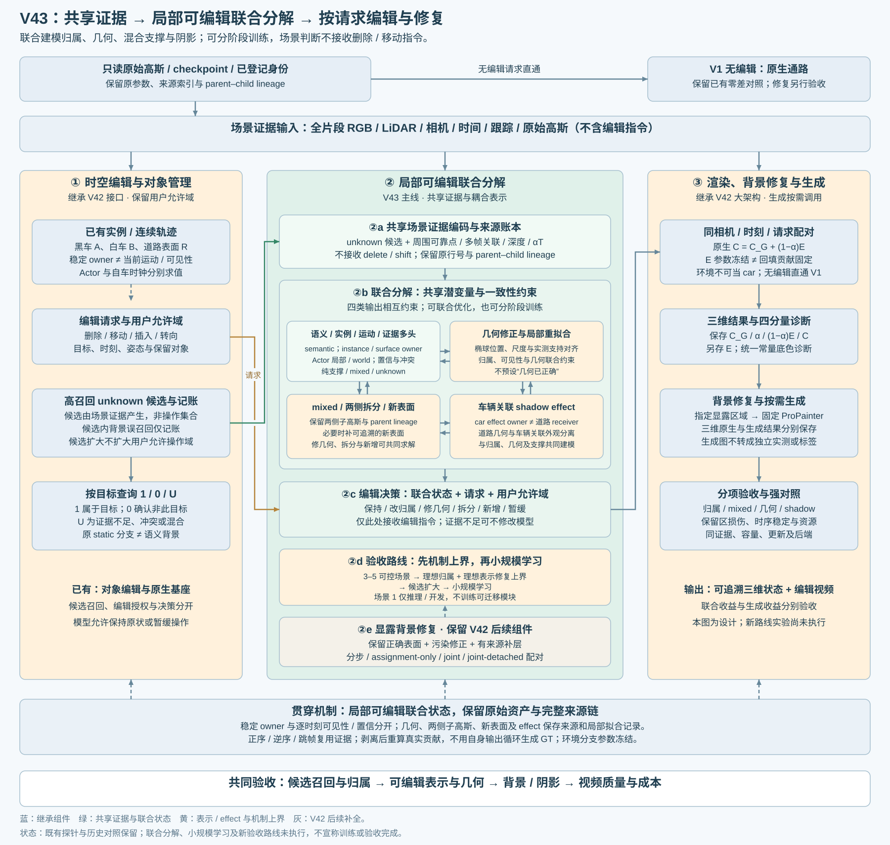

# V43：面向对象编辑的局部可编辑联合分解

Revision 4，2026-10-30。研究目标：在高召回候选中联合推断语义身份、几何支撑与关联效应，把判断转化为可靠的删除、横移和转向。共享证据、多头输出、分阶段训练；不要求几何、归属、拆分、阴影分别解决后才能联合。本次仅修订设计与实验合同，新增训练、渲染均为 0。

## 1. 本次纠偏与继承边界

|原先容易误导的推进方式|修订后的方式|
|---|---|
|先确认 owner，再修几何，再拆分，最后处理阴影|一个共享证据模型同时解释这些因素；逐项诊断用于明确输出、监督和消融，不是互相等待的独立项目|
|只训练 unknown 语义分类器|学习局部可编辑分解：归属、表示修复、效应和不确定性；只分类是必要基线|
|因误召回道路，提前否决更宽的候选|在既有允许域内优先覆盖车身、拖尾、车底及关联阴影；误召回只记录。真正修改时才检查道路是否正确保留|
|用自己的剥离结果证明预测正确|用独立观测或独立生成的编辑参考评价；after 贡献用于追查来源，不回写语义真值|
|原图拟合更好，就认为拆分有效|同时核验删车、平移、旋转及跨帧效果；原图保真只是一个约束|
|冻结环境就视为环境影响不变|环境参数固定，但透射变化会改变回填贡献；两层验收分别报告|

V1 无编辑原生直出、原 checkpoint 和 V42 时空编辑／显露背景修复／按需生成的大框架保留。当前研究核心是可编辑分解；补景与视频生成后续接入固定对照，不能用它们掩盖分解残留。不能预定联合优于流水线。

## 2. 一个模型，场景判断与编辑决策分离

输入为 unknown 候选、周围可靠点、原高斯参数、原动静态批次、跨帧 RGB／深度／跟踪／掩码证据，以及当前状态下真实渲染贡献。原批次和伪标签都是证据，不是归属真值。语义已确定但表示不可靠的点也允许进入候选；相邻可靠点提供上下文，不意味着可随意修改它们。

共享编码器汇聚 Gaussian、观测像素、帧和表面的关系，输出统一局部状态。第一版可用小型时空图网络或局部注意力，具体骨干由机制实验决定，不先堆模型规模。

|联合输出|回答的问题|对编辑的作用|
|---|---|---|
|语义、实例／表面 owner、运动绑定、证据可信度四字段|是什么、属于谁、随谁运动、凭什么|停放车辆仍保留身份；static 批次不等于背景；不可见不自动改 owner|
|混合责任、几何可靠性及修正提议|投影跨类、真实混合、错误深度分别是什么|允许只改归属、改位置／尺度／协方差／轨迹、保留两侧拆分、有限新增表面|
|车辆关联效应|车体、路面材质、车底阴影、环境污染分别由谁承担|道路 receiver 绑定 world；车辆 shadow effect 绑定车辆，不能整块路面随车搬走|
|不确定性与补证据需求|缺测、冲突、域外先验还是不可辨识|允许保持原样和继续 unknown；未知量不强行硬分类|

场景判断记为 `S = Fθ(observations, Gaussians, evidence)`；用户的 delete／shift／rotate 指令不进入身份输出。决策 `D = π(S, request)` 才决定保持、改归属、修几何、拆分、新增、执行或暂缓。同一观察下更换编辑指令，身份状态应一致；动作可以不同。若诊断编辑被用于查询额外贡献，查询协议必须固定、来源可追溯，不能依“希望删掉什么”改身份。

几何与运动可互相约束，语义与几何也可共同拟合独立观测，这属于合法联合推断。模型猜测先当 GT、再用相同猜测评价自身属于自我证明，禁止。独立配对编辑损失可以经渲染反传到共享模型；它不等于给身份头输入指令，也不能变成将道路改成车的伪标签。

离散拆分／新增先用有上限的操作提议与可追溯 parent–child 记录实现，连续几何／外观可联合优化；不声称所有拓扑操作已可端到端求导。动作复杂度、改动范围与新增容量要记账，不能靠无限加点赢对照。

## 3. unknown、混合责任与概率的精确定义

unknown 是待判断状态，**不是删除／移动集合**。候选集合 U、最终操作集合 A 和可见渲染贡献 W 分开保存。正常道路进入 U 后，模型可以判回 road 并保持原样。当前候选优先召回，背景误召回只报告，不作为扩大候选的否决；仍遵守既有用户允许域，域外漏项单独登记，不能悄悄扩大空间权限。

候选覆盖包括车体边界、拖尾、车底、阴影效应及剥离后显露的贡献。环境层污染登记为独立来源：没有对应 Gaussian 的像素，不能虚构一个 unknown Gaussian。高斯中心是否在框内不是唯一支撑证据。

每个字段可独立 unknown。高后验不等于纯支撑；mixed 可以携带多实例／表面的责任，而不是硬塞 car 或 road。三种量必须分开：

- **归属后验 p：** 对潜在身份假设的认知不确定性。未校准前只称 score；在独立场景上用 NLL、Brier、可靠性曲线和风险—覆盖检验。
- **混合责任 r：** 在明确相机／时刻／像素及 alpha×T 权重域内，对多个真实表面的贡献分配，含未分配质量；不称为该高斯“多少概率是 car”。空间质量比例另存，不能与像素责任混用。
- **可见性 v：** 当前是否能观察到及观察可靠性；与稳定身份、模型不确定性分开。高熵不必然表示 mixed，mixed 也可具有高置信。

合成场景有对象真值，不代表重建后每颗高斯存在唯一标签。通过独立表面 ID、深度、可见性与高斯 footprint 建立带观测域的责任；混合／未观测部分保持混合或未知。渲染权重只是分配载体，不自行产生语义。保存含车和无车等多个可见状态，避免被遮挡责任消失。

输出合同见 [ownership_record_contract.json](ownership_record_contract.json)。这是设计侧车合同，尚未完成 checkpoint 迁移或联合模型实现。

## 4. 联合目标与训练日程

拟议目标包含：独立多帧观测的 RGB／深度／掩码／运动损失，语义身份与责任监督，独立编辑对的残留／结构／保留域损失，时序身份一致性，以及最小改动／有限容量正则。各项有效像素、可观测域、归一化、权重与梯度流在正式运行前固定登记。不能只优化原图 RGB。

继续继承原训练合同的完整动态 mask alpha 内外域监督（渲染 alpha 不预先乘 mask）、活跃静态和深度约束；缺失监督记缺失，不用预测强补真值。车体 mask、阴影效应 mask 分开。已有语义高置信点仍需检查混合与结构，不能直接整颗移动。

|训练阶段|可训练部分|目的与边界|
|---|---|---|
|短暖启动|共享编码与判断头；修正残差初始为零，原表示冻结|稳定尺度、责任和拒判；不是要求先把分类问题彻底解决|
|联合阶段|共享特征、判断头、连续修复和效应；拓扑按预算提议|共同解释独立观测及配对编辑监督；允许归属和几何互相促进|
|校准与冻结|独立校准集调概率／决策阈值，不更新测试表示真值|固定模型迁移推理；记录风险、覆盖和拒判|

“保持原样／暂缓”是有效动作，但不能靠不执行编辑获得低误差。未处理的目标仍计入残留分母；报告任务完成率与覆盖，保留失败帧。

## 5. 小型验证数据：先检验可达收益，不批量造分类训练集

先做 **3–5 个可控小场景**。建议四个机制模板：单车＋道路＋阴影；两车重叠；宽视角／遮挡与新显露表面；光照变化＋深色道路纹理。每个保留完整表面、材质、相机、轨迹、灯光、实例与 receiver/effect 信息，并独立生成无编辑、删车、横移、转向及 shadow4 参考。

参考来自独立干净场景的对象级物理渲染与干预，不能由待测错误 Gaussian 的删点输出充当 GT。保存体表 ID／深度／可见性和阴影效应差分；暗像素不是阴影真值。关闭车体可见性但保留投影、只关投影等四档需由独立参考渲染器明确实现。

逐一加入漏归属、错深度、跨界大高斯／混合支撑、阴影烘焙或外观耦合、时序身份扰动；先单因素，再少量组合。构造混合点保存已知父组件，但不把其它普通重建行强行标为单一 GT。

只做标签遮挡不足以训练几何／效应修复。小型集合首先是机制验证集，不声称泛化；小学习的开发／校准／测试必须按物理场景、车辆供体、路面／光照布局和扰动祖先隔离，帧级随机划分不够。3–5 场景不足时仅报可学习性信号，随后扩展独立测试。

**场景1不训练新的共享编码器、判断头、修复策略或效应预测模块。** 后续冻结可迁移模块到场景1推理；若允许逐场景连续状态优化，单列为 test-time adaptation，不能称纯前馈泛化。现有 Actor10K、child refit 和人工反馈已使用该场景，因此它是开发诊断对象，不是整个方法的未见测试。场景1持续用于检验合成扰动是否覆盖真实残影类型。

## 6. 实验矩阵与可并行工作

本节均为待执行设计；机器可读清单见 [mechanism_experiment_plan.json](mechanism_experiment_plan.json)。实验按依赖调度，不要求每个模块先单独成功。

|实验|改变项／冻结项|要回答的问题|
|---|---|---|
|M0 独立参考与渲染接口检查|固定干净场景；核对对象级干预、表面／effect真值、原生 Gaussian 合成接口|数据和接口本身能否表达正确编辑？|
|M1 理想归属|固定错误表示和渲染器，给合法的对象／混合责任；mixed 保持单独处理对照|单靠判断准确，能改善多少？整颗硬路由的上限在哪里？|
|M2 理想表示修复|固定理想归属；从独立几何与材料构造修复，不从删点图补答案|错误几何／混合／效应是否确为剩余瓶颈？分别做修几何、双侧拆分、效应与组合|
|M3 候选范围|固定目标全覆盖、模型和总编辑请求，逐层加入已知正常路面／背景|候选精度下降影响计算和最终编辑多少？不把背景候选当操作|
|M4 小规模联合学习|合法训练分区学习，在独立分区冻结测试|模型能否学会 M1/M2 的有效操作？先不做规模化训练|

M2 同时给出“相同表示容量和优化预算内的理想修复”及独立完整表面参考；后者只能叫参考上界，不能冒充公平方法胜利。oracle 可读取机制集测试真值，只用于上界，不用于选择或调优实际方法。正确标签也不能凭空确定从未观察过的车侧面。

M0 的独立真值准备与场景1环境分量核对可以并行；M1/M2 在 M0 接口核对后并行；M3 可复用 M1 目标全集，M4在数据隔离和有效操作已明晰后启动。这里的上界实验检验表示与接口，不要求先手工修好场景1才开始联合学习。

四个强消融：**B0 特征＋普通阈值；B1 仅概率／决策；B2 仅表示修复；B3 两者联合。** 使用相同重建、合法观测、候选与后端，列出容量和计算差别；B2 保持 B0 选择规则，B1 冻结原表示。在 B3 内另比顺序冻结、联合梯度和跨头 stop-gradient，确认收益来自耦合还是更多参数／更新。不以“联合”本身作为新颖性。

## 7. 环境分支：纳入研究，当前固定控制

本地当前 Actor 完整场景路径采用 `C = C_G + (1-alpha) E`，按整幅图方向查询环境，无天空掩码门控。EnvLight 直接学习 cubemap 数值，forward 未限制到显示颜色区间。Actor10K冻结了原静态与环境：原环境参数异常并非本轮新学得，但本轮 alpha 变化仍可能改变异常回填，不能据此排除车身训练对最终黑带的影响。代码来源：[train_actor.py](LOCAL_SOURCE_REFERENCES.md#actor)、[envlight.py](LOCAL_SOURCE_REFERENCES.md#environment)。

已有浮点证据确认部分黑带来自环境回填；“缺几何先验→覆盖不足→环境承担车影拟合”仍是待检验假设。掩码、几何覆盖和分支数值补偿尚未作因果区分，不能用负值反推训练原因。

|固定的环境条件|基线高斯（同一编辑请求）|待测分解后的高斯（同一编辑请求）|
|---|---|---|
|原环境 E 冻结|原生最终 RGB|完整系统收益／残留|
|统一常量底色 B，仅诊断|C_G＋(1-alpha)B|分解后覆盖、残影、背景误改|

四格同相机、时刻、请求和显示转换；主诊断 B=线性白色，预登记后不因结果改颜色。每格保存浮点 **C_G、alpha、环境／底色回填项、最终 C**，额外保存 E 或 B。显示截断另存，记录负值／超1比例和 ROI。环境参数冻结不代表 `(1-alpha)E` 不变；alpha 改变或相机方向变化都可能影响回填。配对比较固定方向，分别报告 alpha 变化和回填变化。

两级验收：常量底色下检查高斯分解；原环境下检查最终 RGB。白洞不是补好的道路，RGB仍有环境残留也不自动说明 Gaussian 分类失败。若环境成为主要瓶颈，再做固定高斯、只改变环境处理的单因素对照（天空门控、梯度掩码、内容修复各自独立）。当前不训练环境重建算法、不默认修补环境、不与联合分解同时改全部渲染分支。

## 8. 围绕编辑验收，并保留证据缺口

|维度|应报告的量／控制|
|---|---|
|候选覆盖|独立 GT 定义的车身／拖尾／阴影责任覆盖，分母和可观测域；无 GT 的场景1只报证据／贡献覆盖，不报真召回|
|删除|独立删车参考中的车身残留、阴影残留、旧位置误差；unknown 未处理不移出分母|
|横移／转向|新位置车体完整度、旧位置残影、几何／深度、去旧影与生新影，固定时刻不同幅度|
|背景|额外候选数量与成本单列；实际修改后的保留域 RGB／深度损伤及背景稳定性|
|时序与泛化|固定身份跨帧／视角一致性，正序逆序跳帧；独立物理场景测试，机制集不冒充泛化基准|
|概率与决策|pure 身份校准、mixed责任误差、拒判率、任务完成率、风险—覆盖曲线；不同指令身份一致|
|公平比较|匹配候选召回及实际编辑覆盖的结果和整条曲线；另报容量、更新、时间、显存；不能用大面积暂缓获胜|

车底阴影必须在当前范围：shadow4 = 车身开/关 × 车辆阴影开/关，world 道路几何保留；另测平移、转向的去旧／生新影。无影路面缺观测时保留不确定性，不将估计称 GT。阴影 effect 的语义颜色与 car 分开，环境来源也独立显示。

既有 [R2 限定白底](../r2_recovery_20261029/index.html)、[unknown 白材质六组204帧](../unknown_white_20261030/index.html)、[三锚点与短 refit](../editable_ownership_20261030/index.html) 保留。R2是限定范围的显示／剥离诊断；unknown SH涂白改变所选行材质；两者均不是分类真值或最终修复。白材质保留几何／opacity的验证不等于归属已正确。

三锚点452/777/810个投影双域候选的两侧观测质心同时≤3σ计数均为0；raw113七父十四子200步外观拟合后，删Actor状态的假设分边份额39.76%→38.51%。该短探针未显示编辑分离改善；没有完整编辑质量验收，也不能否定这一类设置经过其它有效训练后可能获益。**不能推出联合学习不可行，也不能确立“先彻底修好几何再学习”的必要顺序**。质心不是GT表面，3σ不是泛化拒绝门槛。

## 9. 直接相关工作与强基线

|工作|已核对的相关能力|在V43的角色／边界|
|---|---|---|
|[4D LangSplat，CVPR 2025](https://arxiv.org/html/2503.10437v1)|动态高斯上的时间不变／时变语言语义，开放词汇查询|直接语义／时间选择基线；查询准确不自动证明混合分离和阴影编辑|
|[TRASE，3DV 2026](https://arxiv.org/html/2411.19290v2)|SAM监督的高斯特征与聚类，实例删除／组合／风格编辑|直接实例编辑强基线；先重建再学特征。[作者实现](https://github.com/yunjinli/TRASE)单列原方法与适配版本|
|[HUGS，CVPR 2024](https://arxiv.org/abs/2403.12722)|联合优化城市场景几何、外观、语义、运动|联合表示的依据，不能当作本任务已解决的证据|
|[EmerNeRF](https://emernerf.github.io/)|静态、动态与流场通过自监督共同学习|联合约束的依据，表示／任务不同，比较时写明适配|
|[Jev 官方文档](https://docs.typesafe.ai/introduction)|对状态回答类型化问题，返回结构化值及概率分布|仅启发判断与执行分离；不是GS基线，不默认接入服务|

[TRASE局限与未来工作](https://arxiv.org/html/2411.19290v2#S12)已明确讨论重叠小物体、概率对应及重建与分割联合训练。因此研究贡献必须落在可验证的编辑收益：高召回候选下，是否更好区分不确定性、混合责任、错误几何与关联效应，并在相近覆盖下减少残影和误改。不能把“联合”或“概率化”单独当创新证明。TRASE / 4D LangSplat原发布评测与迁移到当前DrivingEditor的适配对照分别保存，当前尚未运行这些基线。

## 10. 交付、执行与资源约束

本次只更新设计、框图、表示侧车和待办实验，模型与旧诊断不变；新路线实现和机制实验均待执行，human_verdict=null。小时级实验仍须真实环境约10分钟smoke，覆盖保存、评估、完整恢复及下一阶段；正式预算与smoke分别记账。

**本对话禁止自动 AutoDL 关机。** 用户2026-10-30最新规则覆盖此前自动收尾关机约定：完成或空闲均保留实例，只有用户明确要求才执行关机。subagent仅允许gpt-6.1-sol或gpt-6.1-terra。此任务没有新增GPU作业，不从旧报告自动恢复队列。
