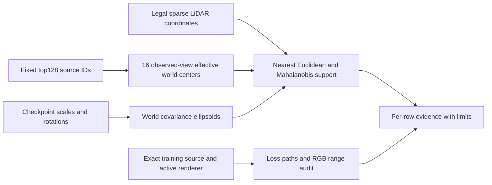

# Frozen hidden-row constraint audit

The audit uses actual legal sparse LiDAR coordinates from all16 input frames. Legal body masks annotate car/complement measurements. Road is not an original LiDAR label: the road subset is separately annotated using independent firsthit semantics at measured UV solely for diagnosis. Distances never use nearest hidden GT mesh samples. Exact minimum Mahalanobis distance is evaluated over every measured point in each subset; its nearest point can differ from Euclidean nearest. A3σ ellipsoid is a diagnostic support convention, not a hard native raster cutoff; the projected raster also applies a pixel covariance low-pass filter.

For row461782, frame8 world center is(8.1153,1.2250,.3420)m; world1σ principal axes are(.0275,.0986,.1787)m. Across all16 inputs the nearest actual LiDAR point is .4129m from its center; closest covariance-normalized point is3.813σ, so no measured point lies within its3σ ellipsoid. Other top8 rows do have sparse points within3σ in1–3 frames. This excludes an all-rows-unmeasured claim. Nearest measured distance does not prove a row received a gradient, and it is not a direct per-Gaussian objective in this code.

Exact source excerpts and SHA256 are in `evidence/constraint_audit_r2/source_evidence.json`:

- `train.py:383-386`: observed_static_mask=1-dynamic_mask; both static image and target are multiplied before L1/SSIM. Direct static RGB pixel gradient inside Md is zero because the mask multiplies the input. The static-only render can still constrain row tails outside Md; windowed SSIM does not undo the input multiplication.
- `train.py:315-326,365-375,400-410`: the global RGB objective uses the unified raw render, including vehicle pixels. Hidden static rows can participate through their actual unified transmittance, but the target is the observed original RGB, not counterfactual empty road.
- `train.py:353-363,403`; `paper_losses.py:88-101`: depth is alpha-normalized composite depth (with configured environment blending), compared to sparse positive input depth in inverse space, summed/full image area. It is not a center-to-nearest-LiDAR or individual hidden-surface loss. `hybrid30k_losses.py:158-172` keeps the exponential decay and registered weights.
- `hybrid30k_losses.py:64-90,143-175`: static duration and velocity regularize rendered static maps; opacity entropy regularizes total alpha. These are not row semantic ownership targets.
- `train.py:381-382,406-410`; `paper_losses.py:62-85`: NPS is applied to opacity-normalized static velocity/features around the dynamic-mask boundary. This path can affect static representation even where direct static RGB is masked, but it does not supply empty-road color truth.
- `train.py:393-405` and the loss weights show inverse-depth and velocity smoothness, static sky opacity and sky RGB paths. Dynamic full-alpha MSE targets the dynamic branch; it is not static vehicle ownership supervision. SGCM is additionally invoked as a refine/controller step (`train.py:624-633`), not a missing photometric surface target.

The environment is a directly trainable cubemap `base` (`scene/envlight.py:9-13`), sampled by linear cube texture and returned without sigmoid/clamp (`:32-41`). SH is evaluated then shifted+.5 and only lower-clamped (`gaussian_renderer/__init__.py:210-217`, also CUDA `forward.cu:18-78`); there is no upper bound1. The actual active Python/binary paths and hashes are recorded separately. Candidate CUDA source copies agree on the lower-only clamp, while native runtime/precomputed parity and measured values>1 directly corroborate the range behavior. Raw training render and raw FP32 evaluation are unbounded; PNG visualization clamps to[0,1], and published evaluation preserves separate raw/clamped columns. This is a range/path explanation, not proof that HDR alone caused the residual.

These source paths establish possible constraint routes, not historical per-row gradient magnitudes. Final10K replay does not reconstruct optimizer-step visibility or whether a row was previously better constrained.

## Reuse with the new checkpoint

`render_generic_source.py` plus `generic_source_audit.py` accepts an explicit event/output/reference root and `--audit-config generic_source_config.json`; use `--keyframes 0,8,15 --edits none --policy recall`. The new event determines its scene/calibration/normalization. The generic path verifies common query world extrinsics and intrinsics against the original independent reference and fails on mismatch.

`selection_directory:null` recomputes the same fixed actual original-body alpha T>1e-4 diagnostic rule on each checkpoint and saves its own selection. Existing row IDs must never be transferred between independently trained reconstructions. Explicit selection_directory is allowed only for a cardinality-compatible frozen same-checkpoint replay. Same topK/ROI/ablation thresholds are retained. Syntax checks passed; this generic path has not been CUDA-executed on the not-yet-published new checkpoint. No new training or loss change was started.
