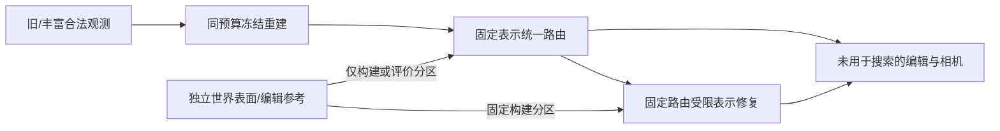

# 下一轮最小可辨识协议

当前没有唯一逐高斯owner GT，因此不能直接报告“准确率已达100%后的收益”。可回答的是：固定表示下，一个统一、受限且真值辅助的编辑路由能做到多少；加入明确表示自由度后，留出结果还能改善多少。两者均为 **truth-assisted feasibility reference**，不是数学上界。

共同约束：沿用同世界、同旧query/heldout、同gauge与物理学习率；构建集与验收集在第一次搜索前锁定。建议构建用旧0/15相机的delete/shift，验收用未见8相机、独立heldout及rotate；构建参考可用于明确登记的特权搜索，验收参考不得调阈值/挑seed。所有结果同时报none、delete、shift、rotate的raw/clamped误差、保留区域损伤、候选覆盖/预算/容量；分开旧道路observed0/1/2+组。未知保持unknown，不能靠世界距离、中心投影或pre-alphaT阈值强制owner。

1. **增证据控制：先结束正在运行的旧/丰富16帧配对。** 分别检查原native动态删除及同一个诊断路由，不重新按各自结果挑点。更充分轨迹的100%几何可见只说明可采到目标道路，不保证离散采样、外观或无阴影辐射。识别量是合法RGB+LiDAR观测包变化，不能单称纯RGB视角效应。**停止条件：** 同query none/保留区域明显失配、gauge或优化预算不一致则工程不通过；若改善集中于旧未见道路，优先判证据瓶颈，不从旧M1/M2失败推出归属或表示无效。

2. **固定表示、多编辑共享的路由可行性搜索。** 冻结全部Gaussian参数、原时间运动和环境；每颗候选只有一个跨相机/时间共享的硬“随车编辑/保留”变量，none合成必须逐像素不变；禁止逐图mask、每编辑单独路由或软路由暗中复制/拆分。候选必须覆盖全部实际残影贡献，预算受限搜索允许未知保持原路由，明确报告未覆盖贡献。用构建参考搜索统一策略并锁定；只在留出评价一次。**停止条件：** 仅构建集好、验收失败或损伤道路就不接受；搜索饱和后只能说“本预算未找到可行路由”，不能说固定表示不可能。成功也只证明一种可行干预，不能赋予唯一owner真值或算法泛化。

3. **局部可穷举路由与嵌套表示对照。** 从跨视角/干预一致支持单一世界表面的保守子集选至多8个源；其余及混合/无对应保持不动，并报告该子集占残影贡献多少。单表面证据仍是条件证书，Gaussian无限尾部/未查视角不强行认证。完整穷举256硬路由，保留全局排序和遮挡，给这个有限问题的真实最优值；然后固定同一路由，分别开放位置/协方差、再开放必要拆分，给相同DC/opacity适配预算、原none保持约束和容量账。M2不得借重选源、额外参考或自由拟合全模型取胜。**停止条件：** M1有限穷举已可行则该子问题无需改表示；只有M1穷举均不满足预定误差/保真条件而受限M2通过留出时，才能说“这个受限子问题需要增加表示自由度”。不能推广到全场景，不能把组合收益全归因拆分。

4. **补全与修复的边界验收。** 沿用世界点可见性分组，不再按输出颜色挑区域；优先在丰富观测的observed2+道路检验2/3。在从未采到的道路，缺少可验证辐射信息，路由/拆分无法凭空恢复真实纹理；若要生成它，应另立completion任务及合法先验，对真实参考只作验收。**停止条件：** 改善主要来自GT色彩/像素替换、参考环境回填、逐图自由Gaussian拟合或white洞，则仅记特权敏感性/补全演示，不算M1/M2成功。已观察区域与未观察区域均失败时，先定位共享路由覆盖及表示/外观不一致，不直接批量造数据。

全体来源新证据支持上述顺序：旧16view累计alphaT<0.1的保留行承载中帧删后78.08% alphaT与79.77%共享误差加权贡献；这是最终冻结模型的弱可见证据统计，不能解释为这些点从未训练、唯一属于车辆或单点因果误差。top8/top128仍不能代表全部来源。
