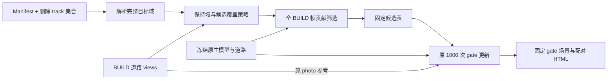

# V44 通用 handoff 修复独立审阅

审阅日期：2026-11-11。范围：旧 gate/road 源码、已有 GPU 诊断、最终通用策略与本地 gate/road 集成；远端检查仅使用 JSON、NumPy 和 PIL 读取实际输入。未启动 GPU、训练、优化器或服务操作，未改共享算法文件。最终源码接线审阅通过，GPU 执行与视觉质量仍需单独验收。

设计能够同时修正两处已确认的覆盖错误：完整目标像素不再因缺少道路支持而被原生底图保持项拉回；这些像素也能参与静态候选筛选。它没有提供未知背景的恢复监督，因此不能据此判定车体残影消失或道路恢复正确。建议以原预算重建 gate，并保留旧结果配对展示。

## 作用边界

令 `T` 为本次全部删除身份在 instance mask 中的并集；`P=other|marking`；`R=T&~P`。一致的通用策略是：

| 项目 | 修复后口径 | 必须保留的边界 |
|---|---|---|
| Native keep | 将 `R` 内权重置 0，`P` 内权重置 1 | 其余权重不变，保护冲突单独计数 |
| Left keep | `~inside & ~other & ~R` | 图范围外的目标也解除保持 |
| Candidate support | `((fit>.05)|T)&~P` | 不因未知参考漏选；保护冲突属于明确例外 |
| Photo | 原 `fit` 与原 `reference_linear` | 不将未知目标当作背景真值，不新增 opacity=0 损失 |
| Static eligibility | `candidate_score>1e-4`、`guard<=20*candidate_score`、固定 `owner<=0` | 保持原阈值与固定身份；不把 unknown 行认证为车体 |
| BUILD / QUERY | BUILD 一次确定候选，QUERY 使用固定结果 | 不按查询图临时重选，不引入额外查询帧监督 |

`candidate_score` 与原 `fit_score` 必须分别保存，否则无法区分“新增可优化覆盖”与“原参考支持”。两种得分和 guard 仍分别取全 BUILD 帧最大值，最大值可以来自不同帧。

已有诊断确认旧候选覆盖缺口确有贡献路径：119/198 帧全目标中的未选静态 alpha·T 占 39.67%/38.62%；低 fit 是其中主要排除原因。与此同时，目标 keep+left 梯度与道路 photo 在这两帧方向相反。因此只改损失或只扩大候选都不能覆盖另一个错误。

## 数据与身份边界

旧 `v44_road.py` 的 `other=foreground&(labels!=road_target)` 绑定一个目标。它不能直接代表任意 `delete_tracks` 的非删除车辆。远端只读核对了实际 065 输入：manifest 与 road views 都有 199 帧，road receipt 的 heldout 为空；119 帧 actor 10 有 11,624 个像素、与旧 other 交集为 0，但 actor 8 的 8,819 个像素全部处于旧 other。换目标或删除两车时，直接沿用旧 other 会保护正在删除的第二目标。

拟议的 `other'=(view_other | labels>0)&~T` 能按本次删除集合重绑定 other，同时保留原 view 中未被 instance 身份标记的 foreground 保护。marking 仍独立优先。该步骤应在计算域和 guard 前完成，并保留旧、新 other 以及冲突像素数供审计。

实际接线还须确认：track→actor→instance-label 的映射显式且一致；mask 使用最近邻对齐实际 camera 分辨率；缺失 mask、非法标签、重复 frame key、views 与 BUILD 集合不匹配必须报错，不能静默退回旧域。通用模块允许“目标在某帧不可见”，但整个请求不能因错误的标签映射得到假空目标。

现版 policy 的 candidate support 排除了完整 `P`，比旧 `(fit>.05)&~marking` 多排除 `fit∩other`。真实 065 应统计该交集；若为零，这一差异不影响原支持域。对其他输入，这属于有意优先保护的边界，不能无条件宣称旧候选集合必为新集合的子集。

### 独立全帧 CPU 审计与跨目标发现

已用原始 199 帧 instance PNG 和 road view 执行零训练审计，不是 GPU 渲染或新训练结果：

| 删除 actor 集合 | 目标像素总数 | 旧目标 keep / left | 新目标 keep / left | unknown 目标像素 | 旧 fit 被新保护域排除 |
|---|---:|---:|---:|---:|---:|
| `[10]` | 1,405,127 | 897,981 / 681,882 | 0 / 0 | 897,981 | 0 |
| `[8]` | 1,081,722 | 1,081,722 / 0 | 0 / 0 | 1,081,722 | 507,146 |
| `[8,10]` | 2,486,849 | 1,979,703 / 681,882 | 0 / 0 | 1,979,703 | 0 |

原始 `fit∩other`、`fit∩marking` 全帧像素数均为 0，PNG 中没有未注册正身份。三种删除集合在重绑定后的目标保护冲突均为 0；actor 8 的 1,081,722 个像素在旧 other 内，重绑定后均退出。

**审阅发现并已由入口校验处理的通用身份边界：** 仅改删 actor 8 而复用原来为 actor 10 生成的 road views 时，原 reveal/photo 仍包含未删除 actor 10 的 507,146 个像素。这些像素现在应受 other 保护。如果 photo 权重完全不变，优化依然会在未删除车辆上施加背景道路参考，与新保护项冲突。当前修复 actor 10 不触发此边界；双删 `[8,10]` 也不触发。最终入口采用要求 BUILD 输入匹配完整删除集合的合同，不静默裁 photo；不匹配输入与任何正 photo 权重和 protected 的重叠都会拒绝。

baseline 同样绑定删除集合：实际 `semantic_delete/provenance.json` 已有 `resolved_query.delete_actor_ids=[10]`、模型、iteration 与逐帧输出路径。若改删 actor 8 却复用这份 baseline，对未删 actor 10 的保护项反而会朝“已删除 10”的图像优化。仅裁 photo 不能解决该问题。最小可靠合同是通用算法接受任意已注册删除集合，但每次 BUILD 提供并校验与该集合匹配的 road views 和 semantic-delete baseline；本轮只正式重跑原 actor 10，跨 actor CPU 域审计用于检查无场景硬编码，不将旧目标专属输入用于新目标训练。

## 最终源码接线复核

已复核 `runtime/v44_gate_fit.py` 与 `runtime/v44_road.py` 最终版本，未发现阻止本次 065 原目标重跑的新增问题：

- gate 读取 `views/binding.json` 和 baseline `resolved_query`，两者均要求完整删除集合相同；baseline 还核对 model、iteration、唯一帧集合与逐帧文件映射。
- gate 逐帧重绑定 other，并拒绝 `fit>0` 与 protected 的任何重叠。参考和 photo 权重仍沿用匹配输入，未裁剪或新增未知参考。
- BUILD 构建在 candidate 或 guard 非空时运行，guard-only 帧不会漏掉；训练 sampler 只包含原合法 photo 支持帧，不混入 candidate-only 帧。
- 三个独立 marker 的 feature 8/9/10 正确对应 `extra` 6/7/8，一次光栅和一次反向分别累计 candidate、fit、guard，不改变颜色、opacity 或排序。
- 固定身份与阈值、`logit=2`、Adam `lr=.06, eps=1e-15`、原损失权重和 mean retention 均保留；新增 checkpoint 0 用于分离初始化衰减。
- checkpoint source binding 已含策略源码、每帧实际 instance PNG 内容、views binding 与 baseline provenance，因此旧策略、变更 mask 或身份集合不能被当作同一完整状态恢复。
- road diff 只接入同一域策略并写出显式删除身份绑定；道路参考、颜色、几何与采样生成过程未改。现有 road producer 仍为单目标适配器；通用 gate/policy 可接受完整多目标集合，但多目标须有匹配 BUILD 生产输入。

runtime policy 与独立测试的 policy 逐行一致。本地独立执行 `python -B -m unittest discover -s work/v44_handoff_fix_20261111/policy -p test_v44_handoff_policy.py -v`，18 项全部通过；该验证不含 Torch、CUDA 或训练，也不能替代后续真实 GPU 保存/恢复与渲染检查。

## 容易误读的机制变化

1. 候选被选中只表示允许优化。纯未知目标区域若没有 photo、keep 或其他有作用的投影损失，仍可能保持残形。不能自动增加背景推断、删除全部 unknown 或扩大科研范围。
2. 新候选继续沿用 `logit=2`，首次渲染就乘 `sigmoid(2)=0.880797`。即使没有目标监督，也会先出现约 12% 的 opacity 衰减；原 retention 正则趋向保留而非主动清除。应保存初始化渲染，避免将这部分亮度变化混为学习效果。
3. 原 `0.0005*mean(1-sigmoid(gate))` 保持不变时，候选数增加会改变每条候选的正则梯度尺度。这是扩候选伴随的现象；本轮不宜另调权重，应报告候选数与损失分项。
4. 排除保护像素参与候选评分，并不保证保护区输出逐像素不变。同一高斯可跨区域，guard 比例和 lane/vehicle/keep 都不是硬渲染不变约束，必须用实际保护区域误差与图像验收。
5. 构建候选时不能跳过“fit 空而目标非空”的 BUILD 帧；训练 sampler 却应保持原有合法 photo 帧集合。若直接把 candidate-only 帧加入原 1000 次采样，会改变原 photo 的更新预算，属于需要显式披露的额外方法变化。

## 最小验证建议

无需训练的通用验证：

| 检查 | 最小输入与通过条件 |
|---|---|
| 身份变换 | 任意整数 ID、track 顺序置换、单目标和双目标；同步重编号后目标域和策略输出一致 |
| 换目标保护 | 使用旧单目标 other，改删另一 actor 或两 actor；删除集合从 other 退出，未删除正身份和未标记 foreground 保持保护 |
| 覆盖边界 | outside target、inside 无支持 target、目标不可见、fit 全空但目标非空；前两者解除保持且进入候选，photo 原样保留 |
| 保护交集 | target∩marking / other 单独构造；keep=1、排除候选支持、冲突数明确 |
| 输入不变 | 不同 HW、非连续数组、NPZ；输入和 reference 原样，非法 shape/非有限值/错误身份失败 |
| 真实 BUILD 掩码审计 | 全 199 帧统计修复前后 target keep/left、candidate support、unknown、保护交集、fit∩other；原 fit/reference 数组不变 |
| 跨 target | 对 065 的另一可见 actor 与双 actor 做 CPU 域审计；可增加既有 029 mask 的同一审计，不要求新训练 |
| 固定候选选择 | 原阈值边界、owner>0 排除、跨帧 max 合并；全 fit 空的目标帧不能被构建循环漏掉 |

真实 GPU 验证由主代理执行：先确认冻结模型、道路与 owner，按 BUILD 支持重算并保存完整原 fit/candidate/guard 得分、候选 IDs 和固定身份。比较旧候选保留情况及新增候选在目标 unknown 区的真实 alpha·T；这一步只需光栅和 marker 梯度，不需训练。

正式 1000 次更新前的真实短程必须覆盖：finite forward/backward、gate 梯度、显存和数据加载；实际保存 checkpoint；从新目录恢复 gate、optimizer、sampler、Python/NumPy/Torch/CUDA RNG 并逐项核对；恢复前后相同输入的 render，以及恢复后下一步采样/更新与连续路径对照；将该 checkpoint 接入固定 gate manifest 并通过正式 CLI 导出浮点结果和 PNG。仅 `torch.load` 成功或 CPU 单测不能代替。若预计为约一小时及以上实验，依用户规则先做约 10 分钟真实 smoke，开销与正式预算分列。

新增策略源码及每帧 instance-mask 内容应进入既有 checkpoint `source_binding`；保持旧格式、旧策略或改变任一 mask 时应拒绝精确恢复。只新增输入路径而不绑定文件内容不足以验证恢复。正式结果不覆盖历史目录；正式方法、学习率、seed、1000 更新预算保持原合同，smoke 与恢复重放另记。

HTML 应直接提供同一帧的旧结果、新结果、输入目标 mask、原参考支持和 unknown 区，至少覆盖 60/119/150/198 并允许查全帧。验收分别报告目标残形、邻车与车道线、时间稳定、未知背景；代理 loss/alpha 改善不能代替视觉恢复结论。人工 verdict 留给用户。AutoDL 保持开机。

来源：`work/diagnosis065_008/v44_gate_fit.py`、`v44_road.py`；`outputs/scene065_gpu_diagnosis_20261111/independent_review.md` 及选择/梯度诊断；`work/v44_handoff_fix_20261111/policy/v44_handoff_policy.py` 与对应测试；远端原 run 的 `road_manifest.json`、`world_road/views/manifest.json`、`world_road/receipt.json`、`semantic_delete/provenance.json` 及全部 199 帧原始 instance mask/views。远端原 run：`/root/autodl-tmp/drivingeditor_repro/campaign/waymo_val065_delete30k_20261109_r1`。

## 正式重跑后的实际质量复核

已只读核对本地 `summary.json`、`verification.json`、`install_receipt.json` 与交付 proof，并实际查看 `comparison119.png`、`comparison198.png`。本次复核未启动 GPU、训练或优化器，未改算法和平台。

工程结果符合本轮修复目标：候选由 45,449 增至 76,861，新增 31,412，旧候选丢失 0；全 199 帧目标域的错误 keep/left 均为 0。原 photo 权重和 `reference_linear` 全帧逐位一致。receipt 记录先完成 32 次正式更新，step 32 完整状态恢复检查 `differences=[]`，再完成 968 次，共 1000 次；原生高斯更新为 0。四个锚帧的独立光栅 RGB 与导出结果最大差均为 0。

覆盖改善没有转化为干净删除。119/198 帧中，目标与 chart 外区域相交部分的静态 alpha·T 已有 97.019%/97.730% 来自已选候选，但 step 1000 的 DELETE 仍保留明显、完整可辨认的半透明车形、彩色横带及下方块状痕迹。与初始化 step 0 配对查看，也没有形成连续干净路面。这说明已确认的两处代码错误得到修正，但修正本身不足以解决编辑质量；不能再把主要残影简单等同为“全部未进入候选”，也不能凭这些图将余下问题归因于唯一机制。

| 指标 | 修复前 | 修复后 |
|---|---:|---:|
| 有真实观测支持目标域：DELETE 参考代理 MAE | 0.0263221 | 0.0247408 |
| 推断参考目标域：DELETE 参考代理 MAE | 0.0325196 | 0.0299684 |
| 可见道路：KEEP 对观测 MAE | 0.0101681 | 0.0104128 |

前两项下降是对既有 BUILD 参考的拟合改善；本场景无留出帧，推断参考也不是背景真值，不能据此认定道路恢复正确。可见道路 KEEP 误差略升。邻车 KEEP 的新旧 RGB 平均变化为 `8.96e-6`，说明该测量域总体改动很小；它不保证所有保护像素严格不变。`target_owned_alpha_max=0` 只证明登记目标身份行已退出，不能证明未知身份或其他分支不再形成车形。

安装记录确认 199 帧五列比较、398 张 PNG 和两段各 199 帧的视频已安装，旧结果及 scene029 保留；当前 receipt 的 `browser_qa=false`，本复核不冒称浏览器交互验收。人工 verdict 仍为空。最终质量边界是：**通用约束与候选覆盖修复已验证，065 干净删除尚未达成。** 本轮不据此追加新方法或新训练，AutoDL 保持开机。
