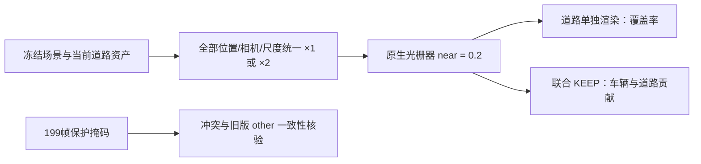

# 当前多视角道路资产：近裁剪零训练复核

当前 `multiview008_r2` 道路资产仍受到原生光栅器近裁剪影响。统一缩放全部几何与相机可恢复近处道路覆盖，但在保留目标车的联合渲染中会明显遮挡车辆。因此，这组控制实验不能作为生产近裁剪修复；道路与车辆的物理深度关系仍须单独解决。

输入为 `multiview008_r2/gate_experiment/final_manifest.json` 和当前 `world_road/reference.npz`，道路有效行数为 **108,216**。运行了 raw119、raw198 的道路单独渲染各两次，以及 raw119 的 KEEP 联合渲染两次，共 **6次前向、0次参数更新**。耗时11.35秒，CUDA峰值分配2.19GB。生产 `raster_units` 保持关闭，场景持久张量不变。

控制对全部位置、相机平移和尺度统一乘2，预计算协方差乘4，原始特征不变。投影平面坐标的最大误差均为0；这不是仅缩放道路的控制。KEEP对照额外保留原生行原有 `depth > 0.2` 可见性，两组允许进入光栅器的原生行均为914,717。

`meter_to_model = 0.0188499258661`，因此固定近裁剪0.2对应相机深度 **10.610米**；统一乘2的控制对应 **5.305米**。这里是相机深度阈值，不是相机到点的欧氏距离。

| 指标 | raw119 原单位 | raw119 统一×2 | raw198 原单位 | raw198 统一×2 |
|---|---:|---:|---:|---:|
| 目标区域内、fit>0.05的像素数 | 2,518 | 2,518 | 2,601 | 2,601 |
| 上述区域纯道路alpha均值 | 0.38941 | 0.99885 | 0.36854 | 0.99828 |
| 上述区域alpha>0.5像素数 | 980 | 2,518 | 958 | 2,600 |
| 道路中心深度不超过当前近裁阈值的行数 | 41,696 | 0 | 43,490 | 0 |
| 这些被裁行中正投影半径行数 | 0 | 0 | 0 | 0 |

当前查询道路映射的有效道路范围与训练区域分别统计：raw119、raw198 的 `target ∩ inside_active` 为3,741、3,977像素；`target ∩ fit>0.05` 为2,518、2,601像素。后者中真实多视角认证域为8、19像素，推断域为2,510、2,582像素。这些覆盖统计描述当前资产及其监督资格，不能把推断域或未观测区域当作真值。

在 `inside_active` 内、相机深度处于5.305—10.610米的查询像素中，raw119、raw198分别有9,962、9,981像素。原单位道路alpha均值仅0.02043、0.01887；统一×2后为0.98597、0.98359。这与被裁中心正投影半径为0的证据一致。

KEEP raw119 中，`target ∩ fit>0.05` 的目标车辆alpha均值由 **0.80270降至0.25345**，道路alpha由 **0.09714增至0.72263**，RGB绝对变化均值为0.19019。对比图可见车辆下部被道路覆盖。该结果只证明当前裁剪和深度排序存在待解决的问题，不证明统一缩放后道路的物理位置正确。

全199帧CPU保护核验通过：`retained_reveal_guard` 共170,925像素帧，逐像素等于 `target ∩ nonfocus_dynamic_alpha>=0.25`；`retained_box_guard` 共316,224像素帧。两类保护区与fit、真实域和推断域的冲突均为0；`other` 相对上一版变化为0。详细逐帧结果在 `guard_audit.json`。

可查看同目录 `report.html` 的3张对比图；完整指标在 `metrics.json`，原始数组在 `119_pure.npz`、`198_pure.npz`、`119_keep.npz`。此次全部输出位于独立审计目录，未修改生产场景或启用近裁剪包装器。
