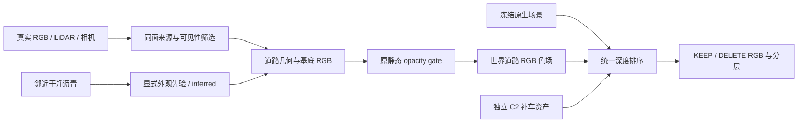

# 008 道路成功链路只读回查

日期：2026-11-11。范围：只读 SSH、源码与小型收据核对，以及 065 已保存 road views 的 CPU 计数；没有训练、渲染、远端文件修改或电源操作。

远端 `CAMP=/root/autodl-tmp/drivingeditor_repro/campaign`；`REPO=/root/autodl-tmp/motion_proj_v82_gn11_v42`。下文证据路径相对这两个根目录。实际 campaign 不在 Git repo 内。

## 结论

008 的采用链不能概括为“冻结现成道路，仅训 1000 步 static gate”。它包含**明确选择的真实来源、补建的道路表示、静态合成交接，以及道路颜色学习/校准**，不同历史阶段的可训练参数不同。补车 C2 与补道路是两个表示分支；两者最终进入同一次高斯深度排序。

早期选中 C 确实有显式限定的道路颜色来源帧 **raw138–169**。代码把目标相机射线对应的同一世界道路点投到这些源帧，要求实测几何和可见性资格，然后生成参考；这不是随意取一块邻近沥青作为同面真值。后来的 2026-11-05 road1k 从完整 **raw000–198、199 帧 FRONT RGB** 重新取色。当前能引用的源码/合同证明“来源帧范围被显式指定”；尚未找到用户手动圈选的 source ROI、具体鼠标操作或原始聊天指令，不能把硬编码范围进一步宣称为已经核实的“用户手选某个矩形”。

065 已经有自动生成的 2 cm road chart，不能说完全没有补建道路；但 handoff_fix 仍使用此前相同的冻结 road。其目标车投影中，当前资格下真实道路参考仅占 **5.04%**，推断占 **31.05%**，无参考占 **63.91%**。放宽 gate 候选并不增加来源、几何或颜色容量。下一步应先补道路来源与表示，再做配套 gate 和必要色场；未知区不生成虚假的 photo target。

## 组件与数据流

图中的邻近沥青先验是对 065 可采用的数据角色划分，不表示旧 008 具有人工 ROI 接口。旧 008 已使用明确标记的邻近沥青 IDW 推断。

## 一、早期用户选中 C：来源与实际优化

权威纠偏：`REPO/scripts/worldsim_v82/drivingeditor_shadow_rebuild_20261017/r15/gn11_stage1_v42_20261024/controlled_smoke_20261026/C_MECHANISM.md:3` 明确选中的是：

`CAMP/r15_gn11_v42_controlled_20261026/edit_smoke_preserve/full199/checkpoint1000_from0.pth`

`edit_visibility/full199` 是未选中的强透射对照。旧 `VISIBILITY_VARIANT_AUDIT.md` 顶部也有更正。**C 这个画面选项与 C2 补车资产不是同一命名。**

### 来源帧与目标字段

- `CAMP/r15_gn11_v42_controlled_20261026/source_delivery/prepare_crossview.py:14–34`：优化/诊断相机 raw102、129、137；目标为 `actor_labels==4 | actor_labels==5`，即 a6/a37。
- 同文件 **第 19 行**：`sources=list(range(138,170))`，因此明确取 raw138–169。投影 `xyz` 是目标射线与已建实测道路的交点；逐源调用 `measured_patch_evidence`，排除 `guard` 和 `ray_box_blocked`，再从真实 `FULL/rgb/{src}.png` 采样。
- 第 28–34 行：合格源的 RGB median；内点 MAE≤0.05，至少 3 个、至少占几何有效源的 60%、跨度至少 3 帧。保存 `crossview/{raw}.npz` 的 `rgb / valid / target / counts / sources / depth`。缺证据像素的 `valid=False`，不是黑色道路标签。
- `edit_smoke_preserve/full199/contract.json` 实际记录 `training_frames=[102,129,137]`、`source_frames=[138,169]`、`static_initial_multiplier=0.999`、预算 1000。`source_frames` 是范围端点，不是仅两帧。
- 道路初始化为 `r15_gn11_fullclip_cpu_20261026/full199_initialization.npz`：199 帧构建、7848 个合格道路高斯。`REPORT.md` 明确完整片段带回 raw141–159 一带此前 49 帧没有的中心道路见证。新增观测是新增 BUILD 输入，不是算法同输入收益。

### 参数与损失

`source_delivery/train_edit_smoke.py:25` 的 Adam 同时更新道路 `dc`（lr0.0025）、道路 `opacity`（lr0.05）和独立 static `gate`（lr0.05）；道路 xyz、scale、rotation 和原生 B 参数冻结。

实际第 46–54 行：

\[
L=L_{deleteRGB}+L_{outsideKeep}+0.1 L_{roadContributionShortfall(0.25)}+0.1L_{visibleSoloRoadRGB}.
\]

- `L_deleteRGB`：统一场景输出与 `crossview.rgb` 的 sRGB L1，只在 `crossview.valid` 上。
- `L_outsideKeep`：目标轮廓外与原 static baseline 的 sRGB L1。
- contribution 项是小权重软目标；并不要求每个像素必须由新道路承担。
- solo road 项：真实可见道路 `dense_training/{src}.npz['rgb']`；mask=`visible`，由小实测三角形与 guard/box 筛选生成。训练相机选择 raw102、130、137。
- **没有**强透射对照后来加入的整射线 `-log(1-alpha_static)` 项。

`C_MECHANISM.md` 的固定状态干预显示：部分区域通过原 static 的 opacity 重分配改善，另一些区域由新 road 补偿；静态和道路共同合成有效。不能把 road alpha×T 越大当成更好，也不能仅因某点 road 贡献为零就否定其编辑效果。更不能由颜色效果推断几何已正确。

## 二、2026-11-05 road1k：先补新道路，再固定道路训 gate

run：`CAMP/scene008_blue_global_road1k_20261105_r1`。

### 真实来源与道路表示

`source/prepare_road37.py:13–17` 的实际依赖：

- `OLD=shadow_a5_a37_199_20261103_r4/inputs`：继承经过资格检查的 8 cm 道路图表/源可见性。
- `FULL=r15_gn11_fullclip_cpu_20261026`：实际 199 帧 RGB 与相机/几何缓存。
- `META=r15_gn11_stage1_v3_20261020/road_multiview_002/bundle.json`：场景特定坐标、曲面与单位。
- `BASE=native_delete`：匹配此次新 native10K 的删 a37 输出，仅用于残影/保持/自适应偏置；不是拿删车渲染当真实道路来源。

`prepare_road37.py:53–91`：在源资格与 a37 证据范围内，细分为 2 cm 切平面子格；几何来自原测量父面片，缺测父格可在≤0.6 m内使用最近测量平面。它是**新增道路高斯表示**，不是新 LiDAR 测量，也不是梯度学出的新几何。

每个细格重新投影 raw000–198 的真实图像，结合原 `source_valid` 与 guard；在上四分位亮度簇中选投影分辨率最好的源，至少 3 个颜色一致源才标 `real_active`。若不够，仅允许从 8 个附近实测沥青格作≤0.6 m IDW，标 `inferred=True`、`best_source_raw=-1`，拟合权重0.25；不进入真实参考指标。

第 97–110 行用原 native 的干净邻域颜色减真实参考，构造世界稳定、各向异性的偏置：σ纵向0.8 m/横向0.4 m，每通道线性 RGB 限幅±0.025，剔除车体、标线与残影。这个偏置是构建期计算，不是 1K 阶段可训练的道路材质。

`inputs/receipt.json` 实际计数：143248 个细格，138451 个真实参考格，4797 个推断格，当前包 unknown=0。后者只描述被纳入该有限图表的格子；不能推断整张图/整条道路没有未知。

注意：`settings.json['source_policy']` 仍含 `no new colour interpolation` 旧文案；实际代码启用了 inferred，收据明确 `no_new_colour_interpolation=false`。应以代码与实际计数为准。

### static gate 的 photo target 与保护

`source/repair37.py:13,18–24,117` 只从 `road_runtime.py` 导入 `StableRoad`，随后 `self.road.requires_grad_(False)`；优化器只有 `gate_raw`。因此 `road_runtime.py` 中独立的旧 `train()`、道路 DC/opacity 优化、局部行删减和 `torch.where(route,branch,base)` 并不是本次实际运行路径。

`source/repair37.py:35–48` 的实际损失：

\[
L=L_{photo}+2L_{native}+4L_{marking}+3L_{otherVehicle}+2L_{leftRoad}+0.0005\operatorname{mean}(1-\sigma(g)).
\]

|项|实际 target 与范围|
|---|---|
|photo|`linear(out.rgb)` 对 `views/{raw}.npz['recovery_reference_linear']` 的加权 L1，权重 `fit_weight`，按 `3*sum(weight)` 归一化。target 是上面新 2 cm 真实/推断 road 参考加干净邻域偏置。|
|native|`out.rgb` 对匹配此次 parent 的无新road/gate删 a37 baseline；权重 `native_keep_weight`，按 `3*sum(keep)` 归一化。|
|marking|`marking_mask` 内相对 baseline 的 sRGB L1。|
|otherVehicle|`other_vehicle_guard` 内相对 baseline 的 sRGB L1。|
|leftRoad|`valid & domain_a5 & ~domain_a37 & actor_labels==0` 内相对 baseline 的 sRGB L1。|
|prior|轻量保留原 static opacity 的先验；并非把 unknown 行强制压到0。|

`prepare_road37.py:120–127` 构造视图：repair 在 active road 上且排除其他车辆；`fit_weight` 的 inferred 部分乘0.25；a37车体投影退出 native keep。未经过相同资格的隐藏区域不应添加 photo target。

`repair37.py:94–110` 用 all49、真实 joint raster 的 alpha×T 贡献选择 static 行：`score>1e-4` 且非 `guard>20*score`。实际 82427/1042776 行；这些是合成贡献候选，不是语义污染真值。`replay_binding.json` 和 checkpoint 将 gate ids 精确绑定到此次 native10K 的拓扑。旧模型的 gate 索引不能跨 065 或新拓扑复用。

`formal/contract.json` 实际记录 `only_static_opacity_gate_trainable=true` 与 `road_colour_geometry_opacity_fixed=true`。native 时间参数不变；keep/delete 使用相同 road/gate；无图像后贴或全局时间替换。

## 三、M2 final 确实另有道路颜色参数学习

run：`CAMP/scene008_blue_global_M2_final_20261105_r1`。

- `source_snapshot/run_finalize.py:84–106` 实际执行 coarse6×5 fresh → fine11×9 fresh → 重新加载系数 → render。`receipt.json.completed` 与 `fine_binding` 均确认启用。
- `source_snapshot/calibration_adapter.py:11–26`：KEEP 用真实观测 RGB，fit 为 observed road 且去掉 shadow proxy；DELETE 用 `observations/frames/{raw}.npz['road_edit_rgb']`，范围 `road_edit & fixed_ground`。保护域 `obs.protect & ~road`。这不是当前车身 RGB 当删车后道路 target。
- `road_edit_rgb` 的上游可追至 `scene008_instances_20261105_r1/source/object_observations.py:241–253`：来自旧已审 road view 的 `reference`；`observed_road_edit()` 同时要求 repair/valid，排除 inferred、inferred_fine、weak_measured。它是有来源的重观测 road proxy，仍不等于独立干净反事实 GT。
- `calibration_method.py:16,107–196`：精确共享排序 alpha×T 设计矩阵；6轮 IRLS/BVLS，节点限幅±0.09；KEEP/DELETE各自归一化，protect权重0.40；fine 有 coarse anchor 与空间正则。最终99×3=297个世界 RGB 系数，54次稳健线性求解，梯度训练更新0。**没有 SGD 不等于没有拟合颜色参数。**
- 40 个 BUILD 视图，9 个颜色 target holdout：89、95、101、105、113、121、125、130、137。native 已训练过本49帧，且199帧参与road BUILD；这9帧不能叫独立场景泛化。
- `final_runtime.py:303–325` 实际输出：`clamp(baseline_colours + world_basis @ fine_world_coeff,0,1)`。fine 是对 baseline 的绝对 residual；不再叠一次 coarse。它只换道路 RGB 表，不改变冻结几何、alpha和深度排序。

所以，008 完整采用链中确实有颜色学习：早期 C 直接学 DC/opacity，后期 road1k 只训 gate，但之后另有世界道路色场求解。两者不可互相替代叙述。

## 四、v44 的道路与 C2 补车双分支

`CAMP/scene008_v44_rgb_asset_20261107_r1/contract/input_contract.json` 明确绑定：

- native：`scene008_blue_global_rgb_probe_20261105_r1/global_10k`；其 RCR-1 恢复全图 joint RGB×1，蓝色修复不是推理时删 SH。
- road/gate：上述 fresh road1k 的 `formal/checkpoint001000.pt`。
- fine：上述 M2 final 的 `fine11x9`。
- C2：`scene008_a6_insert_artifacts_20261105/surface_fit/combined_v1/observed_fit/formal/complete_a6.npz`，匹配 posterior 与 SurfaceLOD wrapper。
- policy：`calibration_mode=frozen_transfer_from_rcr1_m2`、`recalibrated_for_current_asset=false`、新训练/新求解0；旧M2只作来源证明，当前不加载旧M2当C2。

`source/v44_runtime.py:245,331–366,467–507`：加载匹配 gate 和冻结 fine；物理移除所有 native a6 后插入当前 C2/SurfaceLOD，保留 native a37 时间状态；DELETE只移除 a37。static、a37、C2、road 同一深度排序，最后加 `(1-alpha)*EnvLight`。这就是“补车与补路面两个分支”的实际接线。

更换 C2 会改变 alpha×T；该 fine 是冻结迁移，不能声称已针对新车体重新标定。更不能直接跨场景给 065 复用其系数。

成功边界：`REPO/docs/autoresearch/scene008_rcr1_20261105/evidence/user_acceptance_20261105.json` 的采用范围仅为异常蓝色 RGB 修复。raw130/137 银灰残片仍开放；后期道路 prior assessment 还发现原road有限世界域外的显露路面。旧图不是所有隐藏道路均正确恢复的证明。

## 五、065 与 008 的实际缺口

`CAMP/waymo_val065_handoff_fix_20261111_r1/registration.json`：相同 native30K、原生/环境更新0，road颜色几何固定；32步保存及CLI后精确恢复剩余968，正式总预算1000。

`world_road/receipt.json`：2cm automatic robust tangent-plane adapter；176904格，75206 real、92332 inferred、167397 active、9507 unknown。几何准备不同于008原scene-specific road chart，不能当成逐位冻结预处理的复现。

`source/run.py:30–33,53–55` 与 `reference_equivalence.json`：此次 handoff_fix 构建结果与旧 road reference 的全部字段相同；没有增加道路颜色或几何。`source/v44_gate_fit.py:138–164` 只训练static opacity gate；与008 road1k相同的六项损失权重，没有后续世界颜色求解。

只读逐帧汇总 `world_road/views/[000..198].npz`，固定目标 mask 分母：

|当前图表域|像素帧|占目标|
|---|---:|---:|
|`target & real_domain`|70853|5.04%|
|`target & inferred_domain`|436293|31.05%|
|`unknown_target`|897981|63.91%|
|目标总计|1405127|100%|

候选增至76861行，其中31365行没有 fit 参考；候选覆盖修复已经完成，但它不产生真实 photo 监督。这些 unknown 是**当前图表、投影与准入下无参考**，不代表完整原始传感器中永不可观测，也不代表应当清空的车辆点。

## 六、可复用的最低完整道路修复链

1. **先固定来源与角色。** 列出源帧/相机/ROI；同世界点且通过几何与可见性检查的样本才作 measured proxy。手动指定的邻近 clean-asphalt ROI 可提供外观先验，但缺少同面对应时必须标 appearance prior/inferred。分开保存源图像位置与目标世界格映射。
2. **覆盖所有目标射线，再标资格。** road chart 可扩到完整目标车投影与必要边界，full-ray覆盖不自动赋予真值或开启颜色loss；真实、推断、unknown 三类分别保留。先证明确有road rows与有限足迹覆盖，再判断遮挡交接。
3. **构建一份世界稳定道路表示。** 几何只用合法测量或明示几何假设；缺测纹理可用显式沥青先验填充，但不写成真实重观测。保留标线/邻车保护、边界过渡与时间不变性；核对真实源和prior对各域的贡献。
4. **在这一固定road上重选当前30K的static贡献行并训gate。** 固定同面photo域，unknown不造target；其候选可以覆盖完整目标，但只有有合法target的域产生相应photo约束。保留native/标线/邻车/左道路损失，不能以强透射或清空unknown替代完整链。
5. **需要时拟合道路世界色场。** 在当前场景重新做有界、小容量颜色校准，使用合法真实道路与明确单列的prior约束；unknown不作为真值。不能把008既有11×9系数直接移到065；不得重复叠coarse残差。
6. **统一排序后验收。** KEEP/DELETE相同road/gate；先核对实际分层RGB、alpha×T和来源支持，再看最终图像、其他车辆/标线/外围变化、边界及完整时间序列。道路贡献是解释量，不能作为越大越好的验收目标。

目前证据支持补齐上述链，**没有**证据支持“只加1000步gate必然复现008”或“强透射压低static就完成道路恢复”。

## 可引用的一手证据索引

|问题|精确证据|
|---|---|
|早期source frame范围|`CAMP/r15_gn11_v42_controlled_20261026/source_delivery/prepare_crossview.py:19`；`edit_smoke_preserve/full199/contract.json`|
|早期选中C损失与学习变量|同run `source_delivery/train_edit_smoke.py:25,46–54`|
|未采用强透射的纠偏|`REPO/scripts/worldsim_v82/drivingeditor_shadow_rebuild_20261017/r15/gn11_stage1_v42_20261024/controlled_smoke_20261026/C_MECHANISM.md`|
|11/05新road真实/推断与偏置|`CAMP/scene008_blue_global_road1k_20261105_r1/source/prepare_road37.py:53–127`；`inputs/receipt.json`|
|gate target/保护/仅gate可训|同run `source/repair37.py:18–48,94–117`；`formal/contract.json`|
|M2最终实际加载fine|`CAMP/scene008_blue_global_M2_final_20261105_r1/source_snapshot/run_finalize.py:84–106`；`receipt.json.fine_binding`|
|fine target与求解|同run `source_snapshot/calibration_adapter.py:11–26`；`calibration_method.py:107–196`|
|fine输出公式|同run `source_snapshot/final_runtime.py:303–325`|
|v44 C2和road两分支|`CAMP/scene008_v44_rgb_asset_20261107_r1/contract/input_contract.json`；`source/v44_runtime.py:467–507`|
|065保持原road/仅gate|`CAMP/waymo_val065_handoff_fix_20261111_r1/reference_equivalence.json`；`registration.json`；`gate1000/receipt.json`|
|065真实/推断/unknown分母|同run `world_road/views/[000..198].npz` 的 `target / real_domain / inferred_domain / unknown_target`，本次只读CPU重算|

限制：本次未重新加载多GB原生checkpoint、未重渲染成功图、未新做训练因果消融；采用链依据实际运行源码、contract、receipt与既存采用决定交叉确认。没有发现人工source ROI，不等于历史绝无该操作；当前可证的是明确源帧范围和逐世界点来源资格。
