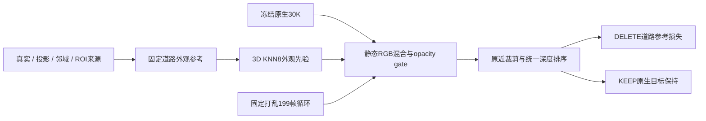

# 065 道路外观原型收口代码审查

2026-11-11。只读检查执行源码、收据、checkpoint 与既存渲染；本次未改训练/运行源码，未启动 GPU 工作。审查截止：cycle 分支仅完成32步pilot，用户随后明确要求参照008实际geometry-source认证链。当前三组均收为工程原型，额外更新合计1064；后续新正式训练已暂停，未发布平台新图。

`O=/root/autodl-tmp/drivingeditor_repro/campaign/waymo_val065_road_completion_20261111_r1`。

## 结论

**三个原型的运行与恢复证据可追踪，但当前来源构建不是008的忠实复现，不能据此提交最终正式结果。** cycle 原型的真实32步pilot队列、epoch、RNG和采样序列与源码CPU重放一致；其完整循环代码若执行1000步可以保证每帧实际训练5或6次，但该1000步并未执行。

三阶段保留为工程证据，**1000+32+32=1064**，不冒充后续正式1000步预算。旧188帧采样池的运行不能充当完整199帧训练；随机199帧池也不等于实际完整覆盖。cycle代码修正了采样覆盖并加入最近道路映射5m限制，但这些修正仍不能替代8cm父格测量三角形认证、2cm继承与双线性取色的来源链。

结果应标为 **road appearance candidate／来源约束的背景外观与 opacity 交接候选**。它改变部分原静态行的临时渲染颜色和 opacity，不证明这些行属于物理道路，不证明路面几何、深度或近裁剪问题已解决。人工画质结论保持未填写。

## 三个阶段及真实覆盖

|目录（相对 O）|采样池与策略|实际已核对更新|实际访问帧数|记账|
|---|---|---:|---:|---|
|`appearance_handoff`|有道路 photo 的 188 帧；有放回随机|1000＝32+968|186|历史工程 1000；完整结果保留|
|`appearance_handoff_allframes`|199 帧池；有放回随机|32|31|历史工程 32；pilot 保留|
|`appearance_handoff_allframes_cycle`|199 帧打乱完整循环；保存剩余队列与 epoch|32|32|工程32；未续968，来源合同重建前暂停|

第一阶段实际未访问 raw000–010、079、142。raw000–010 被 photo 资格过滤排除，079/142 虽在采样池内也没有被1000次有放回抽样访问。第二阶段的31不是199，也不能用未来随机抽样的期望代替实际覆盖。

cycle控制器 `material_run_allframes_cycle.py` 使用独立目录及独立 `runtime_api`；旧source、checkpoint、日志和输出保留。其启动时注册的 `previous_engineering_replay_updates=1032` 反映前两个阶段；cycle又执行32步后，当前收口总额为1064。该注册原计划把cycle32计入正式预算，随后因用户明确的来源合同被收为工程原型，不覆盖原始注册记录，也不再沿该计划续跑。

## cycle原型的循环采样与恢复接口

冻结训练器 `source/v44_road_material_fit.py` 的实际逻辑：

- `frames.append(key)` 对全部声明帧执行。无道路 photo 的帧仍有 KEEP 目标和保持域；photo 权重不补造。
- 初始 `remaining_frames=[]; sample_epoch=0`；队列为空时复制199帧、以独立 `random.Random(0)` 打乱，epoch加1；每步从队尾取一个 key。
- checkpoint 同时保存 `remaining_frames`、`sample_epoch`、sampler RNG、Python/NumPy/Torch/CUDA RNG、两个 Adam 参数状态、gate、mix、来源 RGB、contributors、帧池和来源绑定。
- 恢复先检查当前 contributors、帧池、来源绑定及来源 RGB，再恢复 queue/epoch 与全部状态；`_differences(z,state(startstep))` 必须无差异才进入续跑。
- `source_binding` 包含实际算法源码、道路参考、view/instance/baseline 和5m阈值。旧随机采样分支不能被当作新 cycle 的同合同 checkpoint 继续使用。

本次直接抽取冻结源码中真实的 `if not remaining_frames` 和 `key=remaining_frames.pop()` AST，在独立 CPU 环境执行1000次，再模拟32步保存＋968步恢复：

|检查|结果|
|---|---|
|连续1000次与32+968恢复序列|逐项相同|
|前5个完整pass|每个pass恰好覆盖199帧各一次|
|1000次计数|194帧各5次，5帧各6次|
|step32|epoch1，剩余队列167项|
|step1000|epoch6，剩余队列194项|

实际cycle pilot的32个key、checkpoint的167项queue、epoch1及sampler RNG，均与上述源码CPU序列逐项相同；snapshot与当时staged源码一致。这只是32步实证加1000步纯采样逻辑核查，不是已经完成1000步。控制器中生成 `frame_coverage.json` 并要求每帧5或6次的后续入口未执行；不能用代码预期替代实际凭据。

## 旧1000步运行的恢复与导出核验

`appearance_handoff` 中已经完成的工程运行具备以下实证，保留为有效的工程追踪证据，但不冒充最终全帧合同：

- 更新记录连续为1–32、33–1000，全部 loss 有限，合计1000；恢复收据为 step32、`exact_full_state=true`、`differences=[]`。
- 全1000次历史采样与 `Random(0)` 在其188帧池的独立重建逐项一致，未发现恢复后重新初始化 sampler。
- 92186个导出 ids 与 checkpoint contributors 相同；材质 NPZ 的 ids、source_rgb、mix 与 checkpoint 逐值一致，gate/mix均有限，mix位于[0,1]。
- 选中行在固定 semantic ownership 中 positive owner 数量为0。四份原30K checkpoint 的既有 size/mtime 身份记录未变；训练优化器只有 gate 与mix两个参数。
- source snapshot 与该运行实际 runtime 的训练器、factory、scene、metric wrapper 四文件逐字一致。
- KEEP和DELETE均为199帧，帧 key 精确000–198；实际 query 分别删除空集和actor10。
- 四个实际 roundtrip raw060/119/150/198 的目标删除后 alpha 均为0，KEEP→DELETE→KEEP RGB最大差均为0；分组alpha守恒最大误差≤1.61e-6。

这些检查证明保存、恢复、导出和查询操作接线成立，不证明画质或隐藏道路表面正确。

## KEEP保护与实际损失

训练器计算两次统一排序：DELETE使用原 `values.mask` 再排除目标owner；KEEP使用同一批已混色、已门控的 rows，但保留原 `values.mask`，不沿用DELETE mask。KEEP RGB 对照原30K `v1_30000/{raw}/keep.npz`，目标区域来自固定actor10标签，权重2。

\[
L=L_{roadPhoto}+2L_{deleteKeep}+4L_{marking}+3L_{otherVehicle}+2L_{leftRoad}
 +2L_{keepTarget}+0.0005\,mean(1-\sigma(g))+0.0005\,mean(mix).
\]

道路 photo 为线性RGB加权L1；其余图像保持项使用sRGB。`L_keepTarget` 的参考是原生重建RGB，并非真实无车道路。DELETE保持域退出完整目标，其他车辆和标线独立保护，缺参考像素不生成新的道路真值。

旧188池因此也只在这些抽到的帧上计算KEEP项，这是其全帧合同缺口。循环代码使无photo的前11帧进入采样池，32步pilot已实际抽到raw010；只有继续完成完整循环预算才会形成全199帧实际训练覆盖，而本次已在32步暂停。保护项本身也不能替代图像质量验收。

## 来源角色与5m限制

固定道路参考总588861格，active354165格：

|角色|格数|解释|
|---|---:|---|
|real|352|原生源像素深度与至少3个一致RGB支持的观测代理|
|projected|201349|测量平面支持的投影RGB；不是逐像素实测同面真值|
|neighbor inferred|131554|邻近道路颜色推断|
|reviewed ROI appearance prior|20910|显式审阅沥青ROI借色；不同世界位置的外观先验|

训练器按候选静态行的原模型坐标经 `model_from_world` 逆变换得到世界位置，从 active road 做3D KNN8，按 `1/max(distance,0.1)^2` 融合固定 `source_rgb`。这里没有给候选行赋予道路身份，也没有从目标车RGB构造删除后的道路标签。所有该材质映射都应称 appearance prior，不能因为底层参考中有少量real就将整个92K行材质称为实测。

旧188阶段没有候选映射距离上限：最近距离中位0.360m、p90=1.474m、p99=31.882m、max=58.264m；2606行最近距离超过12m，其中1328行最终mix>0.05。这是已观察到的旧范围问题，已在新分支收紧。

后两个原型以**最近一个道路邻居距离≤5m**定义 `material_allowed`。它不宣称8个邻居都在5m内，更不建立同物理表面的对应。禁止行在forward中乘0，优化后再置mix=0，opacity候选仍保留；5m阈值进入来源绑定与收据。

allframes随机pilot已实证：87278行允许、4908行禁止；allowed与距离条件逐位相同，禁止行checkpoint及材质export的mix均精确0。cycle代码保留同一限制，状态按新算法绑定独立记录。这个限制是候选材质的适用范围修正，不能补回缺失的008测量认证。

## 默认行为、范围和结论用语

训练入口明确拒绝已有 `static_material`、已有static gates及非空 `raster_units`，从原生输入开始。控制器仅在派生pilot/final manifest中接入新gate与材质文件。已读实际KEEP/DELETE manifest均 `raster_units=None`，没有误启统一近裁剪适配，也没有只缩放道路来改变深度。

factory/scene只对固定semantic owner≤0的原生静态行做 `baseRGB*(1-mix)+sourceRGB*mix`，使用非原地 `index_copy`，持久SH、几何、运动和环境参数保持。模型参数颜色未更新不等于渲染RGB未改变，报告应区分两者。已有CPU协议测试验证了默认off、mix0、输入复制/冻结、owner限制及原opacity gate并存。

`coverage.json` 中继承的 `reference_weights_unchanged`、`unknown_target_supervision_added=false` 只描述训练器未再次改写本次views。它们不能被用来声称相对旧road完全没有新增监督：本次views确实加入了明确标记的 projected/neighbor/ROI外观先验。

正确收口表述：**三组道路外观工程原型，共1064额外更新，尚未忠实复现008来源认证；仅第一组完成1000步和全199帧输出，后两组各32步pilot。原生30K参数不变，近裁剪与物理深度问题未解决，BUILD代理与借色先验不是独立隐藏道路真值。平台未发布新图；后续应先重建忠实来源资产，再登记正式合同。** 本review不填写人工画质接受，也不将颜色变化当作几何恢复或道路身份正确的证据。

主要证据位于各阶段的 `source/`、`registration.json`、`fit32/`、历史第一阶段的 `fit1000/`、`material_sources.npz`、`material*.npz`、`roundtrip.json`、KEEP/DELETE `provenance.json`，以及共享的 `O/world_road/reference.npz`。未执行阶段的后续凭据不得用第一阶段结果替代。

## 008真实来源认证函数与调用链

已实际读取的叶函数为：

`/root/autodl-tmp/drivingeditor_repro/campaign/r15_gn11_stage1_v41_20261023/tools/v41_dense_geometry.py:107`：`measured_patch_evidence(world, ground, K, w2c, query_world, query_pixels, query_normals)`。

它由 `/root/autodl-tmp/fullclip_road_cpu_20261026.py:23` 导入；8cm父格调用位于 `campaign/shadow_a5_a37_199_20261103/source/build_expanded_evidence.py:65`。之后 `prepare_reference.py` → r3/r4派生输入 → `scene008_blue_global_road1k_20261105_r1/source/prepare_road37.py` 继承父格 `source_valid`，生成2cm子格。

### 坐标与root plane

`fullclip_road_cpu_20261026.py:28–31` 从 `r15_gn11_stage1_v3_20261020/road_multiview_002/bundle.json` 的 `original_readiness` 读取：

`/root/autodl-tmp/drivingeditor_repro/campaign/nearby_actors_20261015_v1/baseline_engineering_20261018/full5_pipeline/metadata/scene0008_089_137/CPU_readiness.json`，字段 `SGCM_geometry.ground_fit.plane_anchor`。

实际plane为 `[-0.0053279577,0.0186103311,0.9998126167,0.0670399609]`，法向范数1。原调用中的cloud、query xyz、query normal均为**同一anchor-local米制**，`f.w2l=Tr_velo_to_cam_0 @ inv(ego_pose) @ anchor`。叶函数的形参虽叫world，原调用不是绝对世界坐标。新实现可以统一绝对world米制，但cloud/query/normal/camera/OBB必须一起变换；旧x/y范围不能直接套到绝对world X/Y。

### 8cm父格的真实建面与来源资格

1. `build_expanded_evidence.py:21–26` 的ground：`abs(cloud·plane_n+d)<=0.15m`、anchor x∈[0.5,90]、|y|≤8，剔除全部已标注3D OBB内部点。
2. pool使用原 `ground_local`（原提取阶段x≥3m），再补当前cached nearest cloud中符合ground且x<3m的近处点，按10cm XY格去重。
3. `fullclip_road_cpu_20261026.Surface`：nearest8、半径0.8m、至少3个测量支撑；对root plane的高度残差作IDW。法向由高度在x/y方向±0.05m差分获得，**不是给整张图固定一个平面normal**。
4. 在8cm中心建立query，先要求surface supported、z>0.1m、源图有效边界、2D guard清空、入射cos≥0.12、源图清晰度相对权重≥0.2、20cm等效投影面积≥0.25px²。面积使用 `area_8cm*(0.2/0.08)^2`，不能静默改成8cm实际面积门限。
5. 调用实测三角认证后，另用 `ray_box_blocked(query, camera_origin, all_boxes)` 排除相机到query线段穿过全部3D OBB的情况。

原链没有“网络semantic==road id”作为叶函数参数；ground来自测量平面和3D OBB。2D guard由Waymo前视标注矩形膨胀2px，加原已审occluder mask并集；`prepare_v41_dense.py:26` 中后者也会膨胀2px。语义网络门若加入新适配，应单独说明，不能将其冒称为原始008的同一资格条件。

### measured_patch_evidence的实测认证

- 源投影为针孔 `K@camera_xyz/z - 0.5`，相机深度和UV约定一致；原常数在480×320源尺度使用。
- 全部返回先按每像素最近回波筛选，不能只用地面点建最近深度而漏掉前方非地面冲突。
- query周围1.5px内存在最近回波时，若不是ground或深度差>0.3m，则标冲突并拒绝。
- 对最近ground回波在**图像UV平面**做Delaunay；query必须在三角形内，不外插。
- 三角形最大空间边≤1.6m、最大图像边≤24px；三角形法向与query normal的绝对cos≥0.9；透视正确的倒深度重心插值与query深度差≤0.3m。
- 返回 `acceptable, interpolation_depth, triangle_ids, measured_conflict`；triangle_ids是传入cloud数组的行索引，不能未经来源映射就称为原始全LiDAR文件行号。

### 2cm继承与取色

`scene008_blue_global_road1k_20261105_r1/source/prepare_road37.py:64–90`：8cm父格按4×4生成2cm子格，使用父格测量normal的切平面求高度；每个源帧继承 `source_valid[raw,parent_id]`，对子格重新检查z/边界和order0 guard，再以order1双线性采真实RGB。这里**没有对子格重新以“最近像素depth±0.3m”替代父格三角认证**。

颜色按上亮度簇选最佳投影源，至少3个一致源形成real；缺口只从≤0.6m最近实测沥青邻域取8邻居IDW，独立inferred标记，拟合权重0.25。仅满足投影平面、前方无回波或附近有road语义，不能成为这条认证链的等价替代。

这正是当前prototype来源模块与用户新要求之间的实质差异。

## 新观测模块的只读复核

已通读本地 `source/v44_road_observation.py` 并与上述原始源码逐项对照，未发现阻塞性的核心公式差异：

- `LocalRoadSurface.height/normal` 保留8NN/0.8m/至少3支撑、平面残差IDW的0.05m保护和±0.05m法向差分。
- `measured_patch_evidence` 保留全部返回最近像素、非ground/深度冲突、UV Delaunay、倒深度插值及1.6m/24px/0.9/0.3m/1.5px门限。
- `certify_parent_sources` 保留20cm等效面积、view cosine、quality、2D guard及独立ray-OBB veto，不偷偷加入网络road语义门。
- `inherit_child_sources` 明确继承逻辑8cm父格资格，不使用另一个补几何父格的source资格，不另做子格最近深度替代；guard为order0。
- `sample_linear_rgb` 是先sRGB双线性、后linear；分块q75/颜色一致性和最近0.6m的8NN沥青推断与原式一致。少于8个真实沥青邻居时不推断，是明确的边界保护。

这是**模块核心公式的只读审查**，不等于新065来源资产已通过。模块不负责准备root plane、ground mask、ALL OBB点内排除、10cm去重和真实FRONT 2D注释；这些调用方输入仍需独立核验。世界坐标调用合法，但须保持XYZ/normal/camera/OBB统一米制；24px和1.5px必须对应同一交付源图尺度。

root已开始从原始TFRecord按context和时间戳核对提取真实FRONT camera_labels及全部laser_label类型到 `raw_road_annotations/`，不能把既有 `corners2D` 当作原始2D标注。新builder计划使用真实2D框缩到交付尺度、膨胀2px并与已接受mask并集，及全部3D点内/射线排除。其新target-ground射线60m有界ROI/halo和quality以全199帧中位数归一化，相对旧008的scene-specific范围与raw089–137中位数属于**需明示的通用适配**。

008第一次FRONT缩图用LANCZOS到480×320，随后细格双线性取sRGB再linear。调用方若采用不同第一次resampling，应单列差异，不声称输入逐位复现。

独立 `road_source_audit` 代理随后报告 **15项 CPU_ORIGINAL_PARITY 通过**：载入远端原叶函数及原Surface，对1400个合成query比较mask/conflict/triangle IDs/倒深度、显式UV/depth入口、刚体坐标变换、OBB/父格外围、子格继承、Surface h/support/n、sRGB采样和分块颜色参考，均一致。这补充支持模块核心数值迁移成立；它仍不是新065真实来源资产的认证计数或可观测性结论。实际builder的坐标、ground/guard、来源证据及输出标签须由其独立收据核验。

## multiview008实数据caller追加审查

本次只读 `source/v44_road_multiview.py`、真实注释提取器和 `O/multiview008` 正在生成的资产。所查A-local坐标、单位化plane、ALL OBB去内点、10cm去重、父子格逻辑ID、sRGB采样与cos/z²分数，没有发现新的阻塞接线错误：注释center/axes已由提取器转换到world，builder再同时转入median-target A-local；cloud与camera也使用相同A，geometry seed另有world坐标重建一致断言。2cm `parent` 是 `floor_divide(child_key,4)` 的逻辑映射，几何补偿另存 `geometry_parent_ids`，没有以补几何父格替换来源父格资格。

**发现一项可确认的训练视图保护回退，已在训练前报告root：** 新views使用 `reveal=hit & target & ~other`，没有此前 `retained_reveal_guard` 的独立zero-photo保护。`other`来自当前2D可见标签，不能覆盖目标白车删除后才显露的保留动态分支。

读取生成中的前163帧实际views，`fit>0.05` 与此前已保存的 `retained_reveal_guard` 相交 **4631像素帧**；raw060为2、raw119为68、raw150为74。这不是只凭代码假设的风险。旧guard是保留动态实际贡献≥0.25的已登记保护代理，并不是物理语义GT；其全部199帧原统计为170925目标像素帧。

这一问题不否定新父格实测来源认证，也不要求中止或重跑认证CPU阶段；但新views若用于沿用既有保护合同的训练，应在派生输入中恢复该独立guard，或先明确变更保护合同，不能默称其仍然启用。本审查未修改运行文件。source guard自身margin及native色偏校准的历史差异，由并行 `road_source_audit` 继续单独核对，不与本项query/训练视图保护混同。
