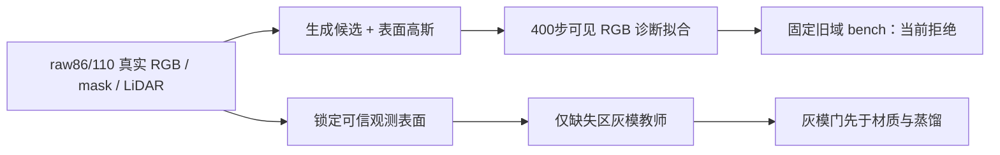

# a20 生成表面与材质诊断归档

当前候选为 diagnostic_rejected_geometry，不可晋升。[报告与组件](report.md)、[交互报告源码](index.html)、[实际执行组件](architecture_executed_r1.svg)、[新版教师协议](teacher_student_protocol_v3.md)。主状态和实验索引只链接本目录。

`run_code/`保存运行代码与冻结 actual-v1；公共 run_surface_student.py 与 run_vehicle_texturing.py 为未来 v2 gate 入口。`report_source/`保留本地报告生成代码及原始 Markdown，顶层 report.md 只转换本地链接。原始观测、模型、NPZ/PT、PNG/JPG/WebP、PLY/GLB均留在独立交付，未放入Git。

400步只是先验初始化和可见RGB拟合，不是完整教师几何/轮廓/新视角蒸馏。总物理更新409=400正式+9smoke，9已包含2replay；original/corrected ledger与材质元数据成对保留。Amodal3R规范输入仅CPU准备，Amodal3R/MM-TRELLIS/RECAST未运行。

当前公共v2按灰模门有意拒绝此候选。历史只读重载使用冻结student/source/run_surface_student_actual_v1.py、保存的原始entry与compact binding；原scene_binding未改写。详见[恢复说明](student/DIAGNOSTIC_RESTORE.md)与[恢复索引](student/restore_index.json)，既有fresh-process五帧八输出maxdiff=0证明保留。本次归档未再运行GPU重载；历史入口不作为灰模晋升或新训练入口。
