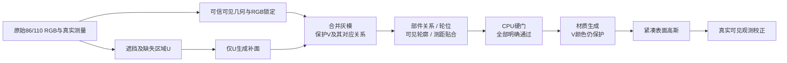

# a20 可见区保护与灰模前置协议 v2

当前整车生成替换候选状态为 **`diagnostic_rejected_geometry`，`eligible=false`**。已执行的整车生成、材质推理与 400 步学生拟合仅作为诊断归档，不称为合格 a20 先验，不追加 GPU 任务。旧 `shape_gate_passed/material_gate_passed` 布尔值只表示当时的工程入口许可，不代表灰模或恢复目标验收。

当前主协议：**锁定真实可见几何与 RGB → 仅对未知区 U 补面 → 灰模四项验收 → 材质 → 表面高斯与真实观测校正**。

## 可见区与未知区合同

- `V` 是经原始图像、可靠可见掩码和测量支持的受保护部分；`U` 是遮挡或缺失区；`B` 是可靠背景。原始 RGB、测距点、相机、实例映射、单位与来源行号都保留。
- 先保存 V 的几何坐标、对应关系和 RGB 绑定，再生成 U。生成结果只作为未知区补面；拼接和过渡处理限于 U，不覆盖已观测车身，不通过整车比例变化吸收缺面。
- 灰模坐标注册单列记录矩阵与依据；可信可见几何的保护应在共同坐标系中核对。测量残差用于独立验收时，不改写为“已经进行深度/几何优化”。
- 材质阶段保留 V 的真实成像颜色及其置信度，U 的纹理保持生成来源。真实 RGB 不自动等于去光照 albedo；metallic/roughness 的生成来源单列。

目前使用的整车生成/纹理接口没有“保护可信几何 patch 并只更新 U”的现成区域写入合同。后续适配必须显式保留可信表面与对应关系、只接入 U 补面，并提供保护证据，不能将整车重生成后再拟合视作可见几何保护。

## 材质前的灰模四项门

| 必须项 | 证据与接受准则 |
|---|---|
| 部件关系 | 固定灰模视角清楚显示驾驶室、货斗、车身面板、保险杠的关系；漂浮、穿插及缺面逐项处理或明确拒绝。 |
| 轮位 | 轮心、轴距、车身间隙与接地关系有可审查证据；可见轮位对齐真实观测，未见轮位明确标为先验。 |
| 可见轮廓 | 固定 BUILD 86/110 与原图叠加，只在真实 V/B 可靠域计算；使用本任务事前明确的数值准则。 |
| 测距贴合 | 使用真实目标测量与其来源，报告实际表面残差及任务阈值；不以生成点或其他帧选择候选。 |

V 几何保护、V RGB 保护和生成仅限 U 是额外必需条件。Alpha 覆盖、网格封闭、atlas 非空等可以证明渲染/文件通路，不能替代这四项灰模验收。旧 CPU 检查的 0.8 覆盖线只保留为历史诊断，不作为 v2 默认准入阈值。

当前 [grey_gate_v2.json](grey_gate_v2.json) 中，四项灰模验收均为 pending；可见几何保护与仅 U 生成记为 failed；整体拒绝。任务专用数值阈值尚未批准，不填通用常数，不代用户填写质量分。

## 可执行 CPU 硬门

`code/check_grey_asset_gate.py` 只使用 Python 标准库。它核对候选文件与证据 SHA-256、任务阈值登记、每项明确的 `status=passed` 和 `passed=true`、审核记录及数值规则。缺证据、pending、规则失败或顶层 `eligible` 未明确为 true 都以非零状态拒绝。

`run_surface_student.py` 的 v2 非 `cpu-import` 入口，在导入 legacy/torch、初始化 CUDA 或构建 Experiment 前执行该检查。材质入口使用同一个检查器并绑定实际 mesh 文件。当前候选 checker 与 student 入口均实测退出 2，`torch_imported=false`、`cuda_initialized=false`；最小合成 schema 只验证逻辑，禁止用作真实入口通过资产。

已执行 400 步的实际 v1 源码冻结在 `student/source/run_surface_student_actual_v1.py`；新硬门是后续入口修复，不重跑历史训练。

## 当前诊断事实与现场

BUILD 仅 86/110，其余 134/179/198 不拟合、不挑先验。选定 5 帧的底部四分之一没有真实可见像素；全 199 帧中有 25 帧存在该区域零星像素，二者分别记录。1030 个 BUILD 实测代表点保留 86/110 与原始点行号；OBB 筛选不升级为语义真值。

最终 heading-fixed 网格已经完成固定朝向修正与已知 5×2.5×2.08 m 粗框配准；尺寸是后处理输入，不是生成原生精度。最终同域 CPU 核查：精确点面 mean **0.08826 m**、p90 **0.29030 m**、p95 **0.39655 m**；86/110 可见核心覆盖 **96.6169% / 95.2368%**，可靠背景 spill 为 0。这些是独立核查数字，未用于选择方向或拟合生成几何，不能替代灰模四门。

历史诊断链为 point-only 失败杆架 → 单张 amodal 条件图加 bbox 的整车候选 → 一次 PBR 推理 → 25k 表面高斯固定 200+200 更新。两个生成候选改变了图像及控制模态，不用于分解独立图像收益。学生训练保持几何、法向和尺度固定，75 行 a9 sidecar 固定；teacher 与车辆梯度隔离、完整恢复和独立进程重载通过，只证明接线。

物理 optimizer 更新共 **409 = 400 正式 + 9 smoke**；smoke 已包含 2 次 replay，之外额外更新为 0。原 ledger 保留，使用 corrected ledger 解释继承的重放字段；formal 的 647 raster / 600 backward 仅属该进程，不报告为整个任务总调用。

官方能力边界见 [Omni pipeline](https://github.com/Tencent-Hunyuan/Hunyuan3D-Omni/blob/main/hy3dshape/pipelines/pipeline_generation_sit_omni.py)、[TRELLIS.2 固定网格纹理接口](https://github.com/microsoft/TRELLIS.2/blob/main/trellis2/pipelines/trellis2_texturing.py)。SVD 是视频生成，SV3D 是合成多视图视频，不能把这些输出当真实新增观测。[Stability AI 官方说明](https://github.com/Stability-AI/generative-models#readme)

旧诊断协议保留于 `history/prior_review_semantic_diagnostic_r1.md`；原始网格、变换、点来源、float 渲染、模型、检查点与日志均保留。当前只完成必要 CPU 评价、硬门修复、取回和归档，GPU 保持开机。

免责声明：未观测车体与大量材质属性仍属于生成先验，当前整车替换结果没有获得几何质量或恢复目标通过。诊断指标、完整文件或成功训练不构成隐藏表面真实验证。
