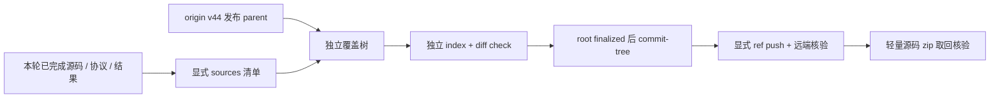

# 车辆补全先验试验轻量归档

本轮已收到 root 的 result/report finalized。当前候选为 diagnostic_rejected_geometry；实际400步作为初始化与可见RGB拟合诊断归档。

归档目标为 `docs/autoresearch/vehicle_completion_prior_20261122/`，发布分支为 `research/worldsim-v8.2-drivingeditor-v44`。只接受显式列举的轻量文本源。模型、NPZ 点云、PNG/JPG、GLB/PLY 与并行道路任务均不进入 Git。



## 当前准备

`capture_preflight.py` 仅读取发布分支和共享 Git 状态，写入本轮 publication 新目录。共享 HEAD/index、tracked dirty 内容以及并行 2D/road_multisource 均不修改。状态更新采用精确旧片段替换；新片段之外的前后文本保持原样。

模板两个完成字段保持 false，`actual_result_kind` 和 `actual_training_performed` 等待最终结果。`sources` 需包含实际 worker/adapter、固定协议、关键小型收据、`architecture.svg`、报告源和本目录工具。每条使用远端绝对来源和归档相对目标，例如：

```json
{"source":"/root/autodl-tmp/drivingeditor_repro/campaign/vehicle_completion_prior_20261122_r1/conditioning/prepare_real_inputs.py","destination":"docs/autoresearch/vehicle_completion_prior_20261122/run_code/prepare_real_inputs.py","role":"run_source"}
```

若 root 判定有同一条 V82-F06 新证据，填写可选 `failure_append`（`source`、`task_marker`）；工具会在 scratch 重建 failure 索引，不运行共享工作区的生成器。

## finalized 后的执行顺序

先查询当前 `localtun sessions` 并验证代理。冻结正式清单和新的状态/实验片段后，再运行：

```bash
export CUDA_VISIBLE_DEVICES= OMP_NUM_THREADS=1 OPENBLAS_NUM_THREADS=1 MKL_NUM_THREADS=1
python prepare_archive.py manifest.final.json --output /ABS/NEW/archive_r1 --proxy http://127.0.0.1:PORT
python publish_selected.py /ABS/NEW/archive_r1/plan.json --proxy http://127.0.0.1:PORT
python validate_archive.py /ABS/NEW/archive_r1/plan.json
# 查看 staged.diff 和 source_validation.json 后再执行：
python publish_selected.py /ABS/NEW/archive_r1/plan.json --proxy http://127.0.0.1:PORT --commit
python verify_published.py /ABS/NEW/archive_r1/plan.json --proxy http://127.0.0.1:PORT
```

SCP 取回 `publication_takeback.zip`、`takeback_receipt.json` 和收据后，本地运行 `verify_takeback.py`。parent 已变化时重新准备；不 reset、merge、checkout 或 force-push。
