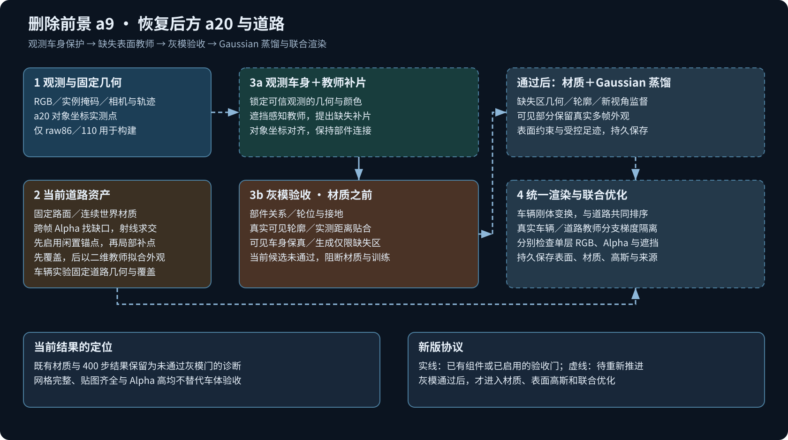

# a20 生成先验与表面高斯：未通过灰模的诊断结果

2026-11-22。目标为删除前景 a9 白色 Mazda（native10），补全后方 a20 黑色皮卡（native21）及被遮道路。当前候选不合格，不替换既有资产；材质与400步仅作诊断归档。

## 本轮实际执行

BUILD 仅用 raw86／110。两帧框内实测点1033个，经2厘米体素选真实代表点后为1030个；未读取诊断帧 LiDAR。RGB可见核心与遮挡分开保存，原始图1920×1280，学生渲染1152×768。

| 环节 | 实际设置与结果 |
|---|---|
| 纯点控制形状诊断 | Omni，seed101，50请求步，CFG0保留点控制、消去图像；形成扫描线栅架，拒绝。 |
| 完整语义条件图 | 冻结SD1.5 inpaint base，无道路LoRA，单图seed101／DDIM20／CFG3；可见核心原像素硬拷贝。 |
| 图像＋粗框形状候选 | 同一Omni，seed101／50步／CFG4.5；连续车身与四轮形成，但含浮镜、凸顶、轮形错误。 |
| 尺寸与方向登记 | 已知5×2.5×2.08米三轴尺寸配准，语义航向修正；原始网格、初始变换及最终变换分别保存。 |
| 材质诊断 | 单次TRELLIS.2固定网格纹理，512／1024纹理，输出PBR；存在错位纹理、伪字和偏灰轮胎。 |
| 学生初值 | 25,000近均匀表面采样高斯，法向薄轴、UV及逐点来源；没有复用旧大足迹车辆高斯。 |
| 短程优化 | 车辆200步＋联合200步，几何／尺度固定，优化可见支持颜色、有界opacity及1191许可道路颜色。 |

教师生成权重均冻结。400步属于“先验初始化＋可见RGB拟合”，没有完整的教师几何、轮廓和新视角蒸馏。

## 画质、保护与测距

固定旧评分域及旧指标，原生浮点渲染与真实可见RGB比较。raw110：

| 指标 | 上一轮75行交接终态 | 本轮联合终态 |
|---|---:|---:|
| RGB MAE | 0.02017 | 0.03088 |
| 局部SSIM | 0.93247 | 0.87547 |
| σ1 高频对应度 | 0.60749 | 0.36875 |
| σ1 高频能量比 | 0.44598 | 0.34484 |

本轮相对自身初值MAE从0.09828降到0.03088，但仍弱于上一轮；颜色拟合有效不足以说明恢复成功。raw86 a10/native11的3029像素中，2948像素变化超过1/255，真实RGB MAE从0.10102升到0.14937，其他车辆保护失败。

最终灰模方向修正后，实测点到实际三角表面的精确均距8.83厘米、p90为29.03厘米；该测距仅作独立核查，未用于几何优化。部件、轮位、轮廓与测距未形成合格验收；整车生成还替换了真实可见几何。

## 工程检查与资源

真实GPU smoke共9次优化更新，其中2次为恢复重放；正式400次，合计409次。保存的模型、Adam及RNG状态恢复逐值一致；后续CUDA一步存在1.19e-7参数差。新进程完整资产重载五帧八类输出最大差0。车辆／道路损失的跨分支梯度均为0，活跃分支非0。几何、法向、尺度、轨迹、相机及原生模型保持固定。工程检查通过不作为灰模质量通过。

生成阶段共2个形状候选、1张条件图、1次材质推理；没有模型权重训练或参数扫描。原生浮点渲染保留远端，轻量图像与恢复资产取回；GPU按用户要求保持开机。

## 新版协议与当前状态

先建立并保护可信观测表面，只在缺失区使用生成补片；灰模须先通过部件连接、轮位／接地、真实可见轮廓及实测贴合，再进入材质与学生蒸馏。当前 `grey_gate_v2.json` 不可通过；材质shell和学生入口均已实际在Torch／CUDA初始化前拒绝该候选。历史执行源码与原始收据保留。

[教师蒸馏协议](teacher_student_protocol_v3.md)区分真实损失与缺失区几何／轮廓／新视角／特征蒸馏；[Amodal3R／RECAST核查](teacher_model_audit_20261122.md)与[MM-TRELLIS核查](mm_trellis_audit.md)给出接口、开放资源和当前a20适配判断。这些教师尚未运行，下一步仅在资源与灰模门流程明确后做有界候选。

[交互诊断报告](index.html)保留上一轮参照与当前真实渲染，RGB与Alpha分别查看。原七阶段与全部道路实验组保留。

免责声明：下半车身没有完整真实监督，生成部分是受证据约束的假设；自动掩码不是隐藏形状真值。原生场景已见全序列，诊断视角不是独立盲测。新旧系统同时改变多项机制，不能将差异单独归因于某个生成模型。
