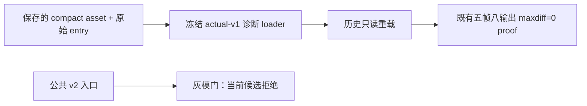

# 当前拒绝状态与历史诊断重载

当前候选为 `diagnostic_rejected_geometry`，不可晋升。公共 `code/run_surface_student.py` 和材质入口属于 v2 前置灰模门，按设计在 Torch/CUDA 初始化前拒绝此候选；此拒绝不表示 checkpoint 损坏。

历史 400 步对应的只读复核入口为已冻结 `student/source/run_surface_student_actual_v1.py`。使用保存的原始 entry、`student/assets/joint_fit/scene_binding.json`、compact vehicle/poses/road RGB patch、固定 a9 sidecar 与原 R2 base binding；路径映射见 `student/restore_index.json`。原始 scene binding 中的 loader 字段保持不变，不能据其 active 路径改用 v2 入口执行历史复核。

既有 fresh-process 重载已完成：五帧、八种 float 输出最大差均为 0，见 `student/disk_reload_proof.json`。本次归档只补充恢复索引与说明，没有重新运行 GPU 重载。历史 loader 仅用于已保存诊断的只读复核，不作为灰模晋升或新增训练入口。
