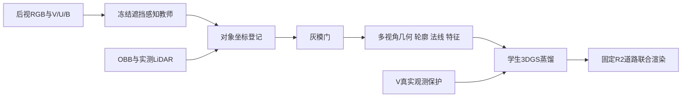

# RECAST / Amodal3R 教师模型核查

核查时间：2026-11-22（UTC+8）。仅阅读官方论文、项目页、代码与模型目录；未运行GPU或下载大权重。MM-TRELLIS由root另行核对。

**结论：Amodal3R有公开可复现资源，遮挡接口更直接，但不是车辆专用模型。RECAST是车辆域适配方法，论文确有遮挡鲁棒训练；目前核实到的官方仓库仅为项目网站，尚未取得可运行生成代码与适配权重入口。**

## 官方资源与接口对比

| 核查项 | Amodal3R | RECAST |
|---|---|---|
| 当前开放状态 | 有训练/推理代码、完整pipeline配置及五份checkpoint；HF公开且非gated，权重合计5,947,858,080字节，约5.95GB。[代码](https://github.com/Sm0kyWu/Amodal3R)、[权重目录](https://huggingface.co/Sm0kyWu/Amodal3R/tree/main/Amodal3R_ckpts) | 官方仓库完整树70个文件，根目录仅`.nojekyll/README.md/index.html/static`，无生成Python、配置环境、checkpoint；GitHub releases响应为`[]`。项目实际外链仅模板/许可证等，未指向可执行方法或模型下载。[官方仓库](https://github.com/ZijunKr/RECAST)、[官方项目](https://zijunkr.github.io/RECAST/)、[releases API](https://api.github.com/repos/ZijunKr/RECAST/releases) |
| 真实输入 | 原RGB + 三值mask；白255=背景、灰188=可见、黑0=遮挡。单图也调用`run_multi_image([image],[mask])`。该入口不接LiDAR或已标定相机位姿。[README](https://github.com/Sm0kyWu/Amodal3R#inference)、[实际入口](https://github.com/Sm0kyWu/Amodal3R/blob/main/inference.py) | GroundingDINO框选、SAM alpha形成单个RGBA车辆crop，生成SS/SLAT后解码3DGS；OBB和LiDAR用于生成后的坐标登记/约束ICP。[论文§III-B/C](https://arxiv.org/html/2609.31374v1#S3) |
| 遮挡是否真实考虑 | 显式mask条件与occlusion-aware attention。源码将mask<127判遮挡、>230判背景，默认对遮挡mask作3×3膨胀，再将这些RGB置零并送入两阶段生成。[pipeline源码](https://github.com/Sm0kyWu/Amodal3R/blob/main/amodal3r/pipelines/image_to_3d.py) | **有遮挡适配证据。**§IV-A明确StageII扰动含occlusion、cropping、foreground-mask perturbations，clean输入概率0.2。因此不能据“single segmented”断言只支持完整可见物体；公开论文接口仍是RGBA，未描述V/U/B显式三值输入。[论文§IV-A](https://arxiv.org/html/2609.31374v1#S4.SS1) |
| 输出 | 同一SLAT可解码mesh与Gaussian；官方示例渲染多视图RGB、网格normal，并保存PLY，可导出GLB。[inference.py](https://github.com/Sm0kyWu/Amodal3R/blob/main/inference.py)、[pipeline.json](https://huggingface.co/Sm0kyWu/Amodal3R/blob/main/pipeline.json) | 生成view-complete Gaussian actor，登记到Street Gaussians场景；属于生成完整演员并插入场景的方法，论文并未提供我们所需的student蒸馏实现。[论文§III](https://arxiv.org/html/2609.31374v1#S3) |
| 训练域 | Amodal适配共20,627个合成3D资产：3D-FUTURE 9,472、ABO 4,485、HSSD 6,670。附录明确数据以家具为主；继承通用TRELLIS底座不等于车辆域适配。[论文§4.1及附录C.6](https://arxiv.org/html/2503.13439v1#S4.SS1) | RECAR约20K真实车辆、600K RGBA；四个方位的原TRELLIS生成并筛选伪目标，两阶段车辆/驾驶日志适配。过滤后12,248 train、648 test。[论文§III-B/IV-A](https://arxiv.org/html/2609.31374v1#S3.SS2) |

## 对a20的执行判断

在本次核实的两者中，**Amodal3R可先进入环境准备与固定候选灰模验证；RECAST先保留为车辆域方法方向，资源门通过后再排实际运行。**这是按当前开放资源和遮挡接口作出的工程优先级，不是车辆质量实测排名。

a20仅有raw86/110后视RGB、约1030个实测点；199相机角度span约0.47°。两张近同向图可以作为外观条件，但不是多方位几何覆盖。Amodal输入适配应明确转码为`B=255、V=188、U=0`，并保留其默认遮挡膨胀记录；不能将现有内部三值灰度直接当官方mask使用。源码通过Torch Hub载入`dinov2_vitl14_reg`，因此5.95GB主权重之外还需核对该依赖；公开资源齐全不等于当前AutoDL环境已安装可跑。[Amodal源码](https://github.com/Sm0kyWu/Amodal3R/blob/main/amodal3r/pipelines/image_to_3d.py)

## teacher → 3DGS蒸馏接线（本项目方案）

教师生成完整对象，学生端以真实V观测与几何锚保护已见车身，U接受教师补全监督。先检查连续表面、朝向、车身/车轮结构和遮挡轮廓，再固定教师多视图；训练同时包含几何、轮廓、novel-view与特征目标，真实RGB校正另列。官方mesh/Gaussian输出可供渲染这些目标，特征导出/固定特征提取器及student损失仍需本项目实现，不能把“初始化高斯再仅拟合RGB”写成完整蒸馏。

本轮GP400已完成，仅保留为未通过灰模诊断的分支；不晋升为合格教师。

## raw110 CPU输入准备

已在新目录建立规范输入：远端`/root/autodl-tmp/drivingeditor_repro/campaign/vehicle_completion_prior_20261122_r1/teacher_inputs_amodal3r/raw110`，本地[RGB](C:/Users/dengyunlong/Documents/Codex/2026-11-16/xian/work/vehicle_completion_prior_20261122/teacher_inputs_amodal3r/raw110/rgb.png)、[三值mask](C:/Users/dengyunlong/Documents/Codex/2026-11-16/xian/work/vehicle_completion_prior_20261122/teacher_inputs_amodal3r/raw110/mask.png)、[映射与来源](C:/Users/dengyunlong/Documents/Codex/2026-11-16/xian/work/vehicle_completion_prior_20261122/teacher_inputs_amodal3r/raw110/mapping.json)、[简单预览](C:/Users/dengyunlong/Documents/Codex/2026-11-16/xian/work/vehicle_completion_prior_20261122/teacher_inputs_amodal3r/raw110/preview.png)。

V从原a20/native21重算保守core；黑0仅覆盖实际a9前景遮挡及一格源分割边界不确定带。a1/native2通过registry绑定，整盒深度在a20之后，因此不计作前景遮挡。旧整OBB未知mask未读取；OBB只约束潜在作用域和完整crop。新V=28,384、遮挡/不确定=49,228、背景=109,012像素（含padding），旧整盒U记录为76,607。原432×364 crop保留全部原像素，上下各pad34至432×432，保存到native及518模型网格的映射。

官方`preprocess_image_w_mask`函数已通过AST隔离执行CPU验证：背景与遮挡RGB被置零，默认3×3遮挡膨胀后为51,425像素。V源RGB差0，V与遮挡互斥，完整潜在范围在crop内；6个核心文件取回后大小/SHA256逐项PASS。当前状态：CPU inputs已准备、官方预处理已验证；Amodal3R教师模型尚未加载，新GPU调用与新候选均为0。[准备脚本](C:/Users/dengyunlong/Documents/Codex/2026-11-16/xian/work/vehicle_completion_prior_20261122/teacher_inputs_amodal3r/source/prepare_amodal3r_raw110.py)与[固定revision官方源码](C:/Users/dengyunlong/Documents/Codex/2026-11-16/xian/work/vehicle_completion_prior_20261122/teacher_inputs_amodal3r/source/amodal3r_image_to_3d.official.py)均已保存。

## 条件性首选与次选

按root汇总后的新协议，**首选Amodal3R作首个灰模验证**，条件是环境与DINO依赖通过真实预检，且a20车体/轮胎/遮挡轮廓通过前置灰模门；**次选MM-TRELLIS作几何对照**，输入能力与可执行资源以root的单独官方核查为准。**RECAST在资源门通过后再进入车辆域教师候选**：需先取得官方生成实现、适配权重及可复现入口，再核对a20重遮挡输入。该顺序依据可执行资源与遮挡匹配确定，不作为绝对画质排序；本分支不追加实验。

## 核查凭据

- RECAST公开仓库当前commit：`831f4b3d27ab97368e59fbcda5c51027821b1fc5`；完整树未截断，70个网站文件；[固定版本](https://github.com/ZijunKr/RECAST/tree/831f4b3d27ab97368e59fbcda5c51027821b1fc5)。
- Amodal3R代码commit：`d00e083f224d0a4c32c1d3a92740ae57d53b58ca`；[固定版本](https://github.com/Sm0kyWu/Amodal3R/tree/d00e083f224d0a4c32c1d3a92740ae57d53b58ca)。HF revision：`32ff3f7d1e3e22875e2fb77b7724c30aece4c062`；[固定权重目录](https://huggingface.co/Sm0kyWu/Amodal3R/tree/32ff3f7d1e3e22875e2fb77b7724c30aece4c062)。
- 原始核查摘要与小型源码快照：[证据JSON](C:/Users/dengyunlong/Documents/Codex/2026-11-16/xian/work/vehicle_completion_prior_20261122/teacher_model_audit_evidence_20261122.json)、[官方pipeline快照](C:/Users/dengyunlong/Documents/Codex/2026-11-16/xian/work/vehicle_completion_prior_20261122/teacher_model_audit_sources_20261122/amodal_image_to_3d.py)。结论依据完整原文及实际目录，未用搜索摘要替代正文。

免责声明：本次未取得RECAST的官方生成实现/适配权重入口，公开状态结论限于已核实官方渠道；没有将网页展示或未发现下载链接解释为模型能力不存在。Amodal3R具有遮挡接口，但家具为主的合成适配不能证明其能正确恢复a20黑皮卡；教师新视图属于生成先验，不能作为隐藏真值。
