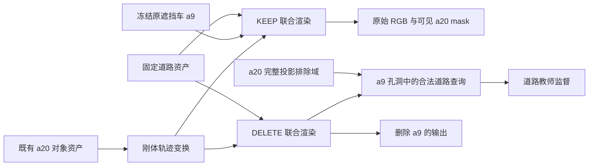

# a20 黑皮卡遮挡修复方法 QA

目标：删除 a9 白色 Mazda（native actor 10），保留并修补 a20 黑皮卡（native actor 21）的隐藏下半部，以及车辆移除后露出的合法道路。检查仅使用 CPU；未运行 GPU。

## 组件与监督域

KEEP 用于已有真实图像监督；DELETE 用于编辑结果及道路监督。二者必须保留不同的监督有效域。

## 分辨率已独立核对

- 原始 RGB、native instance mask、`observations.camera_size` 均为 **1920×1280**。
- repaired instance mask 为 **480×320**。
- `observations.boxes[].corners2D` 是 **960×640** 坐标，不能按 `camera_size` 直接缩放。
- 已用 `world_from_actor`、`camera_pose_world @ camera_extrinsic` 和 Brown 畸变模型重新投影 3D 框。raw086 的原始分辨率框为 `[790.378, 683.623, 1083.828, 928.810]`；除 2 与保存角点一致，最大差约 0.001 像素。
- 独立脚本 `qa_a20_visibility.py` 直接使用原始 3D 投影再映射到 mask 分辨率，避免依赖旧角点标度。输出保存在本地及远端 campaign 根目录的 `qa_a20_visibility.json` 和 `qa_a20_visibility.jpg`。

## 五个验收帧的实际证据

计数单位为 480×320 mask 像素；“下半”指**投影 3D 框的屏幕下半部**，不等同于精确的 canonical 车体表面覆盖。

| raw | a20 可见像素 | 框下半可见像素 | 下半占全部可见 | 框底部 1/4 可见像素 |
|---:|---:|---:|---:|---:|
| 086 | 1312 | 47 | 3.6% | 0 |
| 110 | 2005 | 249 | 12.4% | 0 |
| 134 | 2209 | 230 | 10.4% | 0 |
| 179 | 2240 | 245 | 10.9% | 0 |
| 198 | 2248 | 254 | 11.3% | 0 |

全 199 帧中，198 帧有少量框下半 mask，最大下半框覆盖率为 9.74%；框底部 1/4 的单帧最大计数仅 20 像素。相机在 a20 对象坐标中的水平方位跨度约 **0.47°**。已看正确裁剪的 contact sheet：车尾上部与细小侧缘持续可见，下半主体持续被 a9 遮挡。

建议短程训练帧为 **raw080、095、108、129、198**，覆盖目标大小与可见范围；raw129 的框下半可见像素最多，为 329。原五帧继续用于验收。选择更多相邻停止帧不能提供明显的新观察方向。

## 必须满足的方法约束

1. **隐藏高斯保留**：删除 a9 后，不能用原始 a20 可见 mask 的零区域全域惩罚 a20 alpha。白车遮挡区中的零只表示不可见，不表示 canonical 车体为空。保留原 canonical 几何及 opacity 先验，不依据被遮挡帧的低可见率剪枝隐藏高斯。
2. **KEEP 的可见贡献**：使用保留 a9 的共同排序渲染，监督 a20 在真实遮挡后的贡献。若冻结 a9 的表示存在孔洞，则将原 a9 mask 及其他近处前景遮挡区从 a20 负样本域排除，边界可使用小幅保守扩张。真实可见 a20 正样本仍保留。
3. **道路教师合法域**：DELETE 道路监督使用 `a9 编辑孔洞 ∩ 固定道路有效支持 ∩ 非车体投影域`。不要把整个 a9 mask 排除，否则孔洞中的道路失去监督；应仅排除 a20 完整 3D 投影及其他车辆/前景区域。
4. **查询域一致**：道路教师的有效像素、固定地面射线交点、renderer 视口、a9/a20 mask 与投影盒必须统一到实际查询分辨率。可见 a20 mask 不是完整车体排除域，尤其不能把原 a9 遮挡的 a20 下半当道路颜色目标。
5. **证据与补全分开**：真实多帧可校准已见尾门与侧缘；隐藏下半主体使用既有对象资产或明确的几何先验。新填充几何应在资产中单独记录来源和约束，避免将整块包围盒当作已观测车体。

## 投影与 alpha 域检查

已审首版 `run_joint.py`：实际 renderer Camera 的 `+z` 向前投影，以及 1152×768 bbox 排除域与独立投影一致。raw086 保存框为 `[470,406,654,560]`，raw110 为 `[451,409,666,590]`，已包含保守边界。repaired labels 中 a9=10、a20=21，ID 对应正确。

首版 `step()` 使用 `aout = mean(alpha², ~visible_mask)`，把原遮挡域当负样本。r2 已改为在 a20 框内排除其他实例遮挡 label，并扩张 9×9 像素后定义负样本有效域。独立 CPU 重建该域后，原遮挡区中的有效负样本数为零；raw086/110 的遮挡忽略域分别为 18019、21187 像素。代码中无显式剪枝，车辆位置冻结；当前负样本域修正避免了已发现的误罚路径。

首版已弃用的裁剪 canonical 资产有 9870 行，其中 `local_z<0` 为 5875 行；仅 668 行 opacity>0.1，下部平均 opacity 为 0.04765。该摘要仅解释首版问题，不代表下述 r2 资产。

## r2 canonical 入口等价性检查

r2 改为将 raw110 的实际有效 native owner21 渲染 packet 完整提取为 51400 个 canonical 高斯，继承有效协方差与时间 opacity，将该参考视角颜色烘焙为 SH0。该操作保留参考帧渲染，不是完整保留原时变场或原高阶 SH。

对 native 与 canonical 的参考帧 raw110 浮点渲染独立比较：KEEP 全图 RGB 平均绝对差为 4.05e-9、最大差 7.32e-4，仅 7 个通道值差异超过 1e-5；车辆独立 RGB 平均差 3.19e-8；车辆独立 alpha 平均差 4.80e-8，99 分位差小于 8e-7。**参考帧光度近似等价通过，不是逐位等价，也不代表其他帧等价。**比较保存在 `qa_canonical_r2_comparison.json`。

## 道路教师通道检查

R2 `teacher_manifest.json` 明确：A 区使用原图 AREA 采样目标；C/S 区使用生成图，`target_C_srgb` 与 `target_S_srgb` 全图逐值相同。首版对 A|C|S 统一使用 C；r2 已改为按区选择 A、C/S。raw086/110 的 A-only 区 A-C 平均绝对差分别为 0.01252、0.01211，不能当作相同目标。已保存的 r2 教师 PNG 与正确组合目标逐 8bit 值一致。

旧教师 `teacher_write_full` 与 a20 完整投影框交集在 raw086/110 分别为 11178、14184 像素，`protected` 交集均为零。本次代码已外层排除 a20 完整投影框，方向正确。

教师文件仅存在训练帧 raw086/110；raw134/179/198 属诊断帧，不能把原始带车 RGB 标成删除后道路教师。首版已将其道路教师指标置为 null。

## 固定道路支持域检查

首版 road legal 仅由二维 A|C|S、K、车体投影和保留实例 label 定义。raw086 的 253075 个 legal 像素中，192529 个 road alpha<0.05；raw110 的 253279 个中，124400 个 alpha<0.05。r2 已加入固定道路 alpha>0.05 支持门。

独立 CPU 检查 r2 保存的 query 域后：两训练帧 legal 像素分别为 60546、128879；与 a20 完整框、保留 actor label、无道路支持像素的交集均为零。a9 孔洞中仍有 20498、45425 个监督像素，未因防护整个丢掉道路监督。检查记录为 `qa_supervision_contract_r2.json`。

## 道路基线渲染检查

已将新 `delivery/native_before` 与 R2 `appearance_fit/rendered` 的浮点 NPZ 按相同 DELETE 模式比较。五帧的 road RGB、road alpha、DELETE joint RGB 全部逐值一致，最大绝对差为 **0**。R2 道路加载与普通高斯渲染路径通过；比较记录为 `qa_r2_baseline_comparison.json`。KEEP 含 a9，不应与 R2 DELETE 图直接比较。

## 修正状态

已发现的分辨率、alpha 误罚、教师混域及道路支持问题均已点对点反馈并复核修正。当前监督域与参考入口通过；最终任务仍需独立验收 DELETE 下半车体、道路纹理与最终资产保存结果。alpha 全图诊断和实际负样本有效域指标应分列；最终 contract 应准确记录 reference110/SH0 的实际初始化。

免责声明：屏幕框分区像素计数只用于选择监督帧和判断遮挡证据，不能证明隐藏下半部的精确形状或纹理已被观测。本轮仅完成输入与方法 QA，实际补全质量需结合统一渲染结果验收。
