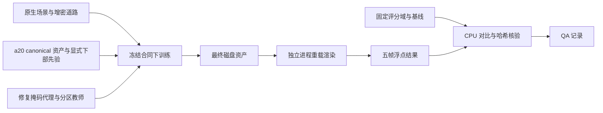

# a9 删除与 a20 下半补全：最终独立 QA

**工程合同、监督域和资产持久化验收通过；另发现左侧 a10 深色轿车的局部图像误差相对原生基线增大，不能宣称其他车辆画面完全不变。**本次独立验收仅执行 CPU 读取、哈希、数组和指标检查。完整记录为 `qa_final_cpu.json`，39 项检查通过，无待完成检查项。

验收对象为 r4 先验的正式训练资产 `assets/joint_fit` 及其 `joint_fit_reloaded` 导出，运行代码位于 `code/frozen_formal_r2`。后续 a9 残影交接可在其独立记录中关联这些基线。

## 合同与监督来源

- 正式更新为车辆 200 步、联合 200 步；训练视角 raw086/110，诊断视角 raw134/179/198。
- 原生重建见过全序列，本轮是少帧资产适配。可见 RGB 来自原始观测；repaired mask 由已有分割、语义及投影支持修复，是评分和监督代理，不是人工标注真值。
- 下部加入 624 个显式形状先验高斯；先验记录明确 `true_hidden_shape_and_RGB_GT=false`。其颜色取自已见深色 a20 像素，未使用道路教师或新扩散训练。
- 实际统一 renderer 的特征 VJP 决定可见许可行；追加先验后重新检查许可。先验在五帧 a9 遮挡区内接受保守 4.5σ 投影保护，并排除观测车体区域。
- 五帧的道路合法域与 a20 完整投影框、保留车辆 label 无交集；车辆负样本有效域与遮挡忽略域无交集。

## 固定域指标

五个阶段使用同一帧、同一评分像素数与 HF 完整核支持像素数。车辆评分像素为 7542、11484、12694、12890、12939；道路仅在有教师的 raw086/110 评分，像素为 60546、128879。评分域未按最终预测质量重新选像素。

## 原生参数与道路几何覆盖

原生 static、dynamic、environment 三个 checkpoint 文件哈希，以及 ownership、静态门控源文件均保持一致。道路全部非颜色字段逐值相同；五帧独立道路 alpha 逐值相同。1191 个许可道路颜色行中，实际变化 214 行，许可外变化为零。

最终车辆资产有 25060 行，含 624 行先验。canonical XYZ、旋转和来源行保持相同的 FP32 运行时初值；来源四元数保存为 FP64，导入时的 FP32 转换未误判为训练更新。轨迹保持固定。

## 隐藏高斯保留

按保存的最终 VJP 许可，4478 行属于不可见冻结行；其尺度最大变化为 **0**，opacity 最大差 **2.98e-8**，对应 FP32 logit/sigmoid 往返。可见支持掩码已保存为 `visible_support.npz`，可逐行复核，未只依赖数量声明。

## 其他车辆图像变化及方向

原生文件与参数保持固定，不代表合成后的其他车辆像素必然不变。38 个“帧×保留车辆”区域、共 387281 像素中，先验初值至最终结果的像素加权变化 MAE 为 **1.77e-4**；原生至最终为 **7.49e-4**。该项描述实际变化，不使用强制为零的通过条件。

其中 raw086 的 native actor11 对应 **a10，track `OPSWYvN-v6rFs-PVaUpiaw`**，是画面左侧横向驶过的深色轿车。已根据别名表、投影位置及原图 crop 核对，它不是右侧白色皮卡。固定代理 mask 有 3029 像素，1152 分辨率包围框为 `[420,427,520,472]`。

| 阶段 | 同一 a10 mask 对原始 RGB 的 MAE |
|---|---:|
| 原生基线 | 0.106841 |
| canonical + 下部先验初值 | 0.164849 |
| 车辆优化后 | 0.159827 |
| 联合优化后 | 0.158465 |

最终相对原生基线 **退化 0.051624，约 48.3%**；相对先验初值改善 0.006384，约 3.9%。原生与最终渲染之间的变化 MAE 为 0.078456，该变化量与对真实观测的误差是不同统计。数据与同 crop 对照保存在 `qa_actor11_raw086_direction.json/.jpg`。

## 恢复与磁盘独立重载

保存的完整模型、优化器和随机状态恢复逐值一致；下一步 FP32 CUDA 更新按数值容差验收。成功 smoke 的下一步损失差为 0，参数最大差 9.76e-6；独立重复探针的下一步渲染最大差为 2.25e-6。报告保留该数值误差，不称下一步优化轨迹逐位确定。

最终资产由新进程从磁盘加载并生成五帧浮点结果。独立 CPU 对比的最大差为 **2.43e-6**，低于既定 2e-5 容差；道路 RGB 与 alpha 差为零。

## 更新预算

正式 400 次更新保持不变。所有尝试共 417 次实际优化器更新：正式 400、失败 smoke 6、成功 smoke 9、独立数值探针 2。成功 smoke 的 9 次已含 2 次 replay，未重复记账。失败现场单独保存；本 QA 未执行 GPU 操作或电源操作。

免责声明：可见域指标依赖修复掩码代理，不能证明持续遮挡下半部的真实几何或纹理还原；新增部分是明确记录来源的形状与颜色先验。工程验收通过不消除上述 a10 局部画质退化，也不等同于独立盲测的科研结论。
