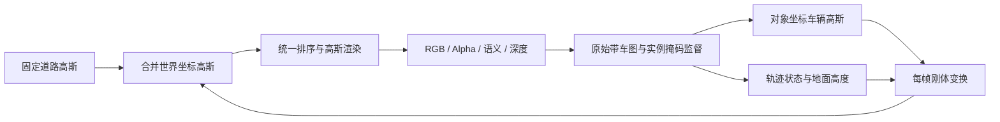

# HUGSIM 车辆分支方法核对

来源：[本地 HUGSIM 论文](C:/Users/dengyunlong/Downloads/HUGSIM.pdf)，24 页，首页标注 arXiv:2412.01718v1，2024-12-02。以下页码均为 PDF 从 1 开始的物理页码。已完整查看第 4-9、19、22、24 页图像；正文通过文本抽取交叉核对。

## 核心结论

可直接借鉴的是：**对象坐标高斯、每实例刚体轨迹、地面接触约束、统一深度排序及 alpha 合成，以及图像和物理先验联合优化**。论文的车辆重建轨迹采用独轮车模型；B 样条重建、PVD 和残差形变属于当前方案的扩展设想。

图为当前接入方式建议：道路分支固定，车辆参数与轨迹接受梯度；论文完整重建还联合优化静态背景。

## 论文真实内容

| 项目 | 论文内容与位置 | 对当前实现的含义 |
|---|---|---|
| 对象空间与刚体运动 | 第 5 页 §3.2：由预测 3D 框划分车辆，在对象坐标系建模高斯。短摘录：`3D Gaussian modeling in object coordinate space`。 | 每个实例一套共享 canonical 高斯，不逐帧复制或学习独立形状。 |
| 轨迹 | 第 5-6 页 Eq.5：每帧可训练水平位置、yaw，以及相邻帧前进速度和角速度；用独轮车残差约束，而非从第一帧完全递归展开。车辆竖直位置来自多平面地面模型。 | 先用低维刚体位姿；有轨迹时再加入速度及运动正则。 |
| 统一渲染 | 第 4 页 Fig.2、第 6 页 §3.3：静态和动态高斯共同排序、投影、alpha 合成。第 19 页 A.1：多模态复用投影和排序。 | 必须在高斯级合并；两次独立 RGB 渲染后贴图无法提供同等遮挡和梯度。 |
| 外观 | 第 4 页 §3.1：SH 颜色；第 6 页 Eq.6：相机外参经小 MLP 生成 RGB 仿射曝光变换 A、b。 | 曝光补偿是成像建模，不是车辆形变；初版可保留已有 renderer 外观接口。 |
| 语义 | 第 7 页 Eq.7、Eq.12：每个高斯的语义 logits 先 softmax，再 alpha 合成，2D 语义交叉熵监督。 | 不能先累积未归一 logits 再 softmax；该设计旨在减少语义漂浮点。 |
| RGB 与前景 | 第 7 页 Eq.11：L1 与 SSIM；Eq.13：非原生车辆重建使用渲染 alpha 与车辆 mask 的 L2 误差，防止背景被建模及车体透明。 | mask loss 可移用于当前实例资产训练，但应标记为接入建议；论文明确把它用于非原生车辆重建。 |
| 几何约束 | 第 7 页 Eq.15-16：预测框水平平移的锚定损失、独轮车运动残差；第 8 页 Eq.17：平滑正则。 | 图像误差同时约束外观和姿态，物理先验减少错误姿态被形状吸收。 |
| 完整资产与阴影 | 第 6 页 Fig.5：从 3DRealCar 的 360 度图像及 mask 重建非原生车；canonical 底部放置扁平阴影高斯，opacity 从中心向外平滑减小。 | 使用已有完整车辆资产符合其非原生车路线；阴影是简化先验，不是逆渲染光照估计。 |

## B 样条、PVD 与损失边界

- **B 样条**：第 9 页 §4.3 的攻击性驾驶候选轨迹使用 spline planner，短摘录为 `spline-based trajectory interpolation`。这是仿真行为规划；论文没有把 B 样条作为车辆重建轨迹参数化，也没有在此处指定 B 样条形式。
- **PVD / 残差形变**：未在本 PDF 方法和附录中发现对应模块。车辆假设为刚体。若当前方案使用这些模块，应以自有扩展明确命名。
- **Flow / depth**：第 7 页 Eq.8-10 描述可渲染的模态；§3.4 未列出 flow loss 或 depth loss，不能将二者写成该论文已采用的监督项。
- **地面正则**：第 7 页 Eq.14 约束地面高斯局部高度方差。它约束道路，不是车体扁平化。固定道路资产时不需要为了接车重新训练此项。
- **正则公式核对**：第 8 页 Eq.17 的印刷公式是二阶差分速度 v 与 yaw θ；正文却称速度和角速度。实现应明确所用定义。第 7 页 Eq.15 公式为 x、z；其说明文字写成 x、y。

## 当前接入的最小可执行方案

1. **坐标与变换**：保留车辆 canonical 参数，逐帧计算 `mu_world = R_t @ mu_object + t_t` 和 `Sigma_world = R_t @ Sigma_object @ R_t.T`；等价实现为旋转四元数左乘，scale 与 opacity 不受刚体变换影响。旋转物体时将 SH 查询视线转换到对象坐标是保持外观随车旋转的工程要求，论文未单列这一实现细节。项目坐标轴与 yaw 零点需显式映射，不能直接假定采用论文的 OpenCV y 向下坐标。
2. **先固定道路与车辆几何**：利用已有完整资产，短程先优化车辆外观、opacity 和少量轨迹/刚体校正；只有可见证据支持时再开放受限 canonical 几何更新，防止少帧把定位误差写入形状。该训练顺序是当前工程建议，不是论文规定的消融方案。
3. **统一 renderer**：将道路和经过变换的车辆高斯一起输入 rasterizer，生成 RGB、总 alpha，及必要时的车辆语义概率或车辆可见贡献图。车辆分支可见贡献应采用共同遮挡后的贡献；单独车体 alpha 只用于独立资产轮廓检查。
4. **监督来源**：实例重建时，车辆像素使用原始带车 RGB 与该实例 mask；去车教师仅用于背景可见区域。替换车辆的目标外观按所选资产定义，不能把另一辆原车外观自动当作替换车真值。训练采样应保证车辆 ROI 有足够权重，避免全图道路像素淹没车辆梯度。
5. **损失组合**：最小集合为车辆/场景可见区 RGB（L1 + SSIM）、车辆 mask/语义约束、位姿锚定与轨迹平滑；有可靠多帧运动输入时加独轮车残差。有些像素存在遮挡或 mask 不确定性时，用其置信度设置权重。无需同时引入 PVD 或形变才能完成刚体资产接入。
6. **数值与验收**：Eq.5、Eq.16 的位移含 `v / omega`，直行时需稳定的零角速度极限；实际不等间隔时间戳显式使用 dt。验收覆盖车辆遮挡道路、道路遮挡车辆、刚体旋转后投影/颜色一致、车辆像素不读取去车教师，以及 checkpoint 恢复后下一步损失与参数一致。

## 建议发送给实现方的配置界限

当前目标可称为“参考 HUGSIM 的对象空间刚体高斯与统一渲染接入”。报告应分列论文依据、当前已有资产复用和新增工程选择；不要宣称当前短程训练是完整 HUGSIM 复现。该 PDF 方法段未给出可直接照搬的所有损失权重、当前少帧预算或 PVD 配置，应由当前运行配置保存这些实际值。
