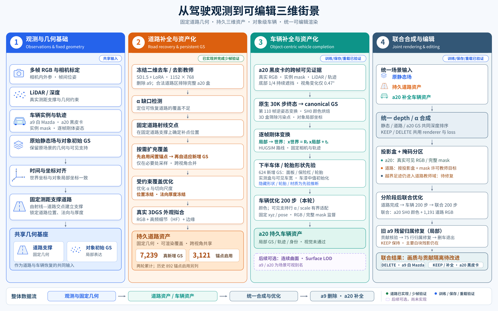

# 删除 a9，恢复 a20 与道路：首轮接入结果

车辆分支已接入当前增密道路资产，完成车辆 200 步与车辆／道路联合 200 步优化。保存、完整训练状态恢复、双分支梯度及独立进程重载通过工程检查。当前画面仍有旧 a9 白块残影、粗糙轮胎和局部车辆退化，尚未达到车辆与道路恢复的画质目标。

## 目标与来源

| 角色 | 场景别名 | 原生实例 | 原始轨迹 |
|---|---|---:|---|
| 删除前景白色 Mazda | a9 | 10 | `NTjq-OhZ_97OMJ4xwJAxXg` |
| 恢复后方黑色皮卡下半部 | a20 | 21 | `bzFbWRrSGOgEaXxnuGV0tw` |

道路继承两轮固定表面覆盖修复：真正追加 7,239 个几何点，另启用 3,121 个已有锚点。历史 892 个活动点属于锚点启用。车辆沿用 [HUGSIM](https://arxiv.org/abs/2412.01718) 的对象坐标刚体高斯与统一排序／透明度合成方式；原文方法核对见同目录 `hugsim_review.md`。

## 实际路线

1. 在 raw110 取得原生渲染器条件化后的有效车辆高斯，逆刚体变换到对象坐标，并烘焙参考帧颜色。参考帧重投影与原生渲染近似一致。
2. 用物理三维框、跨帧实际成像贡献约束对象支持。新增 624 个下半车体、保险杠和轮胎先验高斯；车宽受可见车身约束，车漆由真实可见暗色车体初始化。
3. 车辆 200 步优化颜色、不透明度和有界尺度；联合 200 步优化车辆颜色与 1,191 个许可道路高斯的颜色。实际改变道路颜色的行数为 214。
4. KEEP 渲染用原始带车 RGB 和自动估计实例掩码监督 a20；DELETE 渲染用对应的真实可见道路与冻结二维补全结果监督合法道路。道路教师域排除 a20 的完整投影及其他保留车辆；遮挡区域从车辆 alpha 负样本中排除。
5. 在训练之外核验旧 a9 残影归属。严格版本重归属 49 行；最终受约束版本共 75 行，均为原未知静态行。KEEP 的 RGB／alpha 保持不变，DELETE 中 a20 可见车身及其他车辆 RGB 保持不变；外域最大改变量为 0.00384824，小于 1/255。

几何、相机、车辆轨迹、道路覆盖、原始场景模型和生成网络全程保持固定；无新增扩散模型或 TRELLIS 训练。完整配置以 `contract.json`、`contract_final.json` 和各交接准入记录为准。

## 评价与结论

统一页面保留七个阶段：原生表示、对象坐标初值、下半先验初值、车辆优化、联合优化、49 行严格交接和 75 行受约束交接。所有视图为实际 1152×768 三维渲染。

评价在固定域报告 RGB、局部 SSIM、有符号高频对应度／能量比及边缘 F1；高频尺度为原生像素 σ=1/2/4，保留完整卷积核有效像素数。车辆轮廓 IoU 与自动估计的观测掩码比较；道路使用未量化的原始监督数组。共 49 条阶段／视角／区域记录。

- 两个训练帧可见车体颜色拟合改善；三个诊断帧仍有对象表示转换与外观适配偏差。
- raw86 左侧 a10 深色轿车的对原图 MAE 从原生 0.106841 升至联合结果 0.158465。其影响已保留在独立检查中。
- 主要旧 a9 白块由同时影响多个区域的大足迹高斯产生。安全归属清退只移除部分残留，新增车辆高斯仍会被旧表示遮挡。
- 投影盒与道路损失域没有交集，但部分车辆高斯的足迹越出物理盒，实际贡献仍进入道路教师域。当前联合目标存在少量梯度串扰，按投影盒分区不足以实现贡献隔离。
- 下半形状先验提供了可渲染支撑，轮胎与材质细节仍较粗糙。

原始资产和各阶段结果均保留，当前候选未替换既有道路基线。后续应优先处理跨域大高斯的拆分与归属，并用受测距约束的对象表面改善车辆几何支持。

## 保存与复用

正式更新 400 次；失败 smoke 6 次、成功 smoke 9 次、独立恢复 probe 2 次，合计 417 次，额外更新均未写入最终训练资产。归属修复没有优化器更新。保存的模型、Adam 与 RNG 状态恢复逐值一致；后续 CUDA 步存在记录在案的浮点累加差异。

最终资产包含对象高斯、全 199 个时刻的轨迹可用性表、道路颜色补丁、75 行归属 sidecar 和完整最终优化器／RNG checkpoint。a20 缺失的 raw0 保留为不可用。带 sidecar 的新进程五帧重载最大 RGB 差约 3.64e-6，道路 RGB／alpha 逐值不变。恢复入口见 `RESTORE.md` 和 `asset_index.json`；GPU 保持开机。

免责声明：a20 下半主体持续被遮挡，缺少隐藏车身的真实外观监督；其形状与颜色先验不代表真实还原。原始场景模型已见过全序列，本轮少帧诊断不属于独立盲测；可见掩码为自动估计，工程检查通过不等于画质目标达成。
