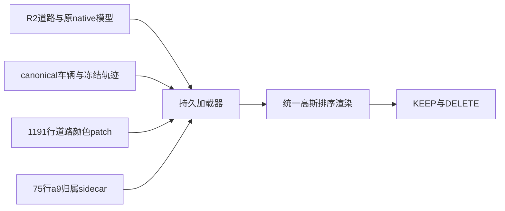

# Scene065 车辆与道路联合首版恢复入口

正式预算为车辆200步、联合200步；原道路和原native模型均保留。最终视觉质量未通过，不能晋升默认场景。诊断帧和其它车辆局部仍有退化，a9残影与粗下半形状先验仍可见。

小包含无损WebP审阅图、细节指标、完整Adam/RNG checkpoint、canonical车辆、全199帧轨迹登记、1191行道路RGB patch和归属sidecar。大体积基础道路及原native checkpoint仍在远端，asset_index.json给出原始路径与可执行渲染命令；所有原始float渲染留在远端delivery目录。

远端完整资产可直接执行asset_index.json中的render_command，从磁盘加载并复核五帧。小包的handoff资产复用assets/joint_fit/vehicle.npz；道路使用基线R2 road.npz加road_rgb_patch.npz，不包含重复的完整道路文件。完整训练状态是checkpoints/joint_step00200.pt；smoke和post_numeric_probe.json保留恢复与数值连续性证据。

恢复检查证明保存状态逐值精确；后续FP32 CUDA原子累加步为数值近似。下半面板、保险杠和轮胎是受尺寸/可见车宽/遮挡约束的工程形状先验，隐藏区域没有真实RGB真值，repaired masks是分割代理而非人工标注隐藏真值。
