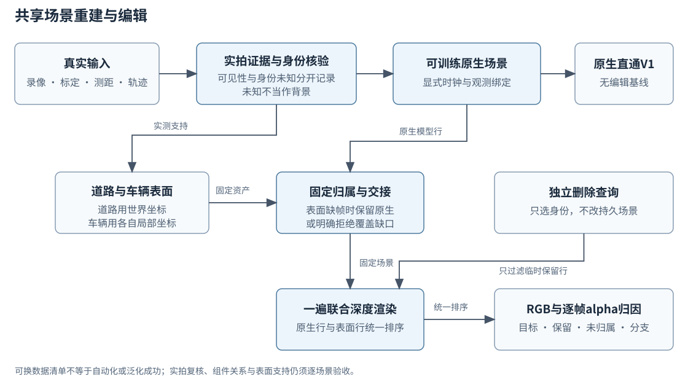

# 共享场景重建与编辑流程

这套代码把“从真实观测建立场景”与“对固定场景发出编辑查询”分开。输入是录像、相机标定、实测测距、对象轨迹及明确的身份登记；输出是同一场景的原生重建、删除后的RGB和逐帧透明度归因。更换数据清单即可复用算法代码，但新场景的数据支持、接线和画面质量仍须验收。



先核对真实时间、模型时间、坐标变换、图像与点云的对应关系，再决定哪些观测有足够依据进入训练。实测可见性、遮挡、是否属于车辆、属于哪个对象是不同问题。空框、车类颜色或box重叠不能证明同一身份；测距不足和身份未知也不能改写成背景。时序候选从明确接受的实拍seed出发，遇实际empty/absent即断链，不能靠之后重新出现的高分自动认回。强制seed分数不是独立证据，弱候选回退同时间戳的已接受观测；没有可信回退就保留未知。

原生训练不接收删除请求。V1基线由独立直通脚本恢复完整原生模型并直接调用原始渲染器，不导入编辑包。共享编辑入口的空删除查询只用于数值一致性检查，不能代替V1列。道路表面在世界坐标中描述，车辆表面在各自局部坐标中描述，由明确轨迹放回场景。归属、静态gate和待交接的原生行集合在构造时固定；若某帧没有表面provider，默认保留该帧原生表示，或在要求完整覆盖时明确报错。

编辑请求只通过登记表选择删除的track/actor ID，不改权重、持久owner或交接规则。原生行与表面行先合并，再进行一遍联合深度渲染，最后补环境项；不拼贴观察照片来补删除区域。未知owner保留，不被强行归到删除目标。

公共模块按以下职责协作：

| 模块 | 职责 |
| --- | --- |
| `v44_inputs.py` | 身份登记、前景与owner表示，保留身份未知 |
| `v44_visibility.py` | 从实际投影回波区分own支持、混合、实测前景和测距未知 |
| `v44_occluders.py` | 提出实测遮挡物候选，接收外部真实图像mask认证 |
| `v44_temporal.py` | seed证据链、断链、弱候选回退；只在实际mask重叠处比较深度 |
| `v44_prepare.py` | 将逐帧证据转成可审查的输入决策；语义未决不能默认为完整训练背景 |
| `v44_manifest.py` | 显式帧key、两种时间、相机绑定和track↔actor登记的数据契约 |
| `v44_factory.py` | 按清单装载原生模型、固定归属、道路和车辆表面 |
| `v44_scene.py` | 只读场景查询、一遍联合渲染、覆盖诊断及版本检查 |
| `v44_cli.py` | 通用inspect/render入口，导出逐帧PNG、float NPZ和来源JSON |
| `v44_sh_asset.py` / `v44_surface_lod.py` / `v44_surface_geometry.py` | 通用表面几何、材质与层级表示 |

数据清单负责声明数据来源、帧与时钟、标定、身份与组件关系、已接受观测、表面及pose来源、未知策略和固定交接。算法代码负责执行这些契约、计算证据、拒绝不相容输入并渲染，不能内置场景、对象编号或特定帧例外。历史Scene008入口保留用于原实验回放，不能当作通用入口，也不能把其中的场景路径当作默认资产。

统一入口示例：

```bash
python -m drivingeditor_dynamic_edit.v44_cli inspect --manifest scene.json
python -m drivingeditor_dynamic_edit.v44_cli render --manifest scene.json \
  --query query.json --diagnostic-branch-alpha --output new_render_directory
```

查询可给`delete_track_ids`或`delete_actor_ids`，并独立声明focus和diagnostic对象；`--frames-json`保留任意已登记str/int帧key。输出中的六组alpha分别为目标、其余静态、其余动态、道路、其余表面、未归属，六组之和单独等于总alpha。unknown统一进入未归属，因此`other_static`不能冒称“全部非目标静态贡献”。需要检查物理分支时，开启`diagnostic_branch_alpha`：`nonfocus_static` / `nonfocus_dynamic`包含各native分支的非focus行，含unknown，且不含附加表面。逐owner标签与branch标签会和六组重叠，不能混加守恒；开启branch时最多14个owner诊断，否则16个。

已有阶段记录包括173项CPU测试和12组实际CUDA RGB一致性对照。新增branch诊断也完成真实GPU输出检查；稀疏材质前向/梯度、交接参数保存与完整恢复均有独立短程证据。这些检查只覆盖所测协议与输入。代码可配置，不等于全自动处理或泛化验证成功：已接受mask、seed实拍复核、对象组件关联、表面覆盖与固定归属仍有明确的数据和审阅依赖。空间接近不会自动合并部件，模型高分也不会取消这些依赖。

065的只读CPU审计核对了全部199帧：模型时间、源时间、初始PLY时间及谱系身份对应一致；原生训练labels和union均精确来自R4，未发现加载旧mask或时间错位。训练后车体/设备部件高斯的时间支持和位置已明显偏离初始观测：车体时间sigma中位约18.51帧，原生周期仅10帧；两者基础中心距初始同谱系源点的位移中位约4.79m / 8.48m。来源谱系正确，不代表优化后仍是正确物理表面。

这些统计提示原生自由4D拟合、宽时间支持与残影之间的相容风险，没有认证具体像素的成因。注释体积只用于相容性检查，未经光栅化的opacity质量不是逐像素`alpha*T`或遮挡真值。输入mask修复不代表重建已经修复；当前065原生画面仍有模糊/残影，不能宣布质量通过。后续formal结果、真实联合渲染归因与多场景验收由实际运行补充。详细证据见`readonly_audits/native065_temporal_cpu_audit_r2.json`。
