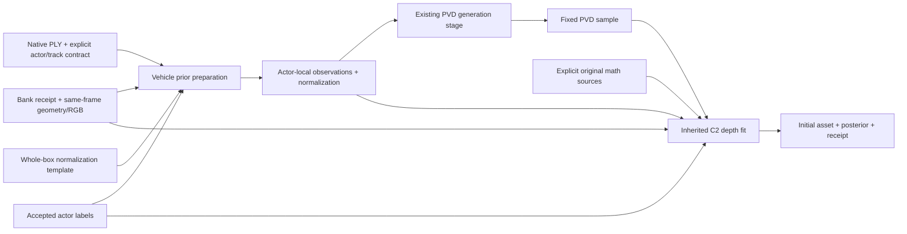

# Vehicle prior/surface parameterized port

These two CPU entry points preserve the inherited whole-box normalization,
color sampling, prior/measurement association and five-step C2 robust depth
fit. They do not introduce a new scientific method or generate a PVD sample.
They have no scene, actor, frame, holdout or server-path constants.



## Preparation

```text
python v44_vehicle_prior.py --root ROOT --bank BANK --mask-root MASKS \
  --track-id RAW_TRACK --actor-id NATIVE_ID --pvd-base NORMALIZATION_DIR
```

Python API:

```python
prepare_vehicle_prior(root, bank, mask_root, track_id, actor_id, pvd_base,
                      *, output=None, time_tolerance=None)
```

`root/identity_contract.json` must bind the supplied `actor_id` and `track_id`
to exactly one `source_actor_rows[].ply`. Relative PLY paths resolve under
`root`; absolute paths retain their declared provenance. A legacy alias-only
contract fails rather than silently inferring a track from an integer.

The native PLY `nx` field stores `model_time`. Each point selects the nearest
actual `receipt.frames[].model_time`, preserving the receipt row's raw frame.
No fixed interval, offset or raw/frame-number relation is used. Distinct frame
times must remain distinct after float32 PLY storage. The default tolerance
allows float32 storage error only; an override must be explicit. Midpoint ties,
unmatched times and nonfinite times fail.

RGB and same-frame target geometry come from actual observation metadata,
with receipt/observation timestamps checked. Mask paths use the matching
observation filename stem. The requested label must exist in each source
point frame. This validates the accepted source contract; it does not use a
mask to resample or synthesize measurements.

The default output is `root/revealed_prior` and must not already exist. It
contains `observations.npz`, `normalization_contract.json` and
`input_contract.json`. The inherited conditioning count remains 200. The
existing PVD stage consumes these files separately.

## Surface fitting

```text
python v44_vehicle_surface.py --root ROOT --bank BANK --mask-root MASKS \
  --track-id RAW_TRACK --actor-id NATIVE_ID \
  --deps-source FIT_SURFACE_SOURCE_DIR --deps-source FULL_PVD_SOURCE_DIR
```

Python API:

```python
fit_vehicle_surface(root, bank, mask_root, track_id, actor_id, deps_source,
                    *, prior_dir=None, pvd_points=None, output=None,
                    camera_index=0)
```

`deps_source` is a list of explicit directories. Together they must locate
exactly one `fit_surface.py` and one `full_pvd.py`; their paths and SHA256 are
recorded. The port uses their inherited `tensor_basis`, `knots_for`,
`curvature`, `nearest3_pitch` and `pca_point_patches` functions. It does not
invoke their legacy entry points or default data paths.

Defaults are `root/revealed_prior`, its
`pvd_seed000/candidate_points_actor_native.npz`, and `root/revealed_surface`.
`--prior-dir`, `--pvd-points` and `--output` override those paths explicitly.
Output must not already exist. Calibration filenames follow receipt frame
IDs, and image dimensions follow RGB. The reference chart is selected by the
largest accepted actor-label area, with the inherited earliest-raw tie break.
Only caller-declared receipt holdouts are excluded; no frame list is embedded.

The output `initial_asset.npz` retains the existing train/edit asset fields;
`posterior.npz` retains the C2 posterior fields. The fit receipt adds explicit
source identities, source paths and math dependency hashes. Importing the
external helpers remains a dependency on their original CPU-compatible
environment; these staging files do not vendor or replace that math.

## Validation

Run from this directory:

```text
python -m unittest -v test_v44_vehicle_prior.py test_v44_vehicle_surface.py test_v44_native_inputs.py
```

All 10 tests passed locally and on the real AutoDL drivingeditor CPU
environment. They cover irregular receipt times, float32 identity collisions,
unmatched/ambiguous times, explicit time tolerance, timestamp/path binding,
the whole-box matrix, explicit/ambiguous dependency sources and the native PLY
xyz/model-time binary contract.

A separate read-only legacy scene probe used unchanged source PLY, masks,
RGB, observations and a fixed existing PVD sample. Because the legacy native
contract had aliases only, an isolated audit fixture explicitly bound its
verified source PLY to the known raw track; no original contract was edited.
All 8 prior NPZ fields, the complete normalization JSON, all 11 posterior
fields, and every numerical asset field matched the original results exactly
in value, shape and dtype. Metadata text intentionally records generic source
bindings. Reference raw 196, accepted measurements 6,823, and total asset rows
24,049 were unchanged. This checks this mathematical port on that input; it
does not establish new-scene quality or complete generalization.

The recorded parity result is
`../visual_scene029/vehicle_port/parity.json`. No GPU, training input or
repository file was changed by this validation.
