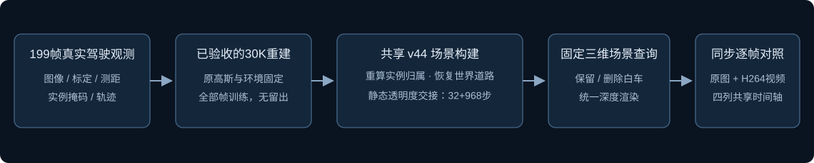
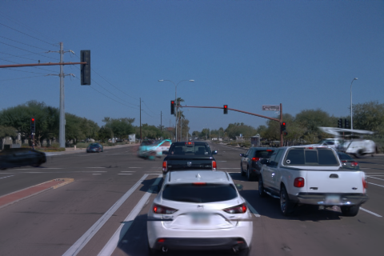
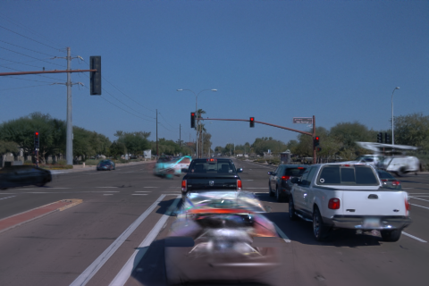

# Waymo scene-065：30K场景中的白色轿车删除

任务 `WAYMO-065-DELETE-WHITE30K-20261109`。用户确认 scene-065 的原生30K重建质量通过，scene-029仍未通过；本轮仅执行065白车删除与结果展示。删除119和198帧仍有明显车形残影与彩色碎片，代理视觉检查未通过；用户尚未评价本次编辑。

输入为验证分区 scene-065 的全部199帧、标定、LiDAR、已有实例掩码和轨迹，无留出。目标为前方白色轿车：原始轨迹 `NTjq-OhZ_97OMJ4xwJAxXg`，场景内沟通代号 `a9`，原生实例标签10。横穿路口的白色工程货车及上方设备属于其他实例。

源模型为 `waymo_val065_allframes10k_20261109_r1/continuation30k_20261109_r1/formal30k`。沿用已存在的共享 v44 算法，重新计算30K行拓扑下的可见质量实例归属、世界道路颜色和静态透明度交接；不复用10K归属或门控行索引，不新增车辆补全资产，不训练高斯或环境。交接共1000次更新，先32步保存，再精确恢复完成余下968步，随机种子0。原始30K检查点与原生渲染保留。

四帧（60、119、150、198）编辑入口未接入恢复资产时，与已发布原生30K浮点RGB的最大差为 `1.1920928955078125e-7`。完整结果通过保留→删除→保留的实际查询回归；这仅证明查询不修改场景及指定owner退出，不能证明隐藏道路恢复正确。

|同一编辑场景保留，第119帧|删除白色轿车，第119帧|
|---|---|
|||

[第198帧删除原图](evidence/delete198.png)同样保留明显残影。第119帧已有白车输入掩码域11624像素，统一渲染的非目标静态分支平均alpha×T为0.834205，其他动态为0.106115，道路为0.059314，目标组为0。其中未知归属贡献0.822701，不能直接当作道路或白车的真实身份。像素(250,300)的未知贡献0.844942、其他动态0.154957、目标与道路均0。以上是已保存浮点输出的CPU统计，不新增GPU诊断，不证明唯一训练原因。

运行根目录：`/root/autodl-tmp/drivingeditor_repro/campaign/waymo_val065_delete30k_20261109_r1/`。`registration.json` 登记输入、目标及预算；`*_command.json` 记录实际资源时间；`completed.json`、`roundtrip.json` 和 `viewer_delivery_r1/receipt.json` 为执行与交付凭据。模型、完整浮点导出、归属、道路和交接检查点留在远端。资源为 RTX4080 SUPER；本轮是已有检查点上的短程编辑构建与只读导出，不追加小时级重建训练。

平台原入口增加第四列“删除白色轿车·30K”，可切换同一编辑场景的保留状态。原生列仍显示未改动的10K及20K/30K；它们与编辑场景保留状态并非同一个分支。四列共享帧号、播放和放大定位，默认第119帧。199帧原始PNG逐字节取回；H264、10fps视频仅用于播放，像素比较使用PNG。历史页面、原生续训记录与scene-029入口保留。

视觉观察及实际耗时见随本次完成状态保存的 `result_summary.json`。本轮不针对渲染结果调整权重、阈值、掩码或道路方案。道路跨时刻实拍恢复与邻域推断仍需区分，删除后的隐藏区域没有完整逐像素独立真值；全部图像参与训练，结果不称留出评价。既有人工掩码核验与组件关联不因共享接口而成为自动化证明。

`failure_ledger_refs=[V82-F06]`，`failure_ledger_delta=updated:V82-F06`。原生重建通过与干净对象删除分开；未新增方法族或失败类别，未调参重跑。编辑效果保留真实输出，等待用户验收。未执行AutoDL关机。
