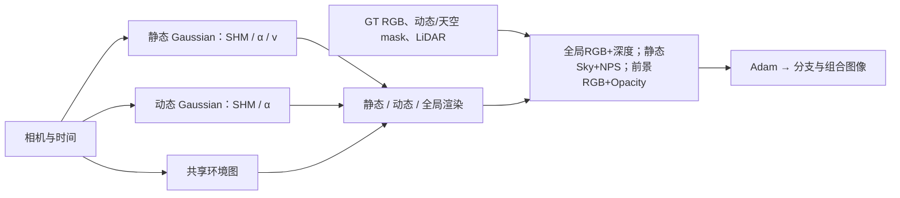

# DrivingEditor 2026 损失与梯度审计交接（CPU）

确定发现稀疏深度的点顺序覆盖错误。完整目标还存在逐像素分支分配退化：静态分支为空、动态分支覆盖整幅背景可以获得与正确分离相同的目标值。30k 全局图像骤降主要与保存前静态 opacity reset 的瞬时断点一致；这不能解释20k已出现的道路分支混入。现有NPS数值、通道、邻居与梯度检查通过。

审计只使用实际执行的 `/root/autodl-tmp/drivingeditor_repro/campaign/resume_vgpu_baseline_20261011/frozen_repository`，与child的`code_snapshot.tar.gz`一致；没有训练、GPU或正式源/配置/checkpoint修改。snapshot SHA256：`141d39bf702d06f1f4c46f52cbf66252d9728339809327e06dbce71fb0de7b2a`。完整JSON及候选位于 `/root/autodl-tmp/drivingeditor_repro/campaign/vgpu_bugfix_20261012/loss_audit`，本地同名`work/vgpu_bugfix_20261012/loss_audit/`。

论文核对范围是Eq7–16：用户提供PDF最后一个编号是16，未找到Eq17。Eq8属于SGCM，由独立SGCM审计负责。公开作者仓库HEAD经`git ls-remote`核实仍为[2024 commit560d57](https://github.com/WangXu-xxx/DrivingEditor/tree/560d57c3825ed2bdbc6a6602e0011ad51e8da60e)，不能以它的旧全图MSE代替2026论文公式。

| 论文页/式 | 实际冻结实现 | 判断 |
|---|---|---|
| PDF5/1700 Eq7 | `paper_losses.py27-31`：-mean(o_sky log(1-o_sky))，仅天空，稳定clamp | 公式/解析梯度通过；alpha达到clamp上界后的零梯度是稳定化选择 |
| PDF6/1701 Eq9 | `paper_losses.py41-74`；`train.py333-335,394`：静态feature1:4 / alpha，四轴相邻，两个棋盘格parity，距离权重，sum | 独立loop与gradcheck通过，无self-target或通道错误；精确采样偏移/边界/距离定义未公开 |
| PDF6/1701 Eq10 | `compose_paper_loss90-95`：sky+NPS | 论文未要求额外staticRGB；不能把旧staticRGB回填叫作已证修复 |
| PDF7/1702 Eq11–12 | `gaussian_model.py147-153`及renderer187-194：damped average v与SHM时间位移 | 动态时间移动与公式相符；具体扰动采样未公开 |
| PDF7/1702 Eq13 | `paper_losses.py34-38`：动态前景mask ×(1-a)log(a)/HW | 公式未显示domain；当前选择按前景prose，mask外梯度为0。字面全图同式会把背景alpha推向1，也不能解决背景归属 |
| PDF7/1702 Eq14–15 | `train.py384-397`：L1+.2SSIM，动态RGB预先乘mask，前景opacity+.photo | 系数.2匹配；全图零填充SSIM/面积归一化是解释选择，不能认证ROI作者实现 |
| PDF7/1702 Eq16 | `train.py360-373,399`与`paper_losses.py78-87`：alpha归一化后harmonic900sky混合；有效稀疏逆深度/HW | reciprocal/有效域/归一化CPU通过；harmonic约定未公开；camera_utils.py133的duplicate last-write确定有问题 |

| 分类 | 证据与含义 | 尚未证明 |
|---|---|---|
| confirmed inherited projection bug：Sparse depth duplicate-pixel order dependence | Point-order reversal changes identical point-set target and reverses Eq16 gradient; real3frames8.09-11.73% populated pixels last-write farther than nearest. (`utils/camera_utils.py117-133`) | Nearest positive finite z is a stated geometry policy; paper omits pixel collision implementation. Branch-collapse causality unproven. |
| confirmed implemented-objective degeneracy; reproduction-domain ambiguity：Loss cannot uniquely identify static/dynamic layer assignment | Actual loss/SSIM/compose functions give both proper split and static-empty/dynamic-full conceptual constructions1.250062504e-10 total. (`utils/paper_losses.py27-95;train.py337-400`) | Per-pixel construction is not a proof of finite3D Gaussian realizability, optimizer trajectory, or author intent. |
| confirmed inherited scheduling instability; observed reset discontinuity：Static opacity reset every3000 after densification ends | At30k scalar forward34.513dB;next step8.591dB; analogous12/15/18/21/24/27/33k pattern. Saved30k eval10.4835dB after reset. (`train.py738-766;scene/gaussian_model.py409-412`) | Explains immediate global checkpoint discontinuity, not earlier20k branch allocation failure. No isolated GPU intervention yet. |
| confirmed executable semantics mismatch; exact intended enforcement ambiguous：Static branch temporal geometry versus paper time-invariant G_s | Static xyz uses SHM(timestamp), marginal opacity varies; xyz/t/beta/rawvelocity trainable. Largebeta can hide velocityfeature despite0.31831-model-unit SHM amplitude. (`gaussian_renderer/__init__.py259-273;scene/gaussian_model.py147-178,269-298`) | Actual checkpoint drift magnitude must be measured; paper does not state hard-freeze versus soft enforcement. |
| confirmed train/export diagnostic mismatch; shared env train behavior matches paper：Dynamic env present in train and absent in exported actor channel | render_d receives residual sharedenv only is_training=True; train uses masked env-filled dynamicRGB; eval component channel is raw actor. (`gaussian_renderer/__init__.py115-120;scene/cameras.py94-106`) | Not a global composite-eval defect. Camera jitter is inherited training sampling and separate diagnostic variable. |
| normalization verified; author depth convention ambiguous：Depth normalization / harmonic900sky convention | Already divides by compositealpha; subsequent harmonic sky blend adds total-opacity gradient. World-to-model scale.1 is consistent for rendered/LiDAR targets. (`train.py360-373,399`) | Cannot certify author intended normalized surface versus environment-filled depth. |
| no confirmed bug in tested formulas/source：NPS channel/self-target/arithmetic/gradient and dynamic xyz LR | Independent loops and doublegradcheck pass;feature uses channels1:4 and alpha normalization;dynamicxyz1.6e-3→1.6e-6 exactly matches paper. (`train.py333-335,394;utils/paper_losses.py41-74;scene/gaussian_model.py891-901`) | Exact checkerboard offsets/distances/numericallambda values and hardclamp boundary stabilization are not disclosed. |

`loss_formula_gradient_cpu.json`包含Eq7/13解析导数、Eq9独立循环与双精度gradcheck、Eq16独立参考。NPS常量非零速度场loss/grad均0；单Gaussian ray的alpha尺度改变几乎不改变NPS（alpha梯度3.55e-15）。这是一致性loss的零空间，不是遗漏某个已给出的强制论文项。NPS还可通过增大beta缩小damped velocity，示例beta=.2的导数-1.5163；实际训练是否利用该路径尚需checkpoint分布验证。

`candidates/candidates_tests_remote_cpu.json`给出完整目标反例：4×4图、中心2×2 mask、GT/env/颜色=.5、两个LiDAR采样20，proper split与static空/dynamic满的globalRGB、masked dynamicRGB、sky、NPS、depth均0，前景opacity同为2.500125e-9，实际compose总值均1.2500625e-10。harmonic深度也计入构造。它证明已实现目标的逐像素不可识别性，不证明有限3DGaussian在全部视角可实现、真实优化路径或作者原意。

静态语义需特别注意：论文Eq4称G_s time-invariant；实际静态renderer仍使用SHM(timestamp)及Gaussian时间marginal，xyz/t/beta/rawvelocity皆可训练。原代码`get_inst_velocity`实际是经beta衰减的average velocity，而SHM振幅使用raw velocity。CPU例rawv=10,beta=10,T=.2的vmap约1.39e-10，但SHM振幅0.31831模型单位（本场景scale=.1，相当3.1831m）。这是可检验的语义差异，尚未测定真实checkpoint漂移量；不能直接假定作者要求硬冻结。

学习率没有发现动态xyz乘10的尾值错误：静态1.6e-4×spatialscale→1.6e-6×scale，动态1.6e-3→1.6e-6，50k指数horizon，符合论文PDF8/1703。两分支velocity恒定.001×scale、beta.002、time.0008→.000008，时间与速度均未被静态硬冻结。先前只读30k checkpoint验证保存LR：static xyz1.009531751e-5、dynamic xyz2.535829108e-5；两者time5.047658756e-5、velocity.001、beta.002。Adam条件step不必等global iteration。

训练dynamicRGB的真实输入包含共享env残差，论文PDF7/1702明确dynamic遵循Eq6并共享env，因此env本身不能定为bug。train.py341还对预测render_d乘mask；Eq14文字只说rendered dynamic image与gt_d，是否需要未mask预测全图的黑背景监督，因共享env也有歧义。outside实验隔离缺失背景域的因果方向，即便改善也不能证明Eq13本应包含该项，更不能未经核对把取消prediction mask称为确定修复。导出eval actor通道缺env，无法直接以该通道与训练loss值比较。训练env rays的像素jitter与eval中心光线差别属独立诊断项。rasterizer backward源码有feature→alpha/feature梯度，但本CPU审计未执行CUDA kernel，不能认证实测所有参数梯度。

| inclusive window | PSNR均值 | globalRGB均值 | 总loss均值 |
|---|---:|---:|---:|
| 19900–20000 | 34.546035 | 0.015393242 | 0.016468128 |
| 20001–20100 | 34.758414 | 0.015025230 | 0.016098999 |
| 20900–21000 | 34.999080 | 0.014575728 | 0.015560872 |
| 21001–21100 | 23.885730 | 0.077692972 | 0.079266185 |
| 23900–24000 | 35.256025 | 0.013918906 | 0.014800646 |
| 24001–24100 | 24.163254 | 0.075497131 | 0.076902976 |
| 26900–27000 | 35.601828 | 0.013310766 | 0.014114525 |
| 27001–27100 | 24.215809 | 0.073787808 | 0.075103833 |
| 29900–30000 | 35.842773 | 0.012870597 | 0.013611060 |
| 30001–30100 | 24.414696 | 0.072297178 | 0.073560095 |
| 30101–30200 | 30.569546 | 0.026786904 | 0.027680595 |
| 30201–30300 | 32.043702 | 0.020789104 | 0.021578734 |
| 35750–35900 | 36.141784 | 0.012315160 | 0.013000521 |

| reset | reset前100步 | 后1–10步 | 后1–100步 | 后101–300步 |
|---:|---:|---:|---:|---:|
| 12000 | 32.765394 | 10.787510 | 22.469957 | 29.472852 |
| 15000 | 33.708001 | 10.052466 | 23.211792 | 30.027845 |
| 18000 | 34.431513 | 10.372482 | 23.510012 | 30.520109 |
| 21000 | 34.999046 | 10.277127 | 23.885730 | 30.873116 |
| 24000 | 35.261558 | 10.959183 | 24.163254 | 31.062904 |
| 27000 | 35.607575 | 10.517933 | 24.215809 | 31.269421 |
| 30000 | 35.835137 | 11.915715 | 24.414696 | 31.306624 |
| 33000 | 36.125356 | 11.001090 | 24.202657 | 31.484318 |

窗口为原event所有逐步scalar，不是抽样。reset前100步为[k-99,k]，上表需求窗口为[k-100,k]，因此均值存在微小差别。step30000训练forwardPSNR34.513126，30001=8.590572；20k保存eval35.248520，30k保存eval10.483502。train scalar发生在reset前，eval/checkpoint在reset及optimizer后；最终scalar35917。train.py764-766在densify截止条件外只重置static opacity（dynamic不重置），并替换参数、清零opacity Adam moments。跨这些周期重复断点与其后恢复排除了“30k前已全局长期发散”的简单说法，不能排除20k已有分支退化。

29900–30000加权分量：globalRGB.012870597（94.56%），dynamicRGB.000163947（1.20%），sky.000022024（.162%），NPS.000044115（.324%），dynamicopacity.000000386（.00284%），depth.000509991（3.75%）。各分量标量比例不等于Gaussian参数梯度比例；未据此宣称NPS无效或应回退旧loss。

| frame | 有效depth pixels | last-write比nearest远 | 占有效pixel | duplicate z跨度中位数/最大m | λ=.1逆depth target差异尺度 |
|---|---:|---:|---:|---:|---:|
| 0017000 | 21712 | 2502 | 11.5236% | 5.103/37.597 | 0.000138549 |
| 0017010 | 21475 | 2518 | 11.7253% | 5.643/55.888 | 0.000136640 |
| 0017048 | 18844 | 1524 | 8.0875% | 4.666/42.209 | 0.000037556 |

深度检查复用相同49pose的冻结PCA、scale=.1、480×320 pixels；frame10点顺序反转改变2593个pixel，其中last-farther2518个（2497在mask外）。两点z5/10、renderz7反转顺序导致Eq16导数-0.0204081→+0.0204081。表中最后列是target逆深度改变的尺度，不是实际render loss改变测量；最近可见点policy需明确标注，不能据此证明它是分支退化主因。

隔离候选均可`git apply --check`于本地snapshot和实际remote frozen，通过CPU测试但没有应用正式源。`nearest_depth.patch`用finite positive z的`np.minimum.at`消除碰撞顺序依赖，测试collision/24permutations/noncollision/empty/zero/NaN/Inf/behind-camera/实际loadCam函数。

`opacity_outside.patch`保留Eq13前景，新增可选实验背景项：L_out=-mean[(1-M)·a·log((1-a+eps)/(1+eps))]，eps=1e-4，默认λ=0，实验λ=.05。它沿Eq7的背景零opacity方向补足域，而不是旧100倍全图MSE；高alpha没有hardclamp造成的上界死区。alpha[.8,.8],mask[1,0]原foreground梯度[-.2365718,0]，新增outside梯度[0,2.8035195]。λ=.05只改变mask外，反例collapsed总值增至.330170063，proper保持1.2500625e-10。该系数背景面积可能大于前景，惩罚规模并不与原foreground相同；这是待检验的假设、不是认证作者公式。

最小实验顺序：先完成真实原frozen30k→30300 baseline；随后仅在独立source应用outside项，新增显式hypothesis flag和λ=.05，沿用相同30k四文件/RNG/sampler/50khorizon；同5camera节点和终点49frame，完整四件checkpoint与实际状态。独立guard仅放行该新增flag/weight及两文件指定diff，保持正式resumehelper严格；baseline完成、rootreview及GPU交接之前不launch。主要判据是mask外dynamicalpha、static道路恢复、actor内质量与global质量相对baseline变化，不能仅以PSNR更高宣布忠实复现。

后续逐项独立候选：nearestdepth只改变目标归约；static时不随时间渲染可测试time-invariant语义；resetstop仅测试周期断点；NPS是否应采用其他feature/距离及λ必须单独调查作者资料。现在不得把depth/SGCM/reset与outside约束一起改。当前完整16项候选测试在localtorch2.12CPU和remotetorch2.2.2CPU均通过；公式参考检查全部通过。

证据清单：`handoff_summary.json`、`events_loss_trends_cpu.json`（所有逐步点与完整窗口）、`loss_formula_gradient_cpu.json`、`sparse_depth_collisions_cpu.json`、`candidates/manifest.json`、两候选patch、`candidates/candidates_tests_remote_cpu.json`、CPU脚本。所有可证结论与未知项在JSON中分别标明。
