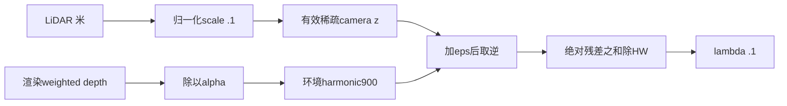

Eq16 跨页定义与当前深度单位回执
===============================

Eq16 在印刷页1702（PDF第7页），下一页1703（PDF第8页）左栏、Fig5下面明确把 D_LiDAR 与 D_image 定义为各自深度图的 inverse；提取文本503–506行。因此使用逆深度本身有论文支持。Eq16的 H×W 分母也与代码一致。原来的算子数值/梯度检查仅验证实现自身，不能据此宣称作者整条深度路径已完全复现。

冻结 `train.py359–372` 先把 raw weighted depth 除以 alpha，再在有环境且 depth_blend_mode=0 时取 `1/(alpha/z_fg+(1-alpha)/900)`；399行输入 `sparse_inverse_depth_loss`。`paper_losses.py77–87` 用有效正 LiDAR 深度、eps=1e-5和full HW归一化。论文没有公开该 harmonic900、alpha 深度归一化、eps、缺测有效域、场景单位或 λ=.1 的具体约定；这些必须与“逆深度定义有依据”分开列为实现选择。

实际 `transform_matrix.txt` 的三个旋转列范数均为 .1。`waymo_loader2.py535/559` 对相机位姿和 camera point cloud 采用该尺度，`camera_utils.py117–133` 存储缩放后的 z。按输入米制距离，10m变成1场景长度单位；逆深度数值约为米制逆深度的10倍，eps=1e-5对应0.1毫米。sky900是900场景单位，即9000m的数值等价，不是论文公开的真实天空距离。

实际 B1 的30001帧 `loss_paper_depth=0.012423455715179443`（full HW上的逆场景长度残差），当前 λ=.1 加到总目标约0.0012423455715。JSON还给出单个像素的10m/20m及alpha=.5算术示例，明确标注为公式示例，不是测得像素。

本回执只有源位置、既有真实 scalar 与小规模算术，没有新增梯度测试或修改长 V。nearest-depth、静态时间语义及深度合成解释依旧需要独立候选，不能混入当前 outside 因果实验。
