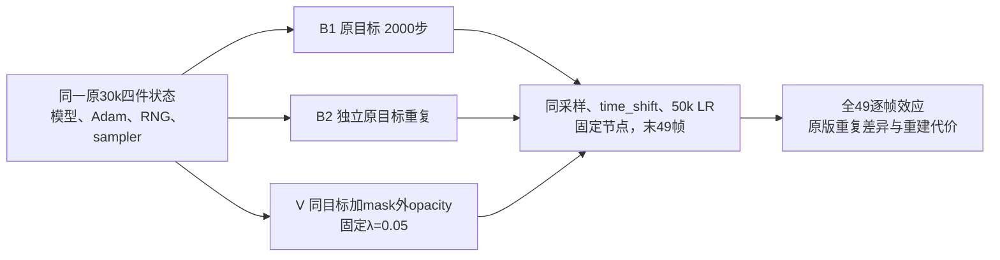

CPU 工作完成。官方 public heads/tags 未发现新版源码；独立长窗口的源码/config、B1/B2 实际 CPU plans 与锁定评价协议已落盘。本 agent 未使用 GPU。Root 最新仅批准 B1 原始目标长窗，执行由 component agent 独占 GPU；B2/V 未获 GPU 授权。

Canonical 本地根：`work/vgpu_bugfix_20261012/loss_audit/long_pair_30k_32000/`。Remote 根：`/root/autodl-tmp/drivingeditor_repro/campaign/vgpu_bugfix_20261012/loss_audit/long_pair_30k_32000/`。下表路径相对这两个根相同。

| 项目 | 路径 | SHA256 / 状态 |
|---|---|---|
| 官方全 heads/tags | `official_git_refs.json` | `d765406ff250693c4e59dd454536328c30cdd8e0bf9d97e41d6548c574dc40fa`；仅 main `560d57c3825ed2bdbc6a6602e0011ad51e8da60e`，无 tags。 |
| 锁定标准 | `evaluation_protocol_locked.json` | `c725cd2153d1104ddaf81078ac753f4e7f474e0be325ca9fbb5b1fccb342f658`；19:28:59Z 锁定，未因30300结果重写。 |
| B1 源 | `materialized_plan/continuation_harness.py` | `88a2df38e5ac4df5905f1de030701189763d469f9eb3daf9e3339f1931aba829` |
| B1 真 CPU plan | `materialized_plan/prepared_plan.json` | `359b9d62ee9aec28951532cedbaed45401838dd6ea2b961d5704bec2d303a2d5`；默认 CPU prepare exit0，未在此步骤训练。 |
| B1 root receipt | `materialized_plan/root_coordination_receipt.json` | `f9a8b649da27f3626daa6ce2e27a3a2bec50a173ea026daf06742a90995b8214`；仅 B1。 |
| B2 源 | `materialized_plan/baseline_noise_reference/continuation_harness.py` | `ede8591eb6ffbc4cca970439d1e8dcd5b75a2b008b408fc03cab73c145e7dd3a` |
| B2 真 CPU plan | `materialized_plan/baseline_noise_reference/prepared_plan.json` | `0b07086c6d425b7dc8526266b8520d5bd8d8d4736697833574029b2c22681329`；默认 CPU prepare exit0，未获 GPU 授权。 |
| V 源 | `materialized_plan/continuation_variant_harness.py` | `93df22a4b8db482af596657ba1d3e86e61a0ad0893dac3af35f85adf872ba1d4` |
| V 独立 guard | `materialized_plan/outside_experiment_guard.py` | `8356201320c757079a5dfaf4cb4968e22bc537fbf8f1dd7e0e6d1b6242f0d42c`；只将允许 stop 从30300改为32000。 |
| V CPU 草稿 | `materialized_plan/outside_cpu_plan_draft.json` | 明确不是 runtime-preflight PASS；长 B1/B2 真实引用为空，尚无真实 experiment_binding 或 GPU 授权。 |
| 实际 CPU receipt | `actual_baseline_cpu_prepare_receipt.json` | `6134e3a777b1a5f9fef400cc1ca3c87d714ceaf35dc89269c4c06c337b3c3e11`；B1/B2 各检查61原文件 pins、同父状态配置与10项历史首步参照。 |

最小生成器在 `generate_long_pair_draft_cpu.py`（37 checks PASS），七份扩窗 diff 和 `source_transforms.json` 可逐项审阅。独立 `materialize_long_pair_cpu.py` SHA 为 `b4d8fa110682acf7d45ef38fbe3faec65b5624f956b9a9c18fbfdf8be60be543`；materialization receipt 同 pin。已生成 7 份小型控制源、2 份已审算法 override、3 完整配置和3 CPU计划草稿，没有复制训练仓库。B1/B2 真 CPU prepare 单独记录，未冒称实际 CUDA optimizer/RNG restore。SGCM reviewer 已独立核对全部 staged 字节、最小 AST/config/type delta、remote 小文件与实际 CPU plans；其最新 `final_review_B1.json` / `final_review_B2.json` 位于 `sgcm_data_audit/long_pair_review/`。

三条轨迹都从原始30k四件状态重新开始，训练30001…32000，`iterations=position_lr_max_steps=50000`，seed0；V 保持唯一新增项和 λ=.05，原纸面损失/mask/renderer/depth/SGCM/reset 规则不变。节点30001/30300/31000固定5帧，32000全49；全部额外评估恢复 RNG。32k 早于33k static reset，densify/SGCM 已于15k结束；原SH hook保留，独立 CPU 审计确认父两支SH阶已为3且有max guard，32k不新增阶。当前短窗 B96 binding/v2源、所有原 checkpoint 和已批准 B1 源/plan 保持冻结。

下一步仅由 root/component 按独立审批推进：完成真实 B1 全2000记录/all49/四件状态；root 单独批准 B2 后同初态完成独立原版重复，核对两者全部 camera/time_shift/LR 与 RNG-safe eval；保存全49逐帧重复差异。再以真实 B1 首步10项、全部2000采样记录、terminal49 GT/固定域及 SHA-bound B2 噪声证据生成新的 V binding/CPU plan，经独立复核和新的精确 root receipt 后才可能启动 V。不能复用短300审批或用首步相同替代长轨迹噪声。30300 terminal 延长捷径未实现，避免新 restore/lineage 协议。

该方案只测试已退化30k模型的恢复方向与稳定性。候选须相对 B1/B2 两条原版逐帧报告效应、噪声差异和组合重建代价；一次重复差异不是置信区间。没有编辑区域的密集GT，不能据此宣称移除精度/FID、从零效果或作者真实 Eq13；也不能把长窗机制改善称为论文复现验收完成。
