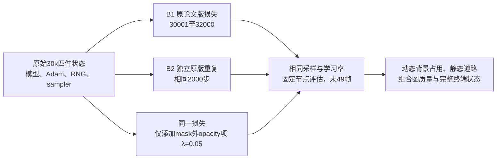

本目录包含官方 Git refs 核对、可审核的扩窗草稿与独立 CPU materializer。**未启动训练，未创建训练仓库副本；32k 方案没有 GPU 运行授权。** 当前 300 步实验的源码、配置、binding、guard、plan 和四件 checkpoint 均只读。



官方仓库 `https://github.com/WangXu-xxx/DrivingEditor.git` 的 `git ls-remote --heads --tags` 只返回 `refs/heads/main=560d57c3825ed2bdbc6a6602e0011ad51e8da60e`，没有 tags 或 2026/final-paper 分支。已核对本地同 SHA 提交日期为 `2024-12-29T17:38:12+08:00`。因此本次未发现新的公开论文版源码，不再下载源码。结论仅覆盖核对时公开 advertised heads/tags；不涉及私有或尚未公开代码。完整命令、时间戳和原始 stdout 在 `official_git_refs.json`。

扩窗双臂另设一个独立原版重复噪声参照：B1、B2、V 都分别恢复原始 30k 四件状态，再各训练 **2000 步：30001…32000**。B1/B2 使用同一原始数学目标；V 继续使用此前唯一的 mask 外 opacity 补充项，系数仍为 0.05。`iterations=position_lr_max_steps=50000`、seed 0、全部原始 Adam/参数/RNG/sampler/EMA/SGCM 状态及其它配置保留。额外实验字段明确保留，outside 不能称为 strict original config 或作者已披露公式。

评估节点预设为 `30001, 30300, 31000, 32000`：前三个节点固定帧 `0/10/20/30/48`，末点使用原始全部 49 帧。额外评估保存并恢复全部 RNG。两组终端均保存并验证 static、dynamic、environment、完整 training state 四件。32k 在下次 33k static opacity reset 之前；densify/SGCM 原设置于 15k 结束。原 32k SH hook 和其它周期 hook 保留，不加入额外修复。

最小源码变更只作用于未来独立目录，当前文件字节保持不变：

| 文件 | 扩窗改动 |
|---|---|
| B1/B2/V harness | `STOP=32000`、四个评估节点、新的计划/输出/终端/审批路径；原 observer/helper 仍从其冻结目录导入；outside 全程配对记录扩为 2000 条。B2 与 B1 只差独立输出/计划路径。 |
| 独立 outside guard | 仅允许的 `stop_iteration` 常量 `30300→32000`，其它字段、类型、源文件和数学限制保留。 |
| 三个独立 launcher | 仅重定向新的 harness、binding、plan、输出与新的 32k 审批标识。 |
| train.py / paper_losses.py | 相对当前已审阅 outside 算法 **零新增改动**；baseline 仍用原始版本。 |

`generate_long_pair_draft_cpu.py` 使用标准库，在内存中生成上述源码，37 项 syntax/AST/精确函数字节与不变式检查通过，仅写出七份 `*_extension.patch`、`source_transforms.json`、`long_pair_plan_draft.json` 和 `generator_cpu_validation.json`。它不导入 Torch/training，不写可执行 harness，不生成训练仓库，不含启动调用。短窗口输入全部用 SHA 锁定：baseline `ac9745…`；PSNR import 工程修订后的 outside v2 `3a2f9a…` / plan `be9e38…`；算法 binding `b96ec9…` 保持不变。`short_v2_receipt_readonly.json` 是从 remote 只读复制到本独立目录的 v2 receipt；不会更新当前实验的本地 receipt。

`materialize_long_pair_cpu.py` 默认只读检查；显式 `--materialize` 只写本独立新目录 `materialized_plan/` 并拒绝覆盖。它生成 7 份小型 harness/launcher/guard、2 份原算法 override、3 份完整配置和 3 份 CPU 计划草稿，源码逐份 SHA 与上述 diff 精确相同；不复制训练仓库、不导入 Torch/training、不执行启动方法。baseline 的真实 CPU prepare 应随后在 remote 调用其新 harness 默认分支；outside 的完整可运行 CPU plan/binding 必须等 B1/B2 真正完成后才能绑定，现有草稿不会伪称 runtime preflight PASS。

当前不伪造 2000 步参考。若 root 选择运行，后续需先生成独立 B1/B2 的真实 CPU plan 和新审批，完成两条真实 2000 步/all49/四件状态；验证全2000采样/time_shift/LR 一致并保存完整重复噪声参照。随后才用实际 B1 首步10项、全轨迹、终端输入和 SHA-bound B2 噪声证据生成新的 outside binding/plan，并独立复核。短实验审批不能授权 32k。outside 首步原始 10 项在真实 backward 前精确匹配，之后允许 loss 变化。

目前仅有一条原版 300 步轨迹。单步相同不足以排除长轨迹的 CUDA 数值波动；比较 V 与 B1/B2 分别的全49逐帧变化和 B1-B2 实际差异。这个重复仅给出一个观察到的差异，不构成置信区间或所有 CUDA 噪声的上界。小变化若与原版重复波动相近，不能归因于新项。

评价标准在 `evaluation_protocol_locked.json` 于 `2026-10-11T19:28:59Z` 锁定：动态 mask 外 opacity/RGB 支撑、非天空 mask 外静态 PSNR/MAE/MSE、全49组合图质量、static Gaussian 与环境贡献、道路与 actor-removal 边界图像。既有 actor 域也保留，用于观察原图内 actor 合成重建与编辑局部性。对每帧和非空固定域报告结果，主误差摘要使用 MAE/MSE，不挑帧、不按结果调整 λ/阈值。更长恢复窗口仍从已退化的 30k 模型开始；改善不能证明作者 Eq13 包含补充项，失败也不能排除从零训练的效果。预测 RGB masking 和其它论文歧义不在本实验中变更。

选择从原 30k 重新开始，未使用 30300 terminal 延长捷径。后者若要公平，需分别证明两臂前300步的完整参数/Adam/RNG/sampler/EMA/runtime/config/source lineage、评估无状态污染，以及新的30301 restore/首步门槛；本方案不引入这些额外协议。root 可在 300 步结果后拒绝 32k 窗口，CPU materialize 授权不代表 GPU 运行授权。

本地生成命令：

```text
python work/vgpu_bugfix_20261012/loss_audit/long_pair_30k_32000/generate_long_pair_draft_cpu.py --short-receipt work/vgpu_bugfix_20261012/loss_audit/long_pair_30k_32000/short_v2_receipt_readonly.json
```

本地目录：`work/vgpu_bugfix_20261012/loss_audit/long_pair_30k_32000/`。Remote mirror：`/root/autodl-tmp/drivingeditor_repro/campaign/vgpu_bugfix_20261012/loss_audit/long_pair_30k_32000/`。`materialized_plan/` 只放独立 CPU 小型源/config/plan；未来最多一个 outside 仓库副本为 `variant_frozen_repository/`，目前尚未创建。真实 baseline CPU prepare 的结果与 materializer 计划草稿分别记录，不混作实际 GPU restore。
